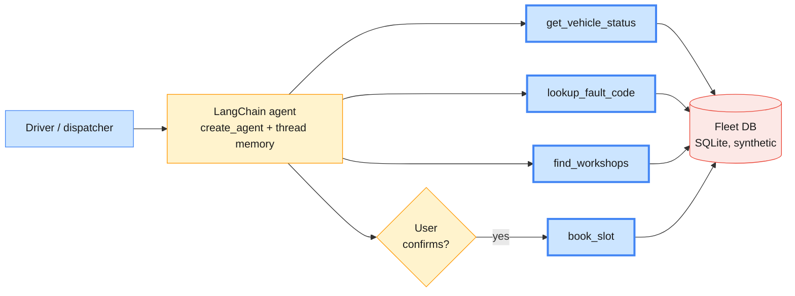
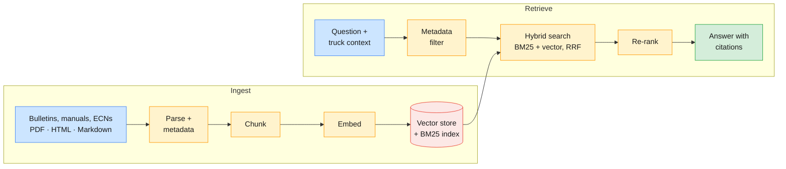
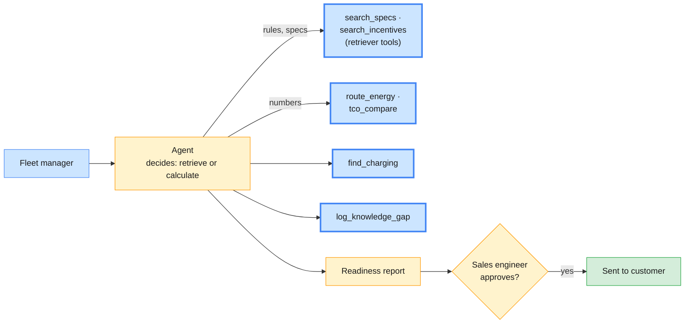

# Capstone Projects — Truck Innovation Centre

> **Course:** Agentic AI Systems Engineering (Python track)
> **Builds on:** Module 2 (LangChain agents, tools, memory) and Module 3 (RAG ingestion, retrieval, evaluation, agentic RAG). Modules 4–5 supply the stretch goals.

Three capstone projects set in a commercial-truck business. Each solves a real
day-to-day problem: a stopped truck, a technician hunting through PDFs, a
fleet unsure whether it can go electric. Each team picks one project.

| # | Project | What you practise | Main users | The demo moment |
| - | ------- | ----------------- | ---------- | --------------- |
| 1 | [Roadside Rescue Copilot](#1-roadside-rescue-copilot) | Conversational agent with LangChain: tools, memory, human approval | Drivers, dispatchers | A dashboard warning becomes a booked workshop slot in one chat |
| 2 | [Service Bulletin Navigator](#2-service-bulletin-navigator) | RAG ingestion and retrieval with LlamaIndex or LangChain | Workshop technicians | A new bulletin supersedes an old one, and the answer changes, with a citation |
| 3 | [eTruck Route Advisor](#3-etruck-route-advisor) | Agentic RAG: the agent decides when to retrieve and when to calculate | Fleet managers, sales engineers | "Can my routes go electric?" answered with a cited, calculator-checked report |

**Suggested team:** 3–4 people, split across data and ingestion, agent and tools, and evaluation and demo.

---

## Ground rules (all projects)

- **Synthetic data only.** Invent the vehicle models, customers, workshops and people. No real company, product or person names.
- **Provider-configurable.** Runs on OpenAI or Claude through `LLM_PROVIDER`; model IDs come from `.env`. Claude has no embeddings endpoint, so use OpenAI embeddings or a local Sentence Transformers model.
- **No secrets** in code, notebooks or output. Keys live in a git-ignored `.env`.
- **Offline fallback** for every external service: a mock tool, local files or an in-memory store.
- **Structured outputs** validated with Pydantic. Tests assert on structure (right tool called, citation present, schema valid), not on exact wording.
- **Traced and evaluated:** LangSmith or Langfuse tracing, plus a labelled test set your team writes.

## Deliverables (all projects)

1. Code (a uv project or notebooks) that runs from a clean checkout with one command.
2. A README: setup, architecture diagram and the three most important design decisions.
3. An evaluation report: the test set, the metrics, and one failure you found and fixed.
4. A 10-minute demo: the happy path, one failure handled safely, and the eval result.

---

## 1. Roadside Rescue Copilot

**Type:** Conversational agent · **Framework:** LangChain (`create_agent`) · **Builds on:** Module 2 Labs 04–05

### The problem

A warning light comes on 200 km from base. The driver phones dispatch,
dispatch phones a workshop, the workshop asks for the fault code, and nobody
knows whether the part is in stock. Every call adds downtime, and a stopped
truck earns nothing.

### Description

A chat assistant for drivers and dispatchers. The user describes the problem
in plain words. The agent asks for anything missing, reads the truck's latest
telematics snapshot, looks up the fault code and gives one of three clear
verdicts: **continue**, **drive to a workshop today**, or **stop safely now**.
If a workshop is needed, it finds the nearest partner workshop with the part
in stock and proposes a slot. It books only after the user says yes.

> **Driver:** Amber engine light, truck feels weak on hills. It's TRK-0417.
> **Copilot:** TRK-0417 reports fault FC-3251-0 (exhaust filter pressure high). Verdict: drive to a workshop today; avoid long climbs. WS-NUE-02 is 38 km away, has the part and can take you at 14:30. Shall I book it?
> **Driver:** Yes, book it.
> **Copilot:** Booked: BK-55102 at WS-NUE-02, 14:30. Dispatch has been notified.
>
> *(Representative; all IDs are synthetic.)*

### Key requirements

| ID | Requirement |
| -- | ----------- |
| R1 | Multi-turn chat with thread memory (a LangGraph checkpointer): the user never has to repeat the truck ID, location or symptoms. |
| R2 | At least four typed tools: `get_vehicle_status(vehicle_id)`, `lookup_fault_code(code)`, `find_workshops(location, part_number)`, `book_slot(workshop_id, vehicle_id, slot)`. |
| R3 | Asks a clarifying question when the truck ID or location is missing, instead of guessing. |
| R4 | Returns the verdict as a validated object: `verdict`, `fault_codes`, `reason`, `workshop`, `confidence`. |
| R5 | `book_slot` runs only after explicit confirmation (`HumanInTheLoopMiddleware` or an interrupt). |
| R6 | **Safety rule in code, not in the prompt:** any fault in brakes, steering or tyres returns *stop safely now* plus the breakdown hotline, whatever the model says. |
| R7 | Long chats stay within budget (`SummarizationMiddleware` or message trimming). |

**Data to create:** 20 trucks, 30 fault codes (styled after J1939 SPN/FMI, with severity and affected system), 10 workshops with opening hours and parts stock, and 15 scripted test conversations.

**Done when:**
- At least 13 of the 15 scripted conversations get the right verdict.
- Every safety-critical case escalates.
- No booking is made without confirmation.
- The same conversations have been run on both providers and compared.

**Stretch goals:** reply in the driver's language (German, Polish, Spanish); add RAG over the driver handbook using Project 2's pipeline; expose the fleet tools as an MCP server (Module 4).

---

## 2. Service Bulletin Navigator

**Type:** RAG with ingestion and retrieval · **Framework:** LlamaIndex or LangChain · **Builds on:** Module 3

### The problem

Technicians search hundreds of PDFs: repair manual chapters, technical service
bulletins and engineering change notices. Documents get revised, but the old
version stays on the shared drive. Part numbers and fault codes need exact
matches that pure vector search misses. One superseded torque value means a
repeat repair.

### Description

Two halves. **Ingestion** loads documents from a local folder (standing in for
a SharePoint or Confluence export). It parses PDFs including their tables,
attaches metadata, chunks, embeds and indexes. Re-running it processes only
new or changed files and marks replaced revisions as superseded.
**Retrieval** answers a technician's question for one specific truck, filtered
by model, build year and market. It cites the document, revision and section,
and says "not found in current documents" rather than guessing.

> **Technician:** Rear hub nut torque for a TX-40 built in 2025, EU market?
> **Navigator:** 650 Nm, tightened in two stages (TSB-2026-014 rev B, §3.2). This replaces the 550 Nm in RM-TX40-07 §5.4 for trucks built from 2025.
>
> *(Representative; values are illustrative.)*

### Key requirements

| ID | Requirement |
| -- | ----------- |
| R1 | **Load three formats** from a local folder: PDF with at least one table, HTML and Markdown. A live SharePoint or Confluence connector is optional; the local-export path is mandatory. |
| R2 | **Metadata on every chunk:** `doc_id`, `doc_type` (TSB, RM, ECN), `revision`, `status` (current or superseded), `models`, `build_from`/`build_to`, `market` (EU, US, APAC), `language` and `access` (technician or engineer). |
| R3 | **Incremental ingestion:** only new or changed files are processed (LlamaIndex `IngestionPipeline` with a docstore and `DocstoreStrategy.UPSERTS`, or a content-hash manifest in LangChain), and a new revision marks the old one superseded. |
| R4 | **Chunking chosen by measurement:** compare two strategies (fixed vs semantic or hierarchical) on your test set, and keep tables whole. |
| R5 | **Hybrid retrieval:** BM25 and vector search fused with RRF, so that exact part numbers and fault codes always match. |
| R6 | **Filters before generation:** only `status = current`, the matching model, build year and market, and the user's access level (draft ECNs are visible to engineers only). |
| R7 | **Citations:** every answer cites document, revision and section. If the retrieved text does not support an answer, the assistant says so. |
| R8 | **Across languages:** an English question finds the answer in a German document (multilingual embeddings). |

**Data to create:**
- About 40 short documents: 15 bulletins, 15 manual chapters and 10 ECNs.
  - 5 of them are in German.
  - 3 are superseded revision pairs.
  - 1 is a draft ECN.
- 30 labelled test questions with their relevant chunk IDs:
  - 5 exact-code lookups;
  - 5 "superseded trap" questions;
  - 3 questions with no answer in the documents.

**Done when:**
- Precision@5, recall@5 and MRR are reported for the baseline and for the final pipeline, with final recall@5 ≥ 0.85.
- No trap question cites a superseded document.
- All three unanswerable questions get the "not found" reply.
- Adding one new revision changes the answer without rebuilding the whole index.

**Stretch goals:** build it in both frameworks and compare; re-rank with a cross-encoder and measure whether it pays off; answer from a photo of a printed page (OCR, Module 1); add an LLM-judge groundedness score (Module 5).

---

## 3. eTruck Route Advisor

**Type:** Agentic RAG · **Framework:** LangChain agent (or LlamaIndex `FunctionAgent`) with retrievers as tools · **Builds on:** Modules 2 and 3

### The problem

Fleet customers want to go electric but don't know which routes are
feasible. The answer sits in several places: battery spec sheets, charging
network guides, depot power limits, incentive rules, and the maths of energy
per kilometre at a given load and temperature. A chatbot that only retrieves
will invent numbers, and a calculator alone cannot explain the rules.

### Description

An agent that answers fleet-electrification questions by choosing its tools:
- **Search** the knowledge base: product sheets for fictional eTruck models, the charging guide, incentive rules, the TCO method.
- **Calculate** route energy.
- **Find** charging stops.
- **Compare** total cost of ownership, electric against diesel.

It produces an **Electrification Readiness Report**. For each route, the report says whether it is feasible and which model is recommended, and gives the charging plan, the cost comparison, the assumptions and the citations. A sales engineer approves the report before it goes to the customer.

> **Fleet manager:** We run 6 trucks on route R-07 every day, 40 t, out and back. Can we go electric?
> **Advisor:** *(calls `route_energy`, `search_specs`, `find_charging`, `tco_compare`)* R-07 is 310 km each way. The eHX-600 covers the outbound leg with a 15 % reserve. The return leg needs one 45-minute stop at CS-0042. Over 6 years, electric costs 4 % more than diesel before incentives and 7 % less after the EU fleet grant (GRANT-EU-03, §2). The draft report is with your sales engineer for review.
>
> *(Representative; models, sites and figures are synthetic.)*

### Key requirements

| ID | Requirement |
| -- | ----------- |
| R1 | **Retrievers as tools:** at least two separate retriever tools (product specs and incentive rules), and the agent chooses between them. Small talk and pure calculations trigger no retrieval. |
| R2 | **Numbers from code, never from the model:** energy, range and cost come from deterministic Python tools, and every assumption (payload, temperature, battery reserve) is listed in the report. |
| R3 | **Multi-hop questions:** some answers need retrieval, then a calculation, then retrieval again (for example, "Does the grant close the cost gap?"). |
| R4 | **Structured report (Pydantic), per route:** `feasible`, `recommended_model`, `charging_stops`, `energy_kwh`, `tco_diesel`, `tco_electric`, `assumptions` and `citations`. |
| R5 | **Knowledge gaps logged:** when the knowledge base cannot answer (say, an incentive in an uncovered region), the agent logs a gap instead of guessing. |
| R6 | **Validity dates respected:** expired incentive rules are filtered out by metadata. |
| R7 | **Human approval** before the report is "sent", through an interrupt or HITL middleware. |
| R8 | **Ingestion for the knowledge base**, reusing Project 2's pattern: product sheets, the charging guide and incentive rules, with metadata for region and validity dates. |

**Data to create:**
- 3 fictional eTruck models with battery capacity and consumption by load, plus 1 diesel reference model.
- 25 charging sites in a CSV and 10 customer routes.
- Incentive rules for the EU, US and APAC, one of them expired.
- A TCO method document.
- 20 test questions:
  - 5 that need no retrieval;
  - 8 that need retrieval and a calculation;
  - 4 multi-hop questions;
  - 3 knowledge gaps.

**Done when:**
- The right tools are called on at least 18 of the 20 test questions.
- Every number in the report matches the calculator output exactly.
- No expired incentive is cited.
- All three knowledge gaps are logged.

**Stretch goals:** split it into a research agent and a calculation agent with LangGraph (Module 4); expose the calculators as an MCP server (Module 4); run the 20 questions on both providers and compare their tool-calling behaviour.
