# Module 3 — Enterprise RAG Pipelines & Fine-Tuning Strategy

> **Course:** Agentic AI Systems Engineering (Python track)
> **Phase:** 2 — Enterprise RAG, Multi-Agent Orchestration, Cloud & Governance
> **Duration:** 8 hours · **Level:** Intermediate
> **Module objective:** Build production RAG pipelines with LangChain and LlamaIndex, including enterprise data-source connectors. Apply a fine-tuning decision framework to choose between fine-tuning, RAG, prompt engineering, and hybrid approaches.

---

## Table of contents

1. [Why this module matters](#1-why-this-module-matters)
2. [RAG fundamentals](#2-rag-fundamentals)
3. [Fine-tuning overview & decision framework](#3-fine-tuning-overview--decision-framework)
4. [Vector databases](#4-vector-databases)
5. [Chunking strategies](#5-chunking-strategies)
6. [Metadata design & hybrid retrieval](#6-metadata-design--hybrid-retrieval)
7. [Retrieval quality evaluation](#7-retrieval-quality-evaluation)
8. [RAG frameworks: LangChain vs LlamaIndex](#8-rag-frameworks-langchain-vs-llamaindex)
9. [Enterprise connectors & use cases](#9-enterprise-connectors--use-cases)
10. [Agentic RAG](#10-agentic-rag)
11. [Hands-on lab: RAG pipelines, retrieval tuning, connectors and agentic RAG](#11-hands-on-lab-rag-pipelines-retrieval-tuning-connectors-and-agentic-rag)
12. [Bridging to the rest of the course](#12-bridging-to-the-rest-of-the-course)
13. [Key takeaways](#13-key-takeaways)
14. [Glossary](#14-glossary)
15. [References](#15-references)

> **How to read the diagrams:** Diagrams are written in [Mermaid](https://mermaid.js.org/),
> which renders automatically in GitHub, VS Code (with a Mermaid extension), and most
> modern Markdown viewers. If a diagram appears as code, install/enable a Mermaid
> preview to see the rendered version.

> **Builds on:** [Module 2 — Prompt Engineering, OpenAI & Claude SDKs, LangChain & Single Agent](./module-02-prompt-engineering-sdks-langchain-single-agent.md).
> This module assumes embeddings (Module 1 §7), structured outputs and business validation
> (Module 2 §3), tools and `create_agent` (Module 2 §4.2, §7.4) and the provider switch in
> `labs/setup/llm.py` (Module 2 §7.2). It replaces the assistant's keyword `search_kb` tool with
> retrieval over the whole knowledge estate, and decides when changing the model itself would
> be the better investment.

> **Outline note (workshop):** The fine-tuning decision workshop (four scenarios, traceability
> point 21) appears in the delivery schedule but not in the hands-on list, so it has no minute
> budget. This guide plans 30 minutes for it, labelled "(from the delivery schedule)"
> (course-map §4 #4).

> **Outline note (connectors):** Cloud sandbox access and SharePoint, Confluence and Jira
> credentials are to be finalised with the client IT team (design decision 15). Every connector
> example has an offline fallback, and this guide invents no endpoints or credentials
> (course-map §4 #6).

---

## 1. Why this module matters

In Module 2 the Enterprise Operations Assistant found `KB-0042` with a keyword search over ten
articles. Real knowledge lives in thousands of KB articles, in policies such as `POL-SEC-012`,
contracts such as `CTR-2026-118` and specifications such as `ENG-SPEC-0417`. It is spread across
Confluence, SharePoint and Jira, written in several languages, restricted by team and region,
and it changes every week.

**Retrieval-augmented generation (RAG)** puts a search index in front of the generator: search
finds the few passages a question needs, the prompt carries them, and the answer cites them.
Every part of that sentence is a design decision you measure today: how documents are split,
embedded and indexed, how keyword and vector search combine, who may see which chunk, and how
you know retrieval works. The second half of the objective is a decision rather than a build:
when would changing the model's weights beat better prompts and better retrieval? In 2026 that
also depends on which providers still offer fine-tuning at all (§3.3).

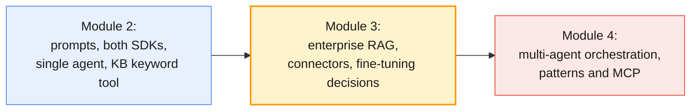

### Module at a glance

| Topic group | Outline topics | Hands-on (minutes) | Tools |
| ----------- | -------------- | ------------------ | ----- |
| RAG fundamentals (§2) | T1 | H1 LangChain RAG pipeline (45) | LangChain · OpenAI SDK · Anthropic Claude SDK |
| Fine-tuning overview & decision framework (§3) | T2, T3 | Fine-tuning decision workshop (30, from the delivery schedule) | Fine-tuning decision canvas |
| Vector databases (§4) | T4 | Used from H1 onwards | FAISS / ChromaDB |
| Chunking strategies (§5) | T5 | H3 chunking comparison (30) | Chunking workbook |
| Metadata design & hybrid retrieval (§6) | T6 | Measured in H4 | LangChain · FAISS / ChromaDB |
| Retrieval quality evaluation (§7) | T7 | H4 retrieval evaluation (30) | Retrieval eval rubric |
| RAG frameworks: LangChain vs LlamaIndex (§8) | T8 | H2 LlamaIndex rebuild (30) | LangChain · LlamaIndex |
| Enterprise connectors & use cases (§9) | T9, T10 | H5 connector lab (45), H6 use-case walkthrough (45) | LlamaIndex Hub connectors · Unstructured API |
| Agentic RAG (§10) | T11 | H7 agentic RAG exercise (25) | LangChain · OpenAI SDK · Anthropic Claude SDK |

The outline's hands-on adds up to 250 minutes; with the 30-minute workshop that is the 280
minutes of the four labs (§11).

By the end of this module you will be able to:

- Explain the RAG pipeline end to end, and choose between RAG, prompt stuffing and fine-tuning for a knowledge problem (T1, T3).
- Describe full fine-tuning, LoRA/PEFT and instruction tuning, and apply the decision framework to four enterprise scenarios (T2, T3, workshop).
- Build the same pipeline in LangChain and LlamaIndex on both providers, with answers that cite their sources (T1, T8, H1, H2).
- Choose a vector database, a chunking strategy and a metadata schema, and combine keyword search, vector search and re-ranking (T4–T6, H3).
- Measure precision, recall and answer relevance on labelled queries, and let the numbers pick the configuration (T7, H4).
- Ingest SharePoint, Confluence and Jira content with its access metadata, build two assistants from one pattern, and give an agent retrieval as a tool (T9–T11, H5–H7).

> **Representative output in this guide:** The dry runs were made on 28 October 2026 with
> `OPENAI_MODEL=gpt-5-mini`, `ANTHROPIC_MODEL=claude-haiku-5-5` and
> `OPENAI_EMBEDDING_MODEL=text-embedding-3-small`, not the course defaults (`gpt-6.1-sol`,
> `claude-opus-5-5`), on a synthetic corpus of 20 documents with 20 labelled queries. The lab's
> corpus is larger. Compare configurations against each other, never against these figures.

---

## 2. RAG fundamentals

### 2.1 The pipeline

RAG has two halves (Lewis et al., 2020). **Ingest** runs offline: load, chunk, embed and index.
**Query** runs per question: retrieve the best chunks, put them in the prompt, and generate an
answer that cites them.

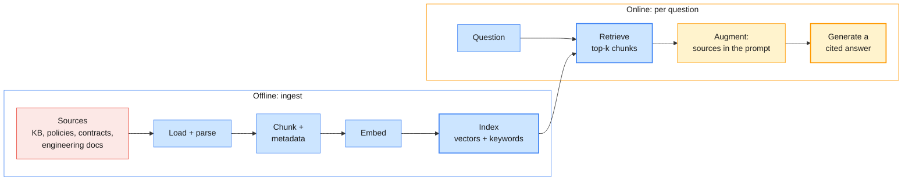

| Stage | The decision you own | Covered in |
| ----- | -------------------- | ---------- |
| Load and parse | Connector, OCR for scans, deletes and access lists | §9, Module 1 §4 |
| Chunk | Size, overlap, structure | §5 |
| Embed | Model, language coverage, where the text is sent | §2.3, Module 1 §7 |
| Index | Vector database, keyword index, persistence | §4, §6.2 |
| Retrieve | k, metadata filters, hybrid search, re-ranking | §6 |
| Augment and generate | Source format, grounding rules, citations, "not in the sources" | §2.3, §2.4 |
| Evaluate | Labelled queries, retrieval and answer metrics | §7 |

> **Engineering takeaway:** RAG is a search engine with a generator on top. The generator
> cannot cite what retrieval did not return, so most RAG quality work is search quality work.

### 2.2 When to use RAG, fine-tuning or prompt stuffing

| Approach | What changes | Best when | Weak when |
| -------- | ------------ | --------- | --------- |
| Prompt engineering (Module 2) | Instructions and examples | Always the first step | The model lacks the knowledge |
| Prompt stuffing | Nothing: the whole corpus rides in every prompt | A small, stable corpus; caching makes repeats cheap | The corpus outgrows the window; per-user access rules |
| RAG | An index in front of the model | Large or changing corpora, citations, per-document access | Questions over the whole corpus ("how many contracts…") |
| Fine-tuning (§3) | The model's weights | Behaviour, format, tone, narrow tasks at volume | Facts that change, provenance, deleting a fact |

Size it with numbers. The dry-run corpus is 3,807 tokens (`o200k_base`), so stuffing would be
fine; Anthropic's contextual retrieval article makes the same point for knowledge bases under
200,000 tokens. A knowledge base of 5,000 articles at about 500 tokens is 2.5 million tokens,
beyond the 1M-token windows of the course models (Module 1 §6.3). An 800,000-token prompt costs
$3.20 per question on Claude Opus 5.5, or $0.16 if every token is a cache read at 0.05×
(Module 2 §6.2). Four retrieved chunks of about 105 tokens cost about $0.002.

> **Common trap:** "The model has a 1M-token context, so we don't need retrieval." Answer
> quality degrades with very long inputs (Liu et al., 2023), the bill scales with every
> question, and one shared prompt cannot apply per-user access rules.

### 2.3 The pipeline in code (H1)

Each corpus file carries its metadata as front matter. The lab's support-doc corpus in `data/`
uses this format, as did the dry runs:

```markdown
---
doc_id: KB-0042
title: VPN client rejects credentials after a password change
doc_type: kb
owner_team: Network Ops
region: ALL
audience: internal
updated: 2026-09-14
---
```

**Load and chunk.** `add_start_index` records each chunk's offset, which later gives every chunk
a stable identity:

```python
import os
from pathlib import Path
from langchain_core.documents import Document
from langchain_text_splitters import RecursiveCharacterTextSplitter

def load_corpus(root: str = "data/corpus") -> list[Document]:
    """One Document per Markdown file; the front matter becomes metadata."""
    docs = []
    for path in sorted(Path(root).rglob("*.md")):
        _, head, body = path.read_text().split("---\n", 2)
        meta = dict(line.split(": ", 1) for line in head.strip().splitlines())
        docs.append(Document(page_content=body, metadata={**meta, "source": str(path)}))
    return docs

docs = load_corpus()
splitter = RecursiveCharacterTextSplitter(chunk_size=600, chunk_overlap=80, add_start_index=True)
chunks = splitter.split_documents(docs)        # 20 documents -> 30 chunks in the dry run
```

**Embed.** Anthropic has no embedding model of its own; its documentation points to Voyage AI,
whose package is not in the course pins. The course uses OpenAI's embedding model, and a local
Sentence Transformers model where an estate runs on Claude only (Module 1 §7.2–§7.4):

```python
# OpenAI: the model ID comes from .env (OPENAI_EMBEDDING_MODEL)
from langchain_openai import OpenAIEmbeddings

embeddings = OpenAIEmbeddings(model=os.environ["OPENAI_EMBEDDING_MODEL"])
```

```python
# Claude-only estates: no OpenAI key, so embed locally; no text leaves the machine
from langchain_core.embeddings import Embeddings
from sentence_transformers import SentenceTransformer

class LocalEmbeddings(Embeddings):
    """Sentence Transformers behind LangChain's Embeddings interface."""
    def __init__(self, name: str | None = None):
        self.model = SentenceTransformer(name or os.environ.get(
            "ST_MODEL", "sentence-transformers/paraphrase-multilingual-MiniLM-L12-v2"))
    def embed_documents(self, texts: list[str]) -> list[list[float]]:
        return self.model.encode(texts, normalize_embeddings=True).tolist()
    def embed_query(self, text: str) -> list[float]:
        return self.embed_documents([text])[0]

# embeddings = LocalEmbeddings()
```

**Index, retrieve, augment, generate.** An LCEL pipeline (Module 2 §7.3) on either provider:

```python
from langchain_core.output_parsers import StrOutputParser
from langchain_core.prompts import ChatPromptTemplate
from langchain_core.runnables import RunnablePassthrough
from langchain_core.vectorstores import InMemoryVectorStore
from llm import get_chat_model                       # labs/setup/llm.py (Module 2 §7.2)

store = InMemoryVectorStore.from_documents(chunks, embeddings)
retriever = store.as_retriever(search_kwargs={"k": 4})

def format_sources(hits: list[Document]) -> str:
    """One <source> per document, its retrieved chunks in document order: no id appears twice."""
    by_doc: dict[str, list[Document]] = {}
    for h in hits:
        by_doc.setdefault(h.metadata["doc_id"], []).append(h)
    return "\n\n".join(
        f'<source id="{doc_id}" title="{parts[0].metadata["title"]}">\n'
        + "\n[...]\n".join(p.page_content for p in sorted(parts, key=lambda p: p.metadata["start_index"]))
        + "\n</source>" for doc_id, parts in by_doc.items())

RAG_PROMPT = ChatPromptTemplate.from_messages([
    ("system", "You are the Enterprise Operations Assistant. Answer only from the sources and cite "
               "the source id in square brackets after each claim, for example [KB-0042]. If the "
               "sources do not answer the question, say so. Name an owning team only if a source "
               "names it."),
    ("human", "<sources>\n{sources}\n</sources>\n\nQuestion: {question}"),
])
rag_chain = ({"sources": retriever | format_sources, "question": RunnablePassthrough()}
             | RAG_PROMPT | get_chat_model() | StrOutputParser())
print(rag_chain.invoke("What is the P1 restore time for the printer fleet, and do we get service credits?"))
```

Representative output:

```text
openai:  The P1 restore time for the printer fleet is within 1 business day. [CTR-2025-044]
         No service credits apply to the printer fleet agreement. [CTR-2025-044]
claude:  The P1 restore time for the printer fleet is within 1 business day. A P1 is a case where a
         whole floor cannot print. [CTR-2025-044] No service credits apply. Instead, repeated
         failures entitle the Company to a replacement device. [CTR-2025-044]
```

Two lines of this code came from dry-run failures. An earlier `format_sources` emitted one
`<source>` per chunk, so `CTR-2026-118` appeared twice with different text, and Claude warned
that "the sources give two different texts under the ID CTR-2026-118". An earlier prompt said
"if the sources do not answer, say so and name the owning team"; asked for the cafeteria menu,
OpenAI invented a "Catering team". An instruction that demands a value the sources cannot supply
is an instruction to hallucinate. With the wording above, neither provider named a team.

> **Common trap:** A SQLite-backed retriever (§6.2) inside this chain fails with "SQLite objects
> created in a thread can only be used in that same thread": LCEL runs the branches of
> `{"sources": …, "question": …}` in a thread pool. Open read-only connections with
> `check_same_thread=False`, or one per call.

### 2.4 Grounded answers with citations, on both SDKs

A cited answer lets a user check the claim and lets your code check the citation:

```python
# Anthropic Claude: retrieved chunks as search_result blocks; citations come back on the text
import anthropic

claude = anthropic.Anthropic()
question = "How long can a VPN session stay idle, and may I use my own tablet?"
hits = retriever.invoke(question)
msg = claude.messages.create(
    model=os.environ["ANTHROPIC_MODEL"], max_tokens=4096,
    system="Answer only from the search results. If they do not answer the question, say so.",
    messages=[{"role": "user", "content": [
        *[{"type": "search_result", "source": h.metadata["doc_id"], "title": h.metadata["title"],
           "content": [{"type": "text", "text": h.page_content}], "citations": {"enabled": True}}
          for h in hits],
        {"type": "text", "text": question}]}])
for block in msg.content:
    if block.type == "text":
        print(repr(block.text), [c.source for c in block.citations or []])
```

```python
# OpenAI: no citation type for your own chunks, so cite through the schema and check it
from openai import OpenAI
from pydantic import BaseModel, Field

class GroundedAnswer(BaseModel):
    answerable: bool = Field(description="False if the sources do not contain the answer")
    answer: str
    cited_ids: list[str] = Field(description="The id of every source used; only ids from <sources>")

oai = OpenAI()
resp = oai.responses.parse(
    model=os.environ["OPENAI_MODEL"], text_format=GroundedAnswer,
    instructions="Answer only from the sources. If they do not answer the question, set answerable to false.",
    input=f"<sources>\n{format_sources(hits)}\n</sources>\n\nQuestion: {question}")
answer = resp.output_parsed
if unknown := set(answer.cited_ids) - {h.metadata["doc_id"] for h in hits}:
    raise ValueError(f"cited ids that were not retrieved: {unknown}")   # route to review (Module 2 §3.3)
```

Representative output:

```text
claude:  'The policy sets a 30-minute limit on inactivity: … gets dropped '           []
         'after 30 minutes'                                                           ['POL-SEC-012']
         ' … The search results don't say anything about using a personal tablet. …' []
openai:  answerable=False cited_ids=['POL-SEC-012']
         answer='… an idle VPN session is disconnected after 30 minutes. The provided sources do not
                 state whether personal tablets (BYOD) are permitted, so I can't answer that …'
```

Dense top-4 retrieval returned the session-limit chunk of `POL-SEC-012` but not its section 3 on
personal devices, and both providers declined the half they could not support: the behaviour you
want. In an earlier run with the hybrid retriever of §6.2, the section 3 chunk came back and both
answered both halves. A two-part question needs retrieval for each part: raise k, or rewrite it
into sub-queries (§10.3).

| | Anthropic Claude | OpenAI |
| - | ---------------- | ------ |
| Your own chunks, native citations | `search_result` blocks (or `document` blocks) with `citations.enabled` | None: cite through a schema field and validate it |
| Citation payload | `search_result_location` with `source`, `title`, `cited_text` (not billed as output) and block indices | Your `cited_ids`, checked against the retrieved IDs |
| Hosted retrieval | None: you retrieve | The `file_search` tool over OpenAI vector stores, with `file_citation` annotations |

> **Common trap:** Claude citations and structured outputs do not combine. Anthropic's
> documentation says the combination returns a 400. In the dry run (anthropic 1.17.0, Claude
> Haiku 5.5 and Opus 5.5) the API instead returned schema-valid JSON and silently dropped the
> citations. Either way you get one or the other; if you need a typed answer and checked sources,
> use the schema pattern on both providers.

> **Enterprise reality:** Hosted retrieval is the fastest demo, but it copies your documents into
> the provider's storage, outside your access-control model and your residency boundary. Decide
> that in the architecture review, not by default.

### 2.5 How RAG fails

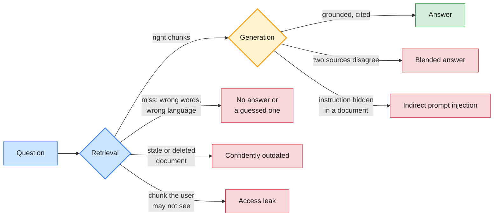

| Failure | Example in the scenario | Fix |
| ------- | ----------------------- | --- |
| Vocabulary miss | "Which document covers CHG-20931?" defeats vector search | Hybrid keyword + vector search (§6.2) |
| Paraphrase miss | "My machine wants a long number before Windows starts" | Better embeddings; re-ranking (§6.3) |
| Wrong chunk | The SLA table split from its heading | Structure-aware or parent retrieval (§5) |
| Stale or deleted source | A retired policy still answers | Delta sync and delete propagation (§9.1) |
| Access leak | A customer sees an internal runbook | Filter before ranking (§6.1) |
| Indirect prompt injection | A document says "ignore your instructions" (Greshake et al., 2023) | Sources are data; guardrails (Module 5) |

---

## 3. Fine-tuning overview & decision framework

### 3.1 What fine-tuning changes

Fine-tuning continues training a pretrained model on your examples, so that the behaviour you
want becomes the default rather than something you ask for in every prompt.

| Method | What is trained | Data and hardware | Typical use |
| ------ | --------------- | ----------------- | ----------- |
| Full fine-tuning | Every weight | Thousands of examples; memory for the model, gradients and optimiser state | Model builders; rarely enterprise teams |
| PEFT: adapters (Houlsby et al., 2019), LoRA (Hu et al., 2021) | Small added matrices; the base is frozen | Hundreds to thousands of examples; one GPU for small and medium models | Format, tone, domain classification on an open-weight model |
| QLoRA (Dettmers et al., 2023) | LoRA on a 4-bit quantised base | As LoRA, with far less GPU memory | Larger open-weight models on modest hardware |
| Instruction tuning (Wei et al., 2021; Ouyang et al., 2022) | The base model, on instruction-response pairs and preferences | Large curated sets | How chat models are made; you consume it |

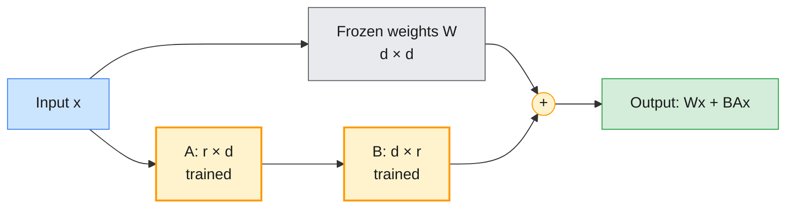

LoRA learns a low-rank update `BA` (rank `r`, often 8–64) beside each frozen weight matrix. The
adapter is megabytes rather than gigabytes, and one base model can serve several adapters.

### 3.2 LoRA in ten lines

The outline treats fine-tuning at overview level and the course pins do not include `peft`. This
runs on a laptop CPU in seconds and shows how small the trainable part is:

```python
# (not in the course pins) pip install peft
from peft import LoraConfig, get_peft_model
from transformers import AutoModelForCausalLM

base = AutoModelForCausalLM.from_pretrained(os.environ.get("FT_BASE_MODEL", "HuggingFaceTB/SmolLM2-135M"))
config = LoraConfig(r=16, lora_alpha=32, lora_dropout=0.05, task_type="CAUSAL_LM",
                    target_modules=["q_proj", "k_proj", "v_proj", "o_proj"])
model = get_peft_model(base, config)
model.print_trainable_parameters()
```

Expected output (deterministic for this model and configuration):

```text
trainable params: 1,843,200 || all params: 136,358,208 || trainable%: 1.3517
```

Training data is JSONL, one conversation per line: the chat format of OpenAI's supervised
fine-tuning and of TRL's `SFTTrainer`:

```text
{"messages": [{"role": "system", "content": "Classify the ticket. Reply as <category> | <priority>."},
              {"role": "user", "content": "INC-104290: Nobody in Finance can post invoices; the ERP returns HTTP 503."},
              {"role": "assistant", "content": "Finance Systems | P1"}]}
```

> **Production baseline:** Before anyone trains, there is an evaluation set and a baseline for
> the best prompt (Module 2 §2.4) and the best RAG configuration (§7). A fine-tune that cannot
> beat both on held-out data is not shipped. OpenAI's model-optimisation guide gives the same
> order: evals, then prompting, then fine-tuning.

### 3.3 Provider reality in 2026

> **Outline vs current API:** The fine-tuning concepts are stable; where you can apply them
> changed in 2026 (verified 28 October 2026):
>
> | Platform | Status | Consequence |
> | -------- | ------ | ----------- |
> | OpenAI fine-tuning API | Being wound down. From 7 May 2026, organisations that had never fine-tuned cannot create jobs; from 2 July 2026, neither can those without fine-tuned-model inference in the past 60 days; from 6 January 2027, no one can. Fine-tuned models serve until their base model is retired | No new work on it. Its methods (supervised, DPO, reinforcement fine-tuning) remain useful vocabulary |
> | Claude API | No fine-tuning | Shape Claude with prompts, Skills, tools and retrieval |
> | Amazon Bedrock | Its fine-tuning page lists Claude 3 Haiku as the only Claude model, which was retired on the Claude API on 20 April 2026 | No current Claude model can be fine-tuned; Bedrock's other models are Module 5 material |
> | Open-weight models | LoRA, QLoRA and full fine-tuning with Hugging Face PEFT and TRL | Where enterprise fine-tuning now happens; you own serving, evaluation and updates |
>
> For the course's default model families the levers are prompts, retrieval and tools.
> Fine-tuning means an open-weight model you host, or a managed service whose current model
> list you check first (Module 5).

### 3.4 The decision framework (T3)

The outline's four criteria are data availability, latency, cost and update frequency. Ask one
question first, because it settles most cases: is the gap **knowledge** (the model does not know
your facts) or **behaviour** (it knows enough but does not act the way you need)?

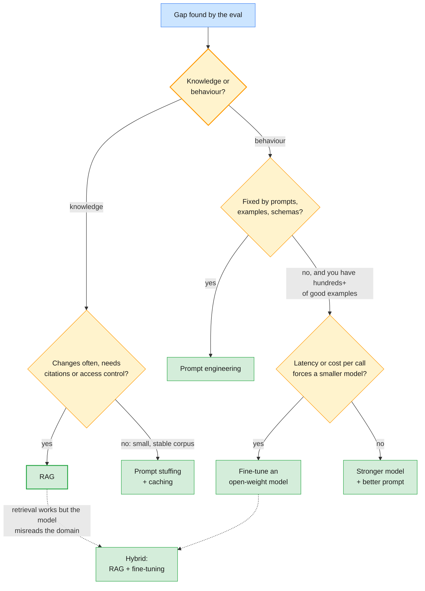

| Criterion | Prompt engineering | RAG | Fine-tuning | Hybrid |
| --------- | ------------------ | --- | ----------- | ------ |
| Data you need | A few examples | The documents, with metadata | Hundreds to thousands of labelled examples | Both |
| Latency | Model call only | Plus retrieval and a longer prompt | Lowest when a small tuned model replaces a large one | Retrieval plus a small model |
| Cost | Tokens per call | Index, storage, chunk tokens | Training, hosting, re-training | Highest to build |
| Update frequency | Edit the prompt | Re-index changed documents in minutes | Re-train for each change | Facts via RAG, behaviour via training |
| Provenance and deletion | — | Cite and delete per document | In the weights: no citation, no deletion | Facts stay citable |

Research agrees. Ovadia et al. (2023) found that RAG "consistently outperforms" unsupervised
fine-tuning for injecting knowledge, both knowledge seen in pretraining and new knowledge. RAFT
(Zhang et al., 2024) is the hybrid case: it fine-tunes a model to use retrieved documents well,
including ignoring the irrelevant ones.

### 3.5 The decision canvas and workshop (30 min, from the delivery schedule)

The workshop fills in the fine-tuning decision canvas for four scenarios: gap, data, latency
budget, monthly cost, update frequency, decision, and the evaluation that would prove the
decision wrong. Four example scenarios (the lab's scenario cards may differ):

| Scenario | Key facts | Likely decision | What would change it |
| -------- | --------- | --------------- | -------------------- |
| IT knowledge base answers | 5,000 articles, edited daily, users need the source | RAG with citations | — |
| Ticket triage at volume | 40,000 tickets a day, fixed labels, 12,000 labelled tickets, p95 under 300 ms | Few-shot prompt on the small tier (Module 2 §2); fine-tune an open-weight classifier only if cost or latency still fail | The small tier already meets the bar |
| Contract and policy search | Auditors need the exact clause; contracts change quarterly | RAG with clause-level citations; no fine-tuning (provenance) | — |
| Engineering-document assistant | Internal jargon and part codes; 300 Q&A pairs; weekly changes | Hybrid retrieval for the codes (§6.2); RAFT-style fine-tuning only if retrieval is right but answers misread the domain | Re-ranking closes the gap |

> **Engineering takeaway:** "Fine-tune it on our documents" is usually a knowledge request in
> disguise. Knowledge belongs in an index you can update, cite and delete from; weights are for
> behaviour you cannot get any other way.

---

## 4. Vector databases

### 4.1 What a vector database does

A vector database stores an embedding per chunk and answers "which stored vectors are nearest to
this query vector?" quickly, usually approximately. Production use also needs metadata filters,
persistence, updates and deletes.

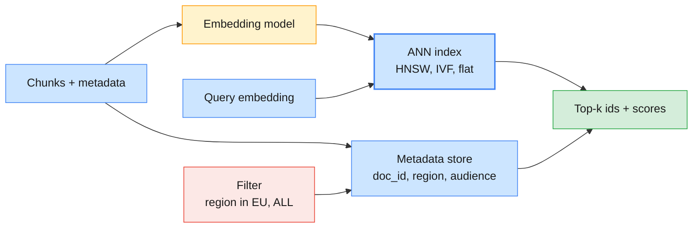

OpenAI's embeddings and the course's local model (with `normalize_embeddings=True`) are unit
length, so cosine similarity equals the inner product (Module 1 §7.1). Pick one metric per index.

| Index family | How it searches | Recall | Use when |
| ------------ | --------------- | ------ | -------- |
| Flat (exact) | Compares the query with every vector | 100% | Up to roughly a million vectors, and as ground truth |
| IVF | Searches only the nearest clusters | Tunable (`nprobe`); needs training | Large, mostly static sets |
| HNSW (Malkov and Yashunin, 2016) | Walks a layered proximity graph | High, tunable (`ef`); incremental inserts | The default in most vector databases |
| PQ (often IVF-PQ) | Compresses vectors into short codes | Lower; a fraction of the memory | Billions of vectors |

### 4.2 FAISS, Chroma and Pinecone

| | FAISS | Chroma | Pinecone |
| - | ----- | ------ | -------- |
| What it is | A similarity-search **library** (Douze et al., 2024) | An open-source **database**, embedded or as a server | A managed, serverless **service** |
| Persistence | You save and load index files | Built in (`PersistentClient`) | Managed |
| Metadata filtering | None: keep ids and metadata yourself | `where` on metadata, `where_document` on text | Metadata filters |
| Updates and deletes | Limited by index type; often rebuild | Upsert and delete by id | Upsert and delete by id; namespaces |
| Data residency | Wherever you run it | Wherever you run it | The provider's cloud regions |
| In this course | Labs (pinned `faiss-cpu`) | Labs (pinned `chromadb`) | Trade-offs only; not in the outline's tools |

### 4.3 FAISS and Chroma in code

```python
import faiss
import numpy as np

Path("index").mkdir(exist_ok=True)
vectors = np.array(embeddings.embed_documents([c.page_content for c in chunks]), dtype="float32")
flat = faiss.IndexFlatIP(vectors.shape[1])          # exact; inner product = cosine on unit vectors
hnsw = faiss.IndexHNSWFlat(vectors.shape[1], 32, faiss.METRIC_INNER_PRODUCT)   # approximate graph
for index in (flat, hnsw):
    index.add(vectors)
query = np.array([embeddings.embed_query("Which firmware do the EU VPN gateways run?")], dtype="float32")
scores, ids = hnsw.search(query, 4)
print([(chunks[i].metadata["doc_id"], round(float(s), 2)) for s, i in zip(scores[0], ids[0])])
faiss.write_index(hnsw, "index/kb.faiss")           # vectors only: keep chunks and metadata yourself
```

```python
import chromadb

client = chromadb.PersistentClient(path="index/chroma")
collection = client.get_or_create_collection("eoa_knowledge", configuration={"hnsw": {"space": "cosine"}})
collection.upsert(
    ids=[f'{c.metadata["doc_id"]}:{c.metadata["start_index"]}' for c in chunks],   # stable: re-ingest updates
    embeddings=vectors.tolist(),
    documents=[c.page_content for c in chunks],
    metadatas=[{k: c.metadata[k] for k in ("doc_id", "title", "doc_type", "region", "audience")}
               for c in chunks])
result = collection.query(
    query_embeddings=[embeddings.embed_query("What is the P1 restore time?")], n_results=3,
    where={"$and": [{"region": {"$in": ["EU", "ALL"]}}, {"doc_type": "contract"}]})
print([(m["doc_id"], round(d, 2)) for m, d in zip(result["metadatas"][0], result["distances"][0])])
```

Representative output:

```text
faiss:   [('ENG-SPEC-0417', 0.58), ('POL-SEC-012', 0.53), ('CTR-2026-118', 0.47), ('ENG-SPEC-0417', 0.38)]
chroma:  [('CTR-2026-118', 0.51), ('CTR-2026-118', 0.69), ('CTR-2025-044', 0.75)]
```

FAISS returns similarities (higher is better); Chroma with `space: cosine` returns distances
(1 − similarity, lower is better). On 30 chunks the flat and HNSW indexes agree; at scale they
diverge, which is why you keep a flat index as ground truth when you tune `ef` or `nprobe`.

> **Common trap:** Mixing embedding models in one index. Vectors from two models live in
> different spaces, usually with different dimensions. Store the embedding model's ID with the
> index, and re-embed everything when it changes.

> **Enterprise reality:** An index is derived data. The dry-run corpus's own `POL-DATA-007` states
> the rule most legal teams give: indexes follow the retention and residency of their sources and
> are purged when a source is deleted. That rules out some hosting choices before any benchmark.

---

## 5. Chunking strategies

### 5.1 Why chunk size matters

A chunk is the unit you retrieve, cite and pay for. Too small, and it loses the context that
gives it meaning ("restore within 4 hours", without saying which contract). Too large, and it
mixes topics, its embedding blurs, and it fills the prompt with text the question did not need.

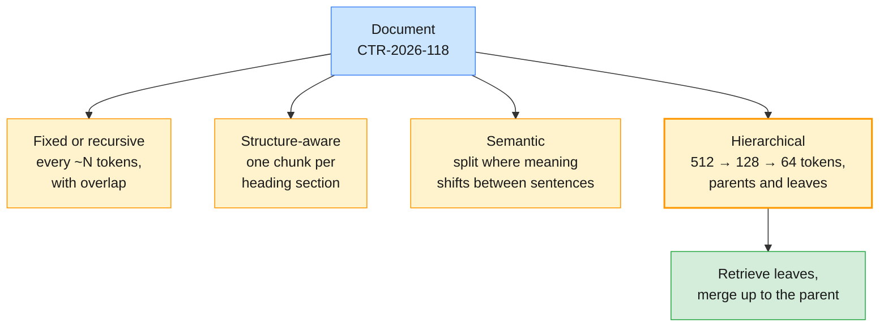

| Strategy | Splits on | Strength | Weakness | In the libraries |
| -------- | --------- | -------- | -------- | ---------------- |
| Fixed / recursive | A length; recursive tries paragraphs, then lines, then words | Simple, predictable cost | Cuts through tables and sections | `SentenceSplitter` (tokens), `RecursiveCharacterTextSplitter` (characters) |
| Structure-aware | Headings, sections, pages | Matches how authors organised content | Uneven sizes | `MarkdownNodeParser`, `MarkdownHeaderTextSplitter` |
| Semantic | Embedding distance between neighbouring sentences | Topic-coherent chunks | Extra embedding calls; sizes vary | `SemanticSplitterNodeParser` |
| Hierarchical | Several sizes at once, linked parent to child | Precise matching, full-context answers | More nodes; needs a docstore | `HierarchicalNodeParser` + `AutoMergingRetriever` |

### 5.2 The strategies in code (H3)

LlamaIndex's node parsers make the comparison short. `HIDDEN` keeps operational metadata out of
the embedded and prompted text while keeping it available for filters:

```python
from llama_index.core import Document as LlamaDocument
from llama_index.core.node_parser import MarkdownNodeParser, SemanticSplitterNodeParser, SentenceSplitter
from llama_index.embeddings.openai import OpenAIEmbedding

embed = OpenAIEmbedding(model=os.environ["OPENAI_EMBEDDING_MODEL"])
HIDDEN = ["source", "updated", "region", "audience", "owner_team"]   # filter on them, do not embed them
li_docs = [LlamaDocument(text=d.page_content, metadata=d.metadata, id_=d.metadata["doc_id"],
                         excluded_embed_metadata_keys=HIDDEN, excluded_llm_metadata_keys=HIDDEN)
           for d in load_corpus()]
splitters = {
    "fixed-64": SentenceSplitter(chunk_size=64, chunk_overlap=8),        # sizes are tokens here
    "fixed-160": SentenceSplitter(chunk_size=160, chunk_overlap=20),
    "fixed-512": SentenceSplitter(chunk_size=512, chunk_overlap=50),
    "semantic": SemanticSplitterNodeParser.from_defaults(embed_model=embed, breakpoint_percentile_threshold=90),
    "markdown": MarkdownNodeParser(),                                    # one node per heading section
}
```

Hierarchical chunking retrieves small leaves and returns their parent when enough siblings match:

```python
from llama_index.core import StorageContext, VectorStoreIndex
from llama_index.core.node_parser import HierarchicalNodeParser, get_leaf_nodes
from llama_index.core.retrievers import AutoMergingRetriever

nodes = HierarchicalNodeParser.from_defaults(chunk_sizes=[512, 128, 64]).get_nodes_from_documents(li_docs)
storage = StorageContext.from_defaults()
storage.docstore.add_documents(nodes)                    # parents must be findable for merging
leaf_index = VectorStoreIndex(get_leaf_nodes(nodes), storage_context=storage, embed_model=embed)
auto = AutoMergingRetriever(leaf_index.as_retriever(similarity_top_k=8), storage, simple_ratio_thresh=0.4)
for n in auto.retrieve("What are the service levels and credits in the managed network agreement?"):
    print(n.metadata["doc_id"], len(n.get_content()))
```

Representative output: 178 nodes, 116 of them leaves; the matching leaves merged into one
762-character parent of `CTR-2026-118` holding the whole service-level and service-credit text.

> **Common trap:** Units and overheads differ between libraries. `RecursiveCharacterTextSplitter`
> counts characters by default; `SentenceSplitter` counts tokens, and also counts the metadata it
> embeds. With all seven front-matter fields embedded, `chunk_size=60` failed with "Metadata
> length (65) is longer than chunk size (60)". Decide what the embedding should see, then size.

### 5.3 What the comparison shows

Measured with the §7.2 harness (OpenAI embeddings, top 4):

| Splitter | Nodes | Median chars | Precision@4 | Recall@4 | MRR |
| -------- | ----- | ------------ | ----------- | -------- | --- |
| Fixed, 64 tokens | 98 | 132 | 0.89 | 1.00 | 1.00 |
| Fixed, 160 tokens | 29 | 497 | 0.47 | 1.00 | 0.93 |
| Fixed, 512 tokens | 20 | 591 | 0.26 | 0.97 | 0.92 |
| Semantic (90th percentile) | 42 | 312 | 0.51 | 0.97 | 0.95 |
| Markdown sections | 88 | 133 | 0.85 | 0.97 | 1.00 |
| Hierarchical, auto-merging | 178 (116 leaves) | — | 0.33 | 1.00 | 0.97 |

Read it before you crown a winner. Recall barely moves on a corpus this small. Precision is
counted per chunk against relevant *documents*, so small chunks win simply because four small
chunks of the right document fill the top 4, yet the 64-token winner splits the SLA table from its
heading and is too small to answer from. That is why H4 also measures answer quality (§7.4), and
why structure-aware chunks are a strong default for well-formatted pages and policies.

---

## 6. Metadata design & hybrid retrieval

### 6.1 Metadata design

Metadata is how retrieval knows who may see a chunk, how fresh it is, and what to cite.

| Field | Example | Used for |
| ----- | ------- | -------- |
| `doc_id`, `title`, `source` | `POL-SEC-012`, a path or URL | Citations, deduplication, deletes |
| `doc_type` | `kb`, `policy`, `contract`, `engineering` | Routing and filtering by use case (§9.5) |
| `audience` | `internal`, `customer` | Who may see it at all |
| `region` | `EU`, `US`, `APAC`, `ALL` | Data residency and regional rules |
| `updated`, `status` | `2026-09-14`, `published` | Freshness; excluding drafts and retired versions |
| Access lists | `allowed_group_ids` (captured by the SharePoint reader, §9.2) | Security trimming per user |
| Section, page | `§5`, page 3 | Precise citations |

Filter **before** ranking. A post-filter (take the top 4, drop what the user may not see) can
leave nothing relevant. LangChain's `InMemoryVectorStore` takes a filter function that runs
before similarity; Chroma takes `where` (§4.3):

```python
def visible_to(region: str, audience: str):
    """Pre-filter: only chunks this caller may see enter the ranking."""
    return lambda doc: doc.metadata["region"] in {region, "ALL"} and doc.metadata["audience"] == audience

q = "What is the P1 restore time?"
for region, audience in (("EU", "internal"), ("US", "internal"), ("EU", "customer")):
    print(region, audience, [d.metadata["doc_id"] for d in store.similarity_search(q, k=4, filter=visible_to(region, audience))])
```

Representative output:

```text
EU internal  ['CTR-2026-118', 'CTR-2026-118', 'KB-0042', 'CTR-2025-044']
US internal  ['KB-0042', 'POL-DATA-007', 'KB-0790', 'KB-0044']
EU customer  ['KB-1203', 'KB-1210']
```

Both contracts are EU-only, so the US analyst sees neither, yet still gets four chunks, none of
which answers the question. A filter always returns *something*, so the generator must be allowed
to say "not in the sources", and retrieval needs a score floor (§9.6).

Metadata can also improve the embedding. Anthropic's contextual retrieval prepends chunk-specific
context to each chunk before embedding and indexing; in Anthropic's experiments that cut top-20
retrieval failures by 35%, by 49% with contextual BM25, and by 67% with re-ranking added.
Embedding the title and `doc_type` with each node, as LlamaIndex does by default, is a cheap
version of the same idea.

> **Production baseline:** Access filters come from the authenticated caller, never from the
> model or the question. The model may choose `doc_type`; it never chooses `region` or
> `audience` (Module 5 builds this as access control).

### 6.2 Hybrid retrieval: keyword plus vector

Vector search matches meaning; keyword search matches exact tokens such as `CHG-20931`, error
codes and host names. BM25, the ranking function behind most keyword engines, is a strong
baseline across domains (Thakur et al., 2021). Hybrid retrieval runs both and fuses the rankings
with reciprocal rank fusion (RRF; Cormack et al., 2009), which needs ranks only, not comparable
scores.

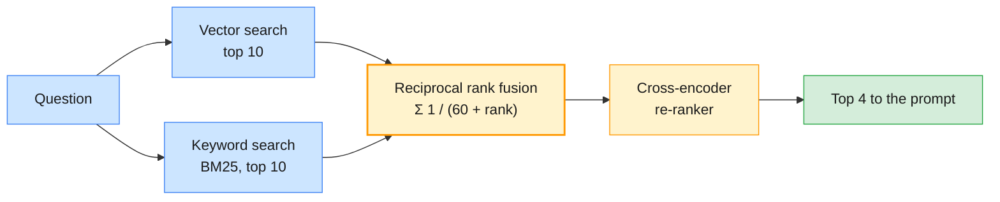

SQLite's built-in FTS5 extension provides BM25 with no extra package:

```python
import re
import sqlite3

fts = sqlite3.connect(":memory:", check_same_thread=False)   # LCEL may call it from other threads
fts.execute("CREATE VIRTUAL TABLE chunk_fts USING fts5(text)")
fts.executemany("INSERT INTO chunk_fts(rowid, text) VALUES (?, ?)",
                [(i, c.page_content) for i, c in enumerate(chunks)])

def keyword_search(query: str, k: int = 10) -> list[Document]:
    """BM25 over the chunks. Every term is quoted: user text is never FTS query syntax."""
    terms = " OR ".join(f'"{t}"' for t in re.findall(r"[\w-]+", query.lower()))
    rows = fts.execute("SELECT rowid FROM chunk_fts WHERE chunk_fts MATCH ? ORDER BY bm25(chunk_fts) LIMIT ?",
                       (terms, k)).fetchall()
    return [chunks[rowid] for (rowid,) in rows]

def hybrid_search(query: str, k: int = 4, pool: int = 10) -> list[Document]:
    """Reciprocal rank fusion of the vector and keyword rankings."""
    fused: dict[tuple, list] = {}
    for ranking in (store.similarity_search(query, k=pool), keyword_search(query, k=pool)):
        for rank, chunk in enumerate(ranking, 1):
            key = (chunk.metadata["doc_id"], chunk.metadata["start_index"])
            fused.setdefault(key, [0.0, chunk])[0] += 1 / (60 + rank)
    return [chunk for _, chunk in sorted(fused.values(), key=lambda e: -e[0])][:k]
```

> **Common trap:** Passing the question straight to `MATCH`. FTS5 has its own query language, so
> a ticket containing `"`, `AND`, `NEAR` or `vpn-gw-eu-02` raises a syntax error or changes the
> meaning. Quote every term, as above; the same holds for any search API that parses its input.

### 6.3 Re-ranking

Retrievers embed query and chunk separately (a bi-encoder): fast but coarse. A **cross-encoder**
reads them together and scores relevance directly (Nogueira and Cho, 2019). It is too slow for
the whole index, so it re-orders a candidate pool:

```python
from sentence_transformers import CrossEncoder

reranker = CrossEncoder(os.environ.get("RERANK_MODEL", "cross-encoder/ms-marco-MiniLM-L-6-v2"))

def rerank(query: str, candidates: list[Document], k: int = 4) -> list[Document]:
    scores = reranker.predict([(query, c.page_content) for c in candidates])
    return [c for _, c in sorted(zip(scores, candidates), key=lambda p: -p[0])][:k]

top = rerank("Which document covers CHG-20931?", hybrid_search("Which document covers CHG-20931?", k=10))
```

| Re-ranker | Latency per query | Notes |
| --------- | ----------------- | ----- |
| None | 0 | The baseline: start here and measure |
| Local cross-encoder | Tens to hundreds of ms on CPU | `ms-marco-MiniLM` is English-only: check multilingual tickets |
| Hosted re-ranker (for example Voyage AI's `rerank` models, which Anthropic's documentation points to) | A network call | Strong and multilingual; text leaves your estate |
| LLM as re-ranker | Seconds | Reserve for low-volume, high-value queries |

---

## 7. Retrieval quality evaluation

### 7.1 What to measure

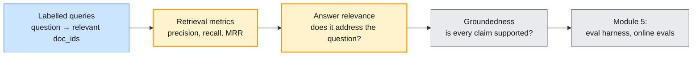

| Metric | Question it answers | Per query (then averaged) |
| ------ | ------------------- | ------------------------- |
| Precision@k | How much of what I retrieved is relevant? | relevant retrieved / k |
| Recall@k | How much of what is relevant did I retrieve? | relevant documents found / relevant documents |
| Hit rate@k | Did anything relevant appear? | 1 if any, else 0 |
| MRR | How high is the first relevant result? | 1 / rank of the first relevant result |
| Answer relevance | Does the answer address the question? | A judge's score (§7.4) |
| Groundedness | Is every claim supported by the sources? | Module 5's evaluation harness |

### 7.2 Labelled queries and the harness (H4)

Pair realistic questions with the documents that answer them. Include identifiers, paraphrases,
other languages and questions with two relevant documents:

```json
[
  {"qid": "q08", "query": "Windows client shows error 809", "relevant": ["ENG-SPEC-0417", "KB-0042"]},
  {"qid": "q13", "query": "Which document covers CHG-20931?", "relevant": ["ENG-SPEC-0417"]},
  {"qid": "q14", "query": "My machine wants a long number before Windows will even start", "relevant": ["KB-0450"]},
  {"qid": "q18", "query": "Le VPN refuse mon nouveau mot de passe", "relevant": ["KB-0042"]}
]
```

```python
import json

queries = json.loads(Path("data/test_queries.json").read_text())

def evaluate(retrieve_ids, queries: list[dict], k: int = 4) -> dict[str, float]:
    """Mean precision@k, recall@k, hit rate@k and MRR; relevance is judged per document."""
    rows = []
    for q in queries:
        ids, relevant = retrieve_ids(q["query"])[:k], set(q["relevant"])
        first = next((rank for rank, i in enumerate(ids, 1) if i in relevant), None)
        rows.append({"precision": sum(i in relevant for i in ids) / k,
                     "recall": len(relevant & set(ids)) / len(relevant),
                     "hit_rate": float(first is not None),
                     "mrr": 1 / first if first else 0.0})
    return {m: round(sum(r[m] for r in rows) / len(rows), 2) for m in rows[0]}

doc_ids = lambda hits: [h.metadata["doc_id"] for h in hits]
configs = {
    "dense": lambda q: doc_ids(store.similarity_search(q, k=4)),
    "keyword (BM25)": lambda q: doc_ids(keyword_search(q, k=4)),
    "hybrid (RRF)": lambda q: doc_ids(hybrid_search(q)),
    "hybrid + rerank": lambda q: doc_ids(rerank(q, hybrid_search(q, k=10))),
}
for name, retrieve_ids in configs.items():
    print(f"{name:16}", evaluate(retrieve_ids, queries))
```

Representative results (20 queries, 30 chunks, k = 4):

| Configuration | Precision@4 | Recall@4 | Hit rate@4 | MRR | What changed |
| ------------- | ----------- | -------- | ---------- | --- | ------------ |
| Dense, local multilingual MiniLM | 0.28 | 0.85 | 0.85 | 0.73 | — |
| Dense, local `all-MiniLM-L6-v2` | 0.41 | 0.95 | 0.95 | 0.80 | — |
| Dense, `text-embedding-3-small` | 0.41 | 0.95 | 0.95 | 0.88 | Missed `CHG-20931` (q13) |
| Keyword (BM25) | 0.30 | 0.82 | 0.85 | 0.79 | Found q13; missed three paraphrases (q14–q16) |
| Hybrid (RRF) | 0.38 | 0.95 | 0.95 | 0.89 | Fixed q13, but lost q16 ("my own iPad") |
| Hybrid + cross-encoder | 0.38 | 1.00 | 1.00 | 0.90 | Recovered both |

The per-query view teaches more than the averages. Hybrid search is not monotonic: q16's answer
was 2nd in the vector ranking and absent from the keyword ranking, so fusion pushed it below
chunks both retrievers ranked moderately. Re-ranking a pool of 10 brought it back. With 20
queries, one query moves recall by 0.05: a one-query difference is noise. The lab's set and your
production set need hundreds.

The H3 comparison (§5.3) runs the same harness on LlamaIndex retrievers:

```python
for name, splitter in splitters.items():
    nodes = splitter.get_nodes_from_documents(li_docs)
    r = VectorStoreIndex(nodes, embed_model=embed).as_retriever(similarity_top_k=4)
    print(f"{name:10} nodes={len(nodes):3}", evaluate(lambda q: [n.metadata["doc_id"] for n in r.retrieve(q)], queries))
```

> **Common trap:** Feeding document IDs to LlamaIndex's `RetrieverEvaluator`. Its `expected_ids`
> are **node** IDs, which change whenever you re-chunk, so doc-level labels score 0 everywhere.
> Label at node level for that tool, or keep a doc-level harness like the one above, which
> survives every chunking experiment.

### 7.3 Turning metrics into decisions

| Symptom in the numbers | Likely cause | Try |
| ---------------------- | ------------ | --- |
| Hit rate high, MRR low | Right document, ranked too low | Re-ranking; contextual headers (§6.1) |
| Misses on identifiers and codes | Vector-only retrieval | Hybrid with BM25 (§6.2) |
| Misses on paraphrases or other languages | Keyword-only, or a weak or English-only model | Better or multilingual embeddings (Module 1 §7.3) |
| Precision low, recall high | Chunks too large, or k too high | Smaller or structure-aware chunks |
| Recall high, answers poor | Chunks too small to answer from | Larger chunks or parent retrieval (§5.2) |

### 7.4 Answer relevance with an LLM judge

Answer relevance asks whether the answer addresses the question; groundedness, whether the
sources support it, is Module 5's topic. A small-tier judge with a structured verdict works on
either provider:

```python
from typing import Literal

class Relevance(BaseModel):
    score: Literal[1, 2, 3, 4, 5] = Field(description="5 = fully addresses the question, 1 = not at all")
    reason: str = Field(description="One sentence")

JUDGE = ChatPromptTemplate.from_messages([
    ("system", "You grade answer relevance: does the ANSWER address the QUESTION that was asked? "
               "Ignore whether it is true; groundedness is graded separately."),
    ("human", "QUESTION: {question}\n\nANSWER: {answer}"),
])
pairs = [("How long can a VPN session stay idle?", "An idle VPN session is disconnected after 30 minutes [POL-SEC-012]."),
         ("How long can a VPN session stay idle?", "Every VPN session requires MFA and a company-managed device [POL-SEC-012]."),
         ("What is the P1 restore time in the network contract?", "I cannot find that in the sources.")]
for provider in ("openai", "anthropic"):
    judge = JUDGE | get_chat_model(provider, small=True).with_structured_output(Relevance)
    print(provider, [judge.invoke({"question": q, "answer": a}).score for q, a in pairs])
```

Representative output: both judges scored the three answers 5, 1 and 2, in all three dry runs.
They agree on the clear cases, and both penalise the honest "I cannot find that".

> **Common trap:** Optimising answer relevance alone rewards confident answers over correct
> refusals. Add questions the corpus cannot answer, labelled "no answer expected", and score them
> separately: a refusal passes, any answer fails.

### 7.5 The retrieval eval rubric

| Check | Threshold (set per use case) | If it fails |
| ----- | ---------------------------- | ----------- |
| Recall@k on labelled queries | For example ≥ 0.95 | Do not ship; fix retrieval first |
| MRR | For example ≥ 0.85 | Re-rank, or tune chunking |
| Unanswerable queries refused | 100% | Tighten grounding rules; add a score floor |
| Answer relevance (judge) | Mean ≥ 4 | Fix the prompt or the chunk size |
| Cited IDs were retrieved | 100% | Schema validation (§2.4) |
| Regression versus the last release | No drop beyond the noise of one query | Block the change |

---

## 8. RAG frameworks: LangChain vs LlamaIndex

### 8.1 The same pipeline in LlamaIndex (H2)

LlamaIndex is built around the data side: documents, nodes, indexes and query engines. A small
helper picks its LLM from the same `.env` variables as `llm.py`:

```python
from llama_index.core import Settings
from llama_index.llms.anthropic import Anthropic
from llama_index.llms.openai import OpenAIResponses
from llm import get_model_name, get_provider

def llama_llm(provider: str | None = None):
    """LlamaIndex's chat model for LLM_PROVIDER, from the same .env variables as labs/setup/llm.py."""
    if get_provider(provider) == "openai":
        return OpenAIResponses(model=get_model_name("openai"))
    return Anthropic(model=get_model_name("anthropic"), max_tokens=4096)

Settings.llm, Settings.embed_model = llama_llm(), embed
index = VectorStoreIndex.from_documents(li_docs, transformations=[SentenceSplitter(chunk_size=160, chunk_overlap=20)])
query_engine = index.as_query_engine(similarity_top_k=4)
response = query_engine.query("The VPN keeps rejecting my new password. What should I do?")
print(response)
print([(n.metadata["doc_id"], round(n.score, 2)) for n in response.source_nodes])
```

Representative output (abridged; both providers retrieved the same nodes):

```text
openai:  Most likely the client is still offering a cached (old) password. Do this:
         1. Wait about 15 minutes after changing the password … 4. Start the client, sign in …
claude:  If the VPN keeps rejecting your new password, the client is probably still using the old
         saved password. Try this: 1. Wait 15 minutes after your password change …
sources: [('KB-0042', 0.64), ('KB-0042', 0.63), ('KB-0044', 0.5), ('POL-SEC-012', 0.46)]
```

The default query engine does not ask for citations: `source_nodes` tells *you* what was used,
but the user sees uncited prose. Pass your own prompt template, or use the patterns of §2.4.

### 8.2 Architecture comparison

```mermaid
flowchart TB
    subgraph LC ["LangChain 1.x"]
        LD1["Loaders<br/>(your code or integrations)"] --> SP1["Text splitters"]
        SP1 --> VS1["Vector store<br/>+ retriever"]
        VS1 --> CH1["LCEL chain or<br/>create_agent + retrieval tool"]
    end
    subgraph LI ["LlamaIndex 0.14"]
        LD2["Readers<br/>SimpleDirectoryReader, Hub readers"] --> NP2["Node parsers<br/>ingestion pipeline"]
        NP2 --> IX2["VectorStoreIndex<br/>+ docstore"]
        IX2 --> QE2["Retriever → query engine<br/>or FunctionAgent + tools"]
    end

    style LC fill:#ffffff,stroke:#ff9800,stroke-width:1px,color:#1a1a1a
    style LI fill:#ffffff,stroke:#4285f4,stroke-width:1px,color:#1a1a1a
    style LD1 fill:#cce5ff,stroke:#4285f4,stroke-width:1px,color:#1a1a1a
    style SP1 fill:#cce5ff,stroke:#4285f4,stroke-width:1px,color:#1a1a1a
    style VS1 fill:#cce5ff,stroke:#4285f4,stroke-width:1px,color:#1a1a1a
    style CH1 fill:#fff3cd,stroke:#ff9800,stroke-width:2px,color:#1a1a1a
    style LD2 fill:#cce5ff,stroke:#4285f4,stroke-width:1px,color:#1a1a1a
    style NP2 fill:#cce5ff,stroke:#4285f4,stroke-width:1px,color:#1a1a1a
    style IX2 fill:#cce5ff,stroke:#4285f4,stroke-width:1px,color:#1a1a1a
    style QE2 fill:#fff3cd,stroke:#ff9800,stroke-width:2px,color:#1a1a1a
```

| Concern | LangChain | LlamaIndex |
| ------- | --------- | ---------- |
| Centre of gravity | Composition: chains, agents, middleware, tools | Data: ingestion, node parsing, indexes, query engines |
| Chunk size unit | Characters by default | Tokens |
| Metadata in embeddings | Only what you put in `page_content` | Embedded by default; exclude keys per document |
| Advanced retrieval | You compose it (§6) | Built in: auto-merging, fusion, node post-processors |
| Connectors | Standalone integration packages | Hub readers (`llama-index-readers-*`) |
| Agents | `create_agent`, LangGraph (Module 4) | `FunctionAgent`, `ReActAgent` (workflow-based) |
| Provider switch in this course | `get_chat_model()` | `llama_llm()` above |

Use LlamaIndex when the hard part is the data: many source types, hierarchical documents,
retrieval experiments. Use LangChain when the hard part is the application: agents, tools,
memory and Module 4's LangGraph orchestration. They interoperate: §5.2 fed LangChain documents
to LlamaIndex, and any retriever can sit behind a LangChain tool (§10).

> **Outline vs current API:** Two names in the outline have moved (verified 28 October 2026):
>
> | Outline term | Current state | What the course does |
> | ------------ | ------------- | -------------------- |
> | "LlamaIndex Hub" | llamahub.ai redirects to the integrations catalogue on developers.llamaindex.ai; each reader is a `llama-index-readers-*` package | Teaches the Hub readers by name (§9.2); they are not in the course pins |
> | LangChain RAG building blocks | `langchain-community` was sunset on 22 May 2026, its repository archived on 19 June 2026, and it now warns on import; integrations move to standalone packages (`langchain-chroma`, `langchain-huggingface`, …) | Builds on `langchain-core` (`InMemoryVectorStore`, `Embeddings`), `langchain-text-splitters`, `langchain-openai` and the native FAISS and Chroma clients |
>
> In the pinned environment `langchain-text-splitters` (1.1.3) arrives only as a dependency of
> `langchain-community`, through `langchain-classic`. Pin it directly before removing either.

---

## 9. Enterprise connectors & use cases

### 9.1 Connector architecture

A connector is a data pipeline, not a file download. It authenticates as a service identity,
pulls changes incrementally, carries each document's access list, and propagates deletions, or
the index keeps answering from documents that no longer exist.

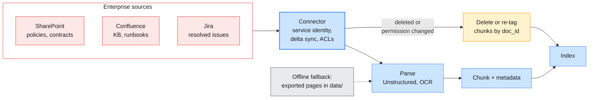

| Concern | What to do |
| ------- | ---------- |
| Identity | An app registration or service account with read-only, least-privilege scopes, never a person's token |
| Delta sync | Sync by modified time or change feed from a stored checkpoint, not a nightly full crawl |
| Deletes | Reconcile source IDs against the index and delete chunks by `doc_id` |
| Access lists | Capture them at ingest; refresh them when permissions change |
| Parsing | A partitioner (Unstructured) or OCR (Module 1 §4) before chunking |
| Rate limits | Backoff, resumable runs, per-source metrics |

### 9.2 LlamaIndex Hub readers for SharePoint, Confluence and Jira (H5)

The signatures below were checked against the current packages
(`llama-index-readers-microsoft-sharepoint` 0.10.0, `-confluence` 0.8.0, `-jira` 0.7.0, all
compatible with the pinned `llama-index-core` 0.14.25). They are not in the course pins, and this
block was not run, because it needs real tenants:

```python
# Shape only: pip install llama-index-readers-microsoft-sharepoint llama-index-readers-confluence llama-index-readers-jira
# Variable names are illustrative; the client IT team provides the real values (course-map §4 #6).
from llama_index.readers.confluence import ConfluenceReader
from llama_index.readers.jira import JiraReader
from llama_index.readers.microsoft_sharepoint import SharePointReader

sharepoint = SharePointReader(client_id=os.environ["SHAREPOINT_CLIENT_ID"],
                              client_secret=os.environ["SHAREPOINT_CLIENT_SECRET"],
                              tenant_id=os.environ["SHAREPOINT_TENANT_ID"])
policies = sharepoint.load_data(sharepoint_site_name="ITPolicies", sharepoint_folder_path="Published")

confluence = ConfluenceReader(base_url=os.environ["CONFLUENCE_URL"])   # reads CONFLUENCE_API_TOKEN itself
kb_pages = confluence.load_data(space_key="ITKB", include_attachments=False)

jira = JiraReader(email=os.environ["JIRA_EMAIL"], api_token=os.environ["JIRA_API_TOKEN"],
                  server_url=os.environ["JIRA_URL"])
resolved = jira.load_data(query="project = ITSD AND status = Resolved AND updated >= -30d")
```

| Reader | Authentication | Selects content by | Access metadata |
| ------ | -------------- | ------------------ | --------------- |
| `SharePointReader` | Entra ID app (client ID, secret, tenant) via Microsoft Graph | Site name and folder path or ID; host name and relative URL for `Sites.Selected` apps | Adds `allowed_user_ids`, `allowed_group_ids` and display names from each file's permissions |
| `ConfluenceReader` | API token, OAuth 2.0, cookies or user name and password; falls back to `CONFLUENCE_API_TOKEN` | One of space key, page IDs, label or CQL | None by default: fetch page restrictions yourself |
| `JiraReader` | Email + API token, OAuth 2.0 or a personal access token | A JQL query, paged with `start_at` and `max_results` | None: apply the project's permission scheme yourself |

Office files and PDFs need parsing before chunking. The Unstructured API partitions a file into
typed elements (titles, narrative text, tables, list items) that chunk along the document's real
structure; its Python client (`unstructured-client`, not pinned) reads `UNSTRUCTURED_API_KEY` and
exposes `client.general.partition(request=…)`. Scans go through OCR first (Module 1 §4).

The lab never depends on a tenant: `data/` holds exported pages from each source, as Markdown
with the §2.3 front matter plus source IDs and access groups. The same `load_corpus()` reads them,
so a live reader later changes only the loader, not the chunking, index, evaluation or prompts.

> **Common trap:** Indexing with an administrator's token and filtering nothing. The index now
> answers every user with content only administrators could open. Capture access lists and filter
> on them (§6.1), or build separate indexes per audience.

### 9.3 Enterprise RAG use cases (T10)

| Use case | Corpus | Chunking | Metadata that matters | Answer contract | Main risk |
| -------- | ------ | -------- | --------------------- | --------------- | --------- |
| IT knowledge base | KB articles, runbooks, resolved tickets | Section-aware (Symptoms, Resolution) | `doc_type`, `owner_team`, `updated` | Steps with `[KB-…]` citations | Stale fixes |
| Policy and contract search | `POL-…`, `CTR-…` | Clause- or section-level | `region`, effective dates, counterparty | Clause citations; "show both" on conflicts | The wrong contract |
| Customer support | Customer-facing KB, FAQs | Short, task-oriented | `audience=customer`, product, language | Plain language; no internal names | Leaking internal content |
| Engineering documentation | `ENG-SPEC-…`, design docs, change records | Hierarchical; tables kept whole | System, version, host names | Exact values, section citations | Identifiers missed by vector search |

### 9.4 Two assistants from one pattern (H6)

H6 builds a policy-search assistant and a customer-support assistant from one shared pattern. The
pattern is fixed; a profile decides what is searched and how the answer is written.

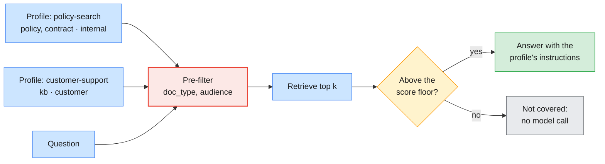

```python
from dataclasses import dataclass

@dataclass(frozen=True)
class RagProfile:
    name: str
    doc_types: frozenset[str]
    audience: str
    instructions: str
    k: int = 4

POLICY_SEARCH = RagProfile(
    "policy-search", frozenset({"policy", "contract"}), "internal",
    "You answer employees' questions about company policies and contracts. Cite the document id "
    "and section, for example [POL-SEC-012 §3]. If two documents disagree, show both.")
CUSTOMER_SUPPORT = RagProfile(
    "customer-support", frozenset({"kb"}), "customer",
    "You help customers of the service portal. Use plain language, never name internal teams or "
    "systems, and cite [KB-…] ids.")

def make_assistant(profile: RagProfile):
    """One retrieval-and-answer pattern; the profile decides what is searched and how it answers."""
    prompt = ChatPromptTemplate.from_messages([
        ("system", profile.instructions + " Answer only from the sources. If they do not answer "
                   "the question, say so."),
        ("human", "<sources>\n{sources}\n</sources>\n\nQuestion: {question}")])
    chain = prompt | get_chat_model() | StrOutputParser()
    def allowed(doc: Document) -> bool:
        return doc.metadata["doc_type"] in profile.doc_types and doc.metadata["audience"] == profile.audience
    def answer(question: str) -> str:
        hits = store.similarity_search(question, k=profile.k, filter=allowed)
        return chain.invoke({"sources": format_sources(hits), "question": question})
    return answer

policy_bot, support_bot = make_assistant(POLICY_SEARCH), make_assistant(CUSTOMER_SUPPORT)
print(policy_bot("May I connect to the VPN from my own tablet?"))
print(support_bot("The VPN keeps rejecting my new password."))
```

Representative output (Claude):

```text
policy:   No. Personal tablets must not connect to the corporate VPN [POL-SEC-012 §3]. Connections
          are permitted only through the corporate VPN client on a company-managed device
          [POL-SEC-012 §2]. …
support:  I don't have information about VPN sign-in problems in the sources I can access … The only
          password guidance I have is for the customer portal. … That guidance may not apply to
          VPN access, so I can't confirm it's the cause.
```

The policy answer is what H6 asks for. The support answer shows the filter working, and a new
risk. Customers may not see `KB-0042`, so retrieval returned only the two customer articles, both
weakly related. Both providers fell back on the portal-password article; OpenAI listed its steps
"in case they help", and in one of two dry runs Claude added advice that no source contains ("the
new password may not have fully saved, so try resetting it again"). The code above has no score
floor yet: a filtered index always returns its nearest neighbours, however far away they are.

> **Production baseline:** Give every profile a score floor: drop hits below a similarity
> threshold calibrated on the labelled set, and when nothing remains, answer "not covered" without
> calling the model. Add unanswerable questions per profile to the evaluation set (§7.4).

---

## 10. Agentic RAG

### 10.1 Retrieval as a tool

The pipelines so far retrieve on every question, which LangChain's documentation calls **2-step
RAG**: predictable and cheap, and wasteful for "thanks, that fixed it". In **agentic RAG** the
retriever is a tool, and the agent decides whether to search, for what, in which `doc_type`, and
whether to search again. **Hybrid RAG** adds validation steps, such as query rewriting and
retrieval checks, around a mostly fixed flow.

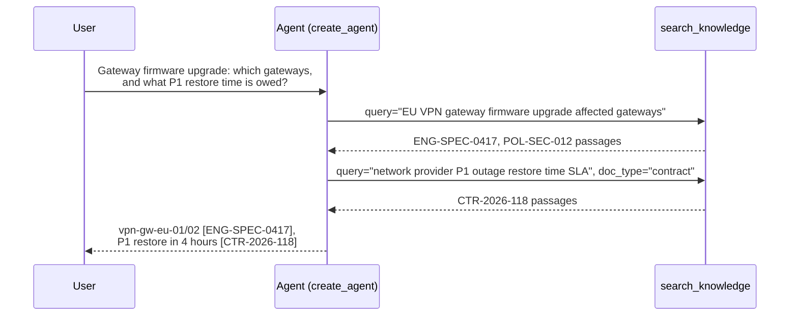

### 10.2 The retriever as a tool for an agent (H7)

The tool keeps the contract of Module 2's `search_kb`: narrow input, concise JSON with stable
IDs, and an actionable message when nothing is found (Module 2 §7.5).

```python
from typing import Literal
from langchain.agents import create_agent
from langchain.tools import tool

@tool
def search_knowledge(query: str,
                     doc_type: Literal["any", "kb", "policy", "contract", "engineering"] = "any") -> str:
    """Search the IT knowledge base, policies, contracts and engineering documents.
    Use it for any question about IT procedures, rules, service levels or system design.
    Do not use it for greetings or thanks. Returns up to 4 passages as JSON with doc_id and title."""
    hits = [h for h in hybrid_search(query, k=8) if doc_type == "any" or h.metadata["doc_type"] == doc_type][:4]
    if not hits:
        return "NO_RESULTS: rephrase the query, or try doc_type='any'."
    return json.dumps([{"doc_id": h.metadata["doc_id"], "title": h.metadata["title"],
                        "text": h.page_content} for h in hits])

agent = create_agent(get_chat_model(), tools=[search_knowledge], system_prompt=(
    "You are the Enterprise Operations Assistant. Search before you answer any question about IT "
    "procedures, policies, contracts or systems, and cite doc_ids in square brackets. Answer only "
    "from what the search returned."))
result = agent.invoke({"messages": [{"role": "user", "content":
    "We are upgrading the EU VPN gateway firmware. Which gateways are affected, and if the upgrade "
    "causes a P1 outage, what restore time does our network provider owe us?"}]})
searches = [c["args"] for m in result["messages"] for c in getattr(m, "tool_calls", None) or []]
```

Representative trace, the same pattern in three dry runs:

| Task | OpenAI | Claude |
| ---- | ------ | ------ |
| "Thanks, that fixed it!" | 0 searches | 0 searches |
| "The VPN keeps rejecting my new password." | 1 search, a keyword-stuffed query | 1 search: "VPN rejects new password troubleshooting" |
| Firmware upgrade + P1 restore time | 1 search covering both parts | 2 searches, the second with `doc_type="contract"` |

Both providers answered the two-document question correctly (gateways from `ENG-SPEC-0417`, a
4-hour restore from `CTR-2026-118`) by different routes. Assert on what matters: whether the tool
was called, that cited IDs came from the tool, and the facts. Do not assert on search counts.

### 10.3 Agentic retrieval patterns and knowledge management

| Pattern | What the agent does | When it pays off |
| ------- | ------------------- | ---------------- |
| Selective retrieval | Searches only when needed (Adaptive-RAG, Jeong et al., 2024) | Chat with small talk; cost-sensitive traffic |
| Query rewriting and decomposition | Turns "it broke again after the update", or a two-part question, into searchable sub-queries | Follow-ups (Module 2 §8); the §2.4 miss |
| Routing | Chooses `doc_type` or an index | Several corpora with different owners |
| Corrective retrieval | Grades results, then re-queries or falls back (CRAG, Yan et al., 2024) | Noisy corpora; high-stakes answers |
| Self-reflection | Critiques its draft against the sources (Self-RAG, Asai et al., 2023) | Module 4's Reflection pattern |

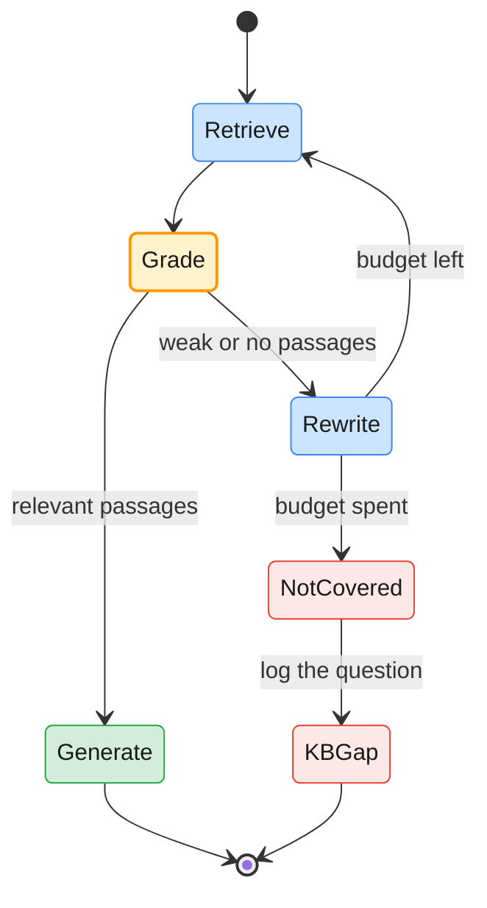

The last two states are the **knowledge management** half of T11. Every question the assistant
cannot answer from the sources is a gap in the knowledge base: log the query, the retrieved IDs
and the scores, and route recurring gaps to the owning team as KB tasks. The assistant then
improves the knowledge base it depends on.

> **Production baseline:** Give the agent a search budget (for example three per turn) and a turn
> budget (Module 2 §4.3), log every query with its retrieved IDs, and evaluate it on the same
> labelled queries as 2-step RAG. If the agent does not beat the fixed pipeline on your set, ship
> the fixed pipeline. Module 4 turns these loops into explicit LangGraph patterns.

---

## 11. Hands-on lab: RAG pipelines, retrieval tuning, connectors and agentic RAG

> **Preview:** At the time of writing, `labs/module-03/` has not been generated. This section
> follows the course-map lab plan and the shared environment in `labs/setup/`; the guide's code
> ran against a 20-document synthetic corpus in the same front-matter format. When
> `labs/module-03/README.md` lands, update this section to the real commands, files and outputs.

| Lab | Title | Covers | Time |
| --- | ----- | ------ | ---- |
| 01 | Building a RAG pipeline with LangChain and LlamaIndex | H1 (45), H2 (30) | 75 min |
| 02 | Tuning and evaluating retrieval | H3 (30), H4 (30) | 60 min |
| 03 | Enterprise connectors and use-case assistants | H5 (45), H6 (45) | 90 min |
| 04 | Agentic RAG and fine-tuning decisions | H7 (25), fine-tuning workshop (30, from the delivery schedule) | 55 min |

### Setup

The Module 3 packages are already pinned in `labs/setup/requirements.txt` (`llama-index-core`
0.14.25, the OpenAI and Anthropic LLM and embedding integrations, `faiss-cpu` 1.15.1, `chromadb`
1.5.9):

```bash
# (terminal) - from the repo root, venv active
python labs/setup/check_env.py --module 3
```

Without an OpenAI key, the labs embed with the local Sentence Transformers model from Module 1
(`ST_MODEL`). The connector readers, `peft` and `unstructured-client` are not pinned: Lab 03 runs
on the exports in `data/` and shows live readers only as instructor demonstrations.

### Lab 01 — Building a RAG pipeline with LangChain and LlamaIndex (H1 45 min, H2 30 min)

- **H1.** Ingest, chunk, embed and index the support-doc corpus, and answer with citations through the LCEL chain on `LLM_PROVIDER=openai`, then `anthropic` (§2.3). Run the Claude `search_result` and OpenAI schema variants side by side, and validate every cited ID (§2.4).
- **H2.** Rebuild the pipeline with LlamaIndex on the same documents (§8.1). Record lines of code, the retrieved sources and your verdict on developer experience and answer quality (§8.2).

### Lab 02 — Tuning and evaluating retrieval (H3 30 min, H4 30 min)

- **H3.** Compare fixed and semantic chunking on the same document set, adding structure-aware and hierarchical chunking if time allows (§5.2, §5.3). Fill in the chunking workbook, including one answer per strategy read by a person.
- **H4.** Score dense, keyword, hybrid and re-ranked retrieval on the labelled test queries (§7.2), judge answer relevance on both providers (§7.4), and complete the retrieval eval rubric (§7.5) with your chosen configuration.

### Lab 03 — Enterprise connectors and use-case assistants (H5 45 min, H6 45 min)

- **H5.** Connect the pipeline to the SharePoint and Confluence exports in `data/`; where the instructor has a sandbox tenant, show the live Hub reader (§9.2). Carry access metadata into the index and prove the trimming with two users (§6.1).
- **H6.** Build the policy-search and customer-support assistants from the shared pattern (§9.4). Add a score floor and unanswerable questions, and show each assistant refusing what it should.

### Lab 04 — Agentic RAG and fine-tuning decisions (H7 25 min, workshop 30 min)

- **H7.** Wrap the retriever as `search_knowledge` (§10.2). Record searches per task and cited IDs on both providers, and compare accuracy and cost with the 2-step pipeline on the labelled queries.
- **Fine-tuning decision workshop (from the delivery schedule).** In teams, complete the fine-tuning decision canvas for four scenarios (§3.5) using §3.3 and §3.4, and present one decision with the evaluation that would overturn it.

### What you should observe

| Observation | Concept | Where it's covered |
| ----------- | ------- | ------------------ |
| Vector search misses `CHG-20931`; keyword search misses paraphrases | Complementary retrievers | §6.2, §7.2 |
| Hybrid fixes one query and loses another; re-ranking recovers both | Fusion is not monotonic | §6.3, §7.2 |
| Tiny chunks top the precision table but answer poorly | Retrieval metrics vs answer quality | §5.3, §7.4 |
| Top-4 retrieval misses half of a two-part question, and the model declines that half | Grounding; query decomposition | §2.4, §10.3 |
| `chunk_size` means characters in one library and tokens in the other | Library conventions | §5.2, §8.2 |
| Asking Claude for a typed schema drops its citations | Citations vs structured outputs | §2.4 |
| A filtered assistant answers from weak neighbours | Score floors; unanswerable queries | §9.4 |
| The agent skips search for "thanks" and may search twice for a two-document question | Agentic RAG | §10.2 |

---

## 12. Bridging to the rest of the course

| Question this module raises | Answered in |
| --------------------------- | ----------- |
| How do I turn retrieve → grade → rewrite into an explicit, testable workflow? | Module 4: LangGraph and the ReAct, Reflection and Plan-and-Execute patterns (T2–T5) |
| How do several agents share one knowledge layer? | Module 4: supervisor orchestration (T7) |
| Can agents reach SharePoint, Confluence and Jira without bespoke connectors? | Module 4: MCP for enterprise data sources (T9, T10) |
| How do I remember what a user asked last week? | Module 4: long-term and episodic memory (T12) |
| How do I keep retrieved text within the context budget across a long session? | Module 4: context engineering (T13) |
| How do I stop instructions hidden in documents from steering the agent? | Module 5: AI risks and guardrails (T4, T5) |
| How do I enforce role, team and region on retrieval, not only on tools? | Module 5: access control and data safety (T7) |
| How do I measure groundedness and run evals continuously? | Module 5: evaluation frameworks (T11) |
| Where do managed fine-tuning and hosted vector search fit? | Module 5: cloud deployment and LLMOps (T1, T3) |

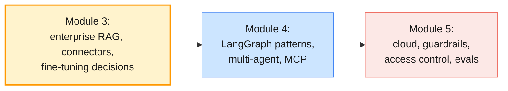

---

## 13. Key takeaways

1. **RAG is search plus generation:** The answer can only be as good as what retrieval returns, so measure retrieval first and the answers second.
2. **Choose by the gap:** Missing knowledge calls for RAG (or stuffing, for a small, stable corpus); missing behaviour calls for prompts first and fine-tuning last.
3. **Fine-tuning moved to open weights:** OpenAI is winding down its fine-tuning API and no current Claude model can be fine-tuned, so in 2026 fine-tuning means LoRA or QLoRA on a model you host.
4. **A vector database is an operational choice:** FAISS is a library, Chroma a database you run, Pinecone a service; residency, deletes and filtering decide before benchmarks do.
5. **Chunking trades precision for context:** Compare strategies with one harness, read the answers, and prefer structure-aware chunks for well-formatted documents.
6. **Metadata is your access control:** Filter by audience, team and region before ranking, from the caller's identity, never from the model.
7. **Hybrid retrieval and re-ranking cover each other's blind spots:** Keywords find identifiers, vectors find paraphrases, a cross-encoder fixes the order; none of it is monotonic, so measure.
8. **Evaluate with labelled queries, including unanswerable ones:** Precision, recall and MRR for retrieval, a judge for answer relevance, and a correct refusal counts as a pass.
9. **Cite, then verify the citation:** Claude's `search_result` blocks, or a schema with `cited_ids` on both providers, always checked against what was retrieved.
10. **Connectors are pipelines, and retrieval can be a tool:** Sync deltas, deletes and access lists from enterprise sources; give an agent the retriever when questions vary, within a search budget.

---

## 14. Glossary

| Term | Definition |
| ---- | ---------- |
| **Retrieval-augmented generation (RAG)** | Retrieving relevant passages at query time and supplying them to the model as the basis for its answer |
| **Prompt stuffing** | Placing the whole corpus in every prompt instead of retrieving from it |
| **Grounding** | Constraining an answer to the supplied sources, including saying when they do not answer |
| **Fine-tuning** | Continuing a model's training on your examples to change its default behaviour |
| **PEFT** | Parameter-efficient fine-tuning: training a small number of added parameters while the base model stays frozen |
| **LoRA / QLoRA** | Training low-rank update matrices beside frozen weights / doing so on a 4-bit quantised base |
| **Instruction tuning** | Fine-tuning on instruction-response pairs so that a model follows instructions |
| **Embedding model** | A model that maps text to a vector so that similar meanings lie close together |
| **Vector database** | A store that indexes vectors for nearest-neighbour search, with metadata, persistence and filtering |
| **ANN / HNSW** | Approximate nearest-neighbour search / its most common graph-based index |
| **Chunk / chunk overlap** | The unit of text that is embedded, retrieved and cited / text repeated between neighbouring chunks |
| **Semantic chunking** | Splitting where the embedding distance between neighbouring sentences jumps |
| **Hierarchical (auto-merging) retrieval** | Retrieving small leaf chunks and returning their parent when enough siblings match |
| **Security trimming** | Restricting retrieval to chunks the caller is entitled to see, before ranking |
| **Contextual retrieval** | Prepending chunk-specific context to each chunk before embedding and keyword indexing |
| **BM25** | A keyword ranking function based on term frequency, inverse document frequency and length |
| **Hybrid retrieval / RRF** | Combining keyword and vector retrieval / merging rankings by summing 1 / (constant + rank) |
| **Cross-encoder (re-ranker)** | A model that scores a query and a passage together, used to re-order candidates |
| **Precision@k / recall@k** | The share of the top k that is relevant / the share of relevant items found in the top k |
| **MRR** | Mean reciprocal rank: the average of 1 / the rank of the first relevant result |
| **Answer relevance / groundedness** | Whether an answer addresses the question / whether every claim is supported by the sources |
| **Connector / delta sync** | A pipeline from an enterprise source into the index / pulling only what changed since a checkpoint |
| **Agentic RAG** | Retrieval exposed as a tool that an agent calls when, and as often as, it decides to |
| **Corrective retrieval** | Grading retrieved passages and re-querying or falling back when they are weak |

---

## 15. References

**OpenAI**

- Embeddings — <https://developers.openai.com/api/docs/guides/embeddings>
- Retrieval — <https://developers.openai.com/api/docs/guides/retrieval>
- File search — <https://developers.openai.com/api/docs/guides/tools-file-search>
- Model optimization — <https://developers.openai.com/api/docs/guides/model-optimization>
- Supervised fine-tuning — <https://developers.openai.com/api/docs/guides/supervised-fine-tuning>
- Deprecations (including the self-serve fine-tuning timeline) — <https://developers.openai.com/api/docs/deprecations>

**Anthropic**

- Search results (citations for RAG) — <https://platform.claude.com/docs/en/build-with-claude/search-results>
- Citations — <https://platform.claude.com/docs/en/build-with-claude/citations>
- Embeddings — <https://platform.claude.com/docs/en/build-with-claude/embeddings>
- Model deprecations — <https://platform.claude.com/docs/en/about-claude/model-deprecations>
- Contextual retrieval in AI systems (Anthropic) — <https://www.anthropic.com/engineering/contextual-retrieval>

**LangChain**

- Retrieval — <https://docs.langchain.com/oss/python/langchain/retrieval>
- Text splitter integrations — <https://docs.langchain.com/oss/python/integrations/splitters>
- Vector store integrations — <https://docs.langchain.com/oss/python/integrations/vectorstores>
- `langchain-community` sunset announcement — <https://github.com/langchain-ai/langchain-community/issues/674>

**LlamaIndex**

- Starter tutorial (using OpenAI) — <https://developers.llamaindex.ai/python/framework/getting_started/starter_example/>
- Node parser modules — <https://developers.llamaindex.ai/python/framework/module_guides/loading/node_parsers/modules/>
- Retriever modules — <https://developers.llamaindex.ai/python/framework/module_guides/querying/retriever/retrievers/>
- Evaluating — <https://developers.llamaindex.ai/python/framework/module_guides/evaluating/>
- Integrations (formerly LlamaHub) — <https://developers.llamaindex.ai/python/framework/community/integrations>
- Confluence reader — <https://developers.llamaindex.ai/python/framework-api-reference/readers/confluence/>
- Microsoft SharePoint reader — <https://developers.llamaindex.ai/python/framework-api-reference/readers/microsoft_sharepoint/>
- Jira reader — <https://developers.llamaindex.ai/python/framework-api-reference/readers/jira/>

**Vector databases & search**

- Faiss documentation — <https://faiss.ai/>
- Guidelines to choose an index (Faiss wiki) — <https://github.com/facebookresearch/faiss/wiki/Guidelines-to-choose-an-index>
- Chroma metadata filtering — <https://docs.trychroma.com/docs/querying-collections/metadata-filtering>
- Pinecone Database — <https://docs.pinecone.io/guides/get-started/overview>
- SQLite FTS5 extension — <https://www.sqlite.org/fts5.html>

**Re-ranking, parsing & fine-tuning**

- Retrieve & re-rank (Sentence Transformers) — <https://sbert.net/examples/sentence_transformer/applications/retrieve_rerank/README.html>
- Unstructured partition endpoint, Python SDK — <https://docs.unstructured.io/api-reference/partition/sdk-python>
- PEFT (Hugging Face) — <https://huggingface.co/docs/peft/index>
- SFT Trainer (TRL) — <https://huggingface.co/docs/trl/sft_trainer>
- Customize a model with fine-tuning in Amazon Bedrock — <https://docs.aws.amazon.com/bedrock/latest/userguide/custom-model-fine-tuning.html>

**Papers**

- Lewis, P. et al. (2020). *Retrieval-Augmented Generation for Knowledge-Intensive NLP Tasks*. — <https://arxiv.org/abs/2005.11401>
- Cormack, G. V., Clarke, C. L. A. and Büttcher, S. (2009). *Reciprocal Rank Fusion outperforms Condorcet and individual Rank Learning Methods*. — <https://plg.uwaterloo.ca/~gvcormac/cormacksigir09-rrf.pdf>
- Nogueira, R. and Cho, K. (2019). *Passage Re-ranking with BERT*. — <https://arxiv.org/abs/1901.04085>
- Thakur, N. et al. (2021). *BEIR: A Heterogenous Benchmark for Zero-shot Evaluation of Information Retrieval Models*. — <https://arxiv.org/abs/2104.08663>
- Malkov, Yu. A. and Yashunin, D. A. (2016). *Efficient and robust approximate nearest neighbor search using Hierarchical Navigable Small World graphs*. — <https://arxiv.org/abs/1603.09320>
- Douze, M. et al. (2024). *The Faiss library*. — <https://arxiv.org/abs/2401.08281>
- Liu, N. F. et al. (2023). *Lost in the Middle: How Language Models Use Long Contexts*. — <https://arxiv.org/abs/2307.03172>
- Houlsby, N. et al. (2019). *Parameter-Efficient Transfer Learning for NLP*. — <https://arxiv.org/abs/1902.00751>
- Hu, E. J. et al. (2021). *LoRA: Low-Rank Adaptation of Large Language Models*. — <https://arxiv.org/abs/2106.09685>
- Dettmers, T. et al. (2023). *QLoRA: Efficient Finetuning of Quantized LLMs*. — <https://arxiv.org/abs/2305.14314>
- Wei, J. et al. (2021). *Finetuned Language Models Are Zero-Shot Learners*. — <https://arxiv.org/abs/2109.01652>
- Ouyang, L. et al. (2022). *Training language models to follow instructions with human feedback*. — <https://arxiv.org/abs/2203.02155>
- Ovadia, O. et al. (2023). *Fine-Tuning or Retrieval? Comparing Knowledge Injection in LLMs*. — <https://arxiv.org/abs/2312.05934>
- Zhang, T. et al. (2024). *RAFT: Adapting Language Model to Domain Specific RAG*. — <https://arxiv.org/abs/2403.10131>
- Asai, A. et al. (2023). *Self-RAG: Learning to Retrieve, Generate, and Critique through Self-Reflection*. — <https://arxiv.org/abs/2310.11511>
- Yan, S.-Q. et al. (2024). *Corrective Retrieval Augmented Generation*. — <https://arxiv.org/abs/2401.15884>
- Jeong, S. et al. (2024). *Adaptive-RAG: Learning to Adapt Retrieval-Augmented Large Language Models through Question Complexity*. — <https://arxiv.org/abs/2403.14403>
- Greshake, K. et al. (2023). *Not what you've signed up for: Compromising Real-World LLM-Integrated Applications with Indirect Prompt Injection*. — <https://arxiv.org/abs/2302.12173>

---

> **Next module:** _Module 4 — Multi-Agent Orchestration with LangGraph, Agentic Patterns & MCP_,
> where the retrieve-grade-rewrite loops of this module become explicit LangGraph graphs. You
> implement ReAct, Reflection and Plan-and-Execute, route work between specialist agents, reach
> Jira, Confluence and SharePoint through MCP servers, and add checkpoints and human approval to
> stateful workflows.
