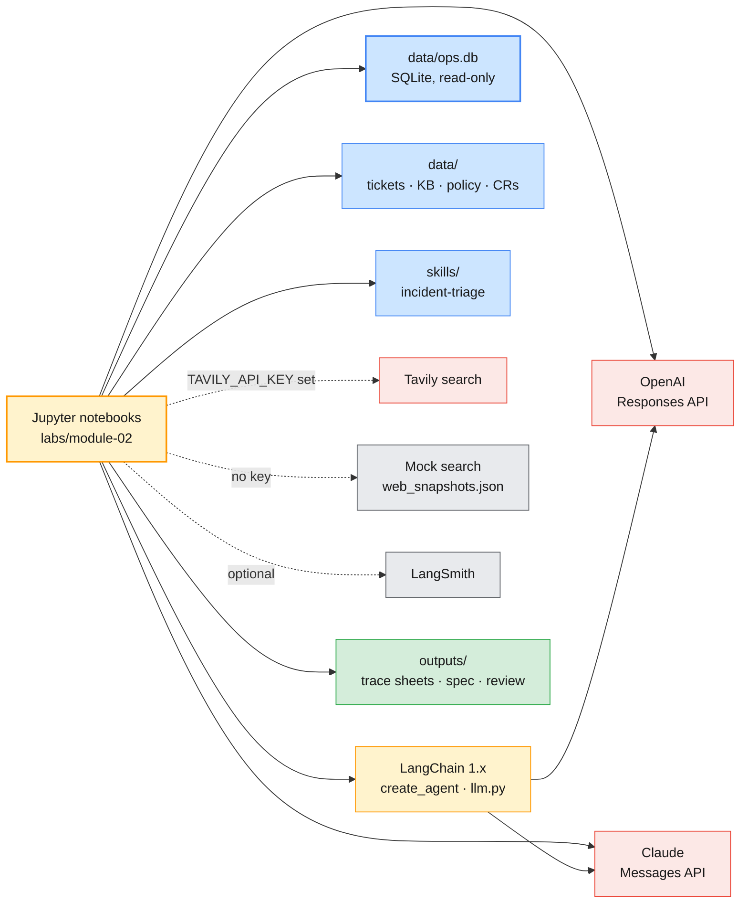

# Module 2 Labs — Prompt Engineering, OpenAI & Claude SDKs, LangChain & Single Agent

> **Course:** Agentic AI Systems Engineering (Python track)
> **Companion guide:** [`guides/module-02-prompt-engineering-sdks-langchain-single-agent.md`](../../guides/module-02-prompt-engineering-sdks-langchain-single-agent.md)
> **Module objective:** Design and build single- and multi-agent AI systems using OpenAI SDK and Anthropic Claude SDK with LangChain.

In these five labs you go from a prompt to a working enterprise assistant:

- **Lab 01** measures prompting techniques on a labelled set of IT tickets and enforces schemas on extracted documents.
- **Lab 02** builds the same tool-calling assistant on both SDKs.
- **Lab 03** packages what you learnt as a reusable Skill and an agent spec.
- **Lab 04** moves to LangChain, with tools and memory.
- **Lab 05** is the mini-project: you design, measure and justify the **Enterprise Operations Assistant**.

The labs climb from fully guided (Beginner) to a design-and-verify use case (Intermediate → Advanced), and each one reuses the last, so do them in order.

| # | Lab | Level | Time | Covers | What you will do |
| - | --- | ----- | ---- | ------ | ---------------- |
| 01 | [Prompt engineering and structured outputs](lab-01-prompt-engineering-structured-outputs.md) | Beginner | 75 min | H1, H2 | A labelled triage set and a keyword baseline, zero-shot vs few-shot vs chain-of-thought on both providers, error analysis and regression checks, prompt caching, JSON-in-the-prompt vs enforced schemas, validators, retry-and-route |
| 02 | [One assistant, two SDKs: OpenAI function calling vs Claude tool use](lab-02-one-assistant-two-sdks.md) | Beginner → Intermediate | 60 min | H3, H4 | Tool contracts, a shared dispatcher, the Responses API tool loop, streaming and time to first token, the Messages API tool loop and tool runner, three deliberate failures, the agent trace sheet |
| 03 | [Designing agents with Skills and OpenSpec](lab-03-skills-and-openspec.md) | Intermediate | 50 min | H5, H6 | A Skill loader with progressive disclosure, a sandboxed file tool, your own Skill, the OpenSpec walkthrough, a spec linter, scenarios run as tests on both providers |
| 04 | [Building a tool-enabled LangChain agent with memory](lab-04-langchain-agent-memory.md) | Intermediate | 100 min | H7, H8 | LCEL chains and batching, web search with an offline mock, a guarded read-only SQL tool, summarisation, `create_agent` with limits and a trace, buffer vs window vs summary memory |
| 05 | [Mini-project: the Enterprise Operations Assistant](lab-05-enterprise-operations-assistant.md) | Intermediate → Advanced | 75 min | H9, H10 | Agent vs workflow architectures, policy as code, an eval on both providers, context-budget and stress measurements, a written architecture review |

Estimated total: **6 hours**, exactly the outline's 360 minutes of hands-on. The module's other four hours (of ten) are the topic sessions the labs build on.

> **Scheduling.** The module table gives Module 2 ten hours; the delivery schedule puts it on Day 2
> (course map §4 #1). On a single eight-hour day, run Labs 01–03 in the morning and Labs 04–05 in the
> afternoon. Lab 03 Part 4 and Lab 05 are team exercises (3–4 people).

---

## Prerequisites

| Requirement | Check with | Notes |
| ----------- | ---------- | ----- |
| Python 3.12 or 3.13 and the course venv | `python --version` | See [`labs/setup/README.md`](../setup/README.md) |
| Course packages | `python labs/setup/check_env.py --module 2` | Pinned in `labs/setup/requirements.txt` (LangChain 1.4.7, `langchain-openai` 1.7.3, `langchain-anthropic` 1.7.6, `openai` 2.54.0, `anthropic` 1.17.0) |
| OpenAI and Anthropic keys in `.env` | `check_env.py` shows ✅ | Provided for the bootcamp; never commit `.env` |
| `LLM_PROVIDER` in `.env` | `check_env.py` shows ✅ | Labs 04–05 run on this provider through `labs/setup/llm.py`; their comparison cells also run the other one |
| `OPENAI_SMALL_MODEL` / `ANTHROPIC_SMALL_MODEL` | `check_env.py --module 1` | Lab 04's summariser uses the small model; without it, the main model summarises |
| Tavily key (optional) | `TAVILY_API_KEY` row | Without it, `web_search` uses an offline mock over `data/web_snapshots.json` and says so |
| LangSmith (optional) | `LANGSMITH_TRACING=true` plus `LANGSMITH_API_KEY` | Without it, Lab 04 writes a local trace to `outputs/lab04-trace.jsonl` |

Module 1 is not a code dependency: everything these labs read is in `data/`.

---

## Lab environment

Everything except the model APIs runs on your laptop: a SQLite operations database, the knowledge
base, the mock web search and the Skill files. Labs 01–03 call both SDKs directly, because comparing
the two APIs is the lesson. Labs 04–05 use LangChain and pick the provider from `LLM_PROVIDER`.



| Setting | Where | Used by |
| ------- | ----- | ------- |
| `OPENAI_API_KEY`, `OPENAI_MODEL` | `.env` | Every lab |
| `ANTHROPIC_API_KEY`, `ANTHROPIC_MODEL` | `.env` | Every lab |
| `LLM_PROVIDER` (`openai` or `anthropic`) | `.env` | Labs 04–05 (through `labs/setup/llm.py`) |
| `OPENAI_SMALL_MODEL`, `ANTHROPIC_SMALL_MODEL` | `.env` | Lab 04's `summarise` tool and summary memory |
| `TAVILY_API_KEY` | `.env` (optional) | Lab 04's `web_search` and `ops_assistant.tools.web_search` |
| `LANGSMITH_TRACING`, `LANGSMITH_API_KEY` | `.env` (optional) | Lab 04 tracing |

| Folder | Contents |
| ------ | -------- |
| `notebooks/` | Starter notebooks: run as-is; `TODO` functions raise `NotImplementedError` until you write them |
| `solutions/` | Reference notebooks, plus `enterprise-ops-assistant.spec.md` (the Lab 03 reference spec) |
| `data/` | `triage_tickets.csv` (labelled set), `triage_policy.md` (POL-OPS-004), `change_requests/` (5 documents + gold), `kb_articles.json`, `incidents.json`, `service_status.json`, `web_snapshots.json`, `support_conversation.json`, `eval_incidents.json`, `model_prices.json`, `openspec/` (the partial spec), `build_ops_db.py` |
| `templates/` | `agent-trace-sheet.md` (Lab 02), `openspec-template.md` (Lab 03), `architecture-review.md` (Lab 05) |
| `skills/` | `incident-triage/`: the example Agent Skill (`SKILL.md`, `reference/`, `scripts/check_triage.py`) |
| `ops_assistant/` | The Lab 05 reference solution as a package; **Module 5 Lab 03 imports it**. Read it after Lab 05 |
| `uv-projects/` | The five labs as standalone uv projects for terminal demos (`uv run lab01 all`); see its [README](uv-projects/README.md) |

### Everyday commands

```bash
# (terminal) - from the repo root
source .venv/bin/activate
python labs/setup/check_env.py --module 2
python labs/module-02/data/build_ops_db.py     # optional: Labs 04-05 build it on first run
jupyter lab labs/module-02/notebooks/          # or open the folder in VS Code
```

To run Labs 04–05 on the other provider, change `LLM_PROVIDER` in `.env` and restart the kernel.

> **Convention used in the labs**
>
> - `# (terminal)`: run in a shell with the course venv active, from the folder the block names.
> - `# (notebook)`: a cell in the lab's starter notebook.
> - **Expected** output is deterministic: fixed data and code, and the pinned versions. **Output
>   shape** and **Representative output** come from a model and vary from run to run; the guides'
>   representative numbers were recorded with `gpt-5-mini` and `claude-haiku-5-5`.
> - Check cells print ✅ (passed), ⏳ (your TODO is not done yet) or ⚠️ (skipped or a finding, with the reason).

---

## Troubleshooting

| Symptom | Likely cause | Fix |
| ------- | ------------ | --- |
| `400 … This model does not support assistant message prefill` | A pre-filled assistant turn (the old "start the reply with `{`" trick) on a current Claude model | Use structured output (`output_format=` / `output_config.format`); Lab 01 Part 4 |
| `400 … Unknown parameter: 'input[2].parsed_arguments'` | OpenAI items echoed back from `responses.stream(...).get_final_response()` carry a client-side field | `item.model_dump(exclude_none=True, exclude={"parsed_arguments"})`; Lab 02 Part 3 |
| `400 … 'additionalProperties' is required to be supplied and to be false` (OpenAI) or `For 'object' type, 'additionalProperties' must be explicitly set to false` (Claude) | A `strict: true` tool schema without `"additionalProperties": false` | Add it to every object, and list every property in `required` (make optional ones nullable) |
| `400 … Invalid signature in thinking block. The block is bound to a different conversation` | Claude: history was trimmed or summarised under a turn that still carries its thinking block | Strip thinking from earlier turns, and summarise only at turn boundaries; Lab 04 Part 5 |
| `400` on `tool_choice={"type": "tool", …}` with Claude Opus 5.5, Sonnet 5.5 or Fable 5.1 | Those models reject forced tool choice (Haiku 5.5 accepts it) | Use `auto`, steer with the prompt, keep `strict: true`, and check that a tool call came back |
| `ProviderConfigError: ANTHROPIC_MODEL is not set …` | `LLM_PROVIDER` names a provider whose key or model is missing | Fill in `.env`, then restart the kernel |
| `⚠️ skipped change-request-extraction: name … must match the folder name` | The Skill's frontmatter `name` and its folder differ | Rename one so they match; Lab 03 Part 2 |
| OpenAI reports `cached_tokens = 0` on repeated calls | The prefix is under 1,024 tokens, or the calls came too close together for the cache to be written | Keep a long, byte-identical prefix and a `prompt_cache_key`; caching is best-effort |

---

## Cleaning up after the module

```bash
# (terminal) - from labs/module-02
ls outputs/                 # trace sheets, your spec, your Skill, the architecture review: keep what you need
rm -rf outputs              # git-ignored; the notebooks recreate it
rm -f data/ops.db           # git-ignored; build_ops_db.py recreates it identically
```

Keep `outputs/enterprise-ops-assistant.spec.md` and `outputs/architecture-review.md`. **Module 3**
replaces the keyword `search_kb` with retrieval over the knowledge base, policies and documentation,
behind the same tool contract. **Module 5 Lab 03** imports `ops_assistant/` to add guardrails,
tracing and an evaluation harness, and reuses `data/eval_incidents.json`.
