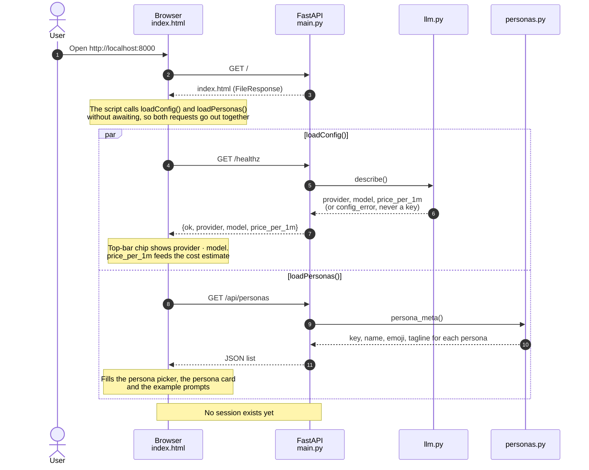
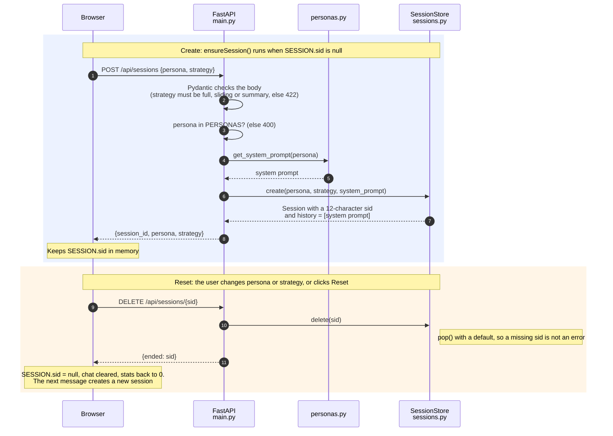
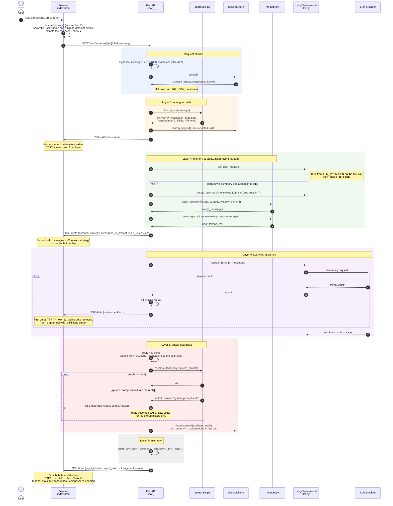
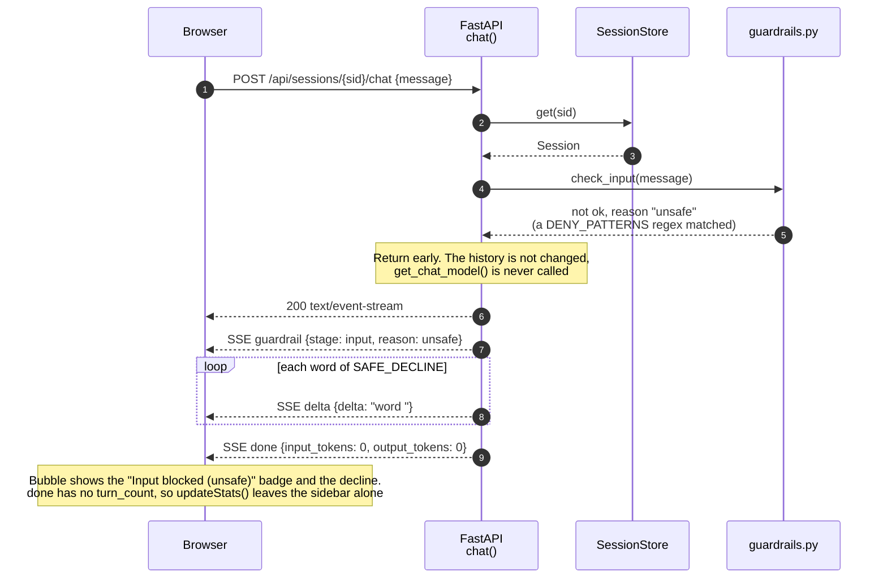
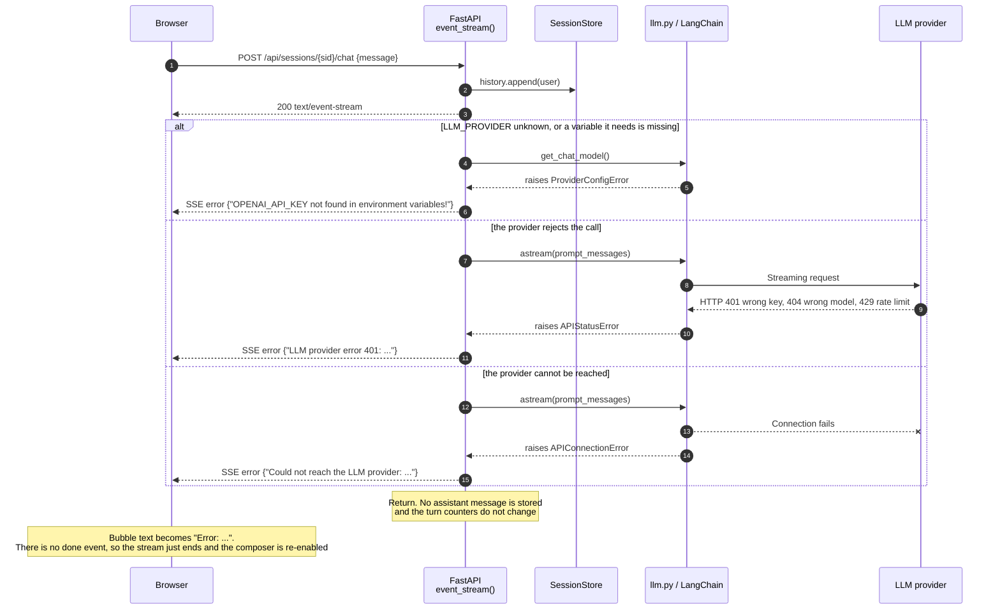
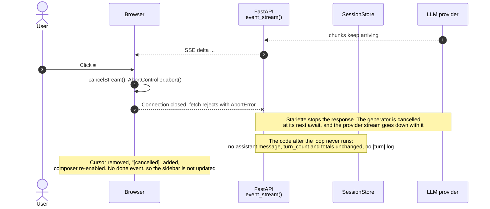
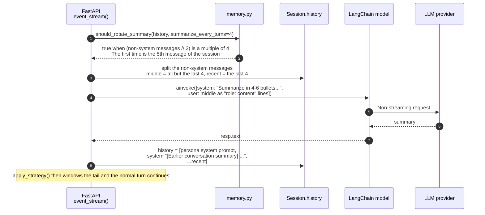

# Request / Response Flow

Sequence diagrams for the web chatbot, from page load to a streamed reply. Each diagram follows the code as written, so you can read a diagram next to the file it names.

| Participant | File | Role |
| --- | --- | --- |
| Browser | `static/index.html` | Chat UI. Reads the reply with `fetch` and a stream reader (not `EventSource`, because the chat call is a `POST`). |
| FastAPI | `app/main.py` | Routes, and the order of steps in one chat turn. |
| guardrails | `app/guardrails.py` | `check_input` before the model, `check_output` after it. |
| SessionStore | `app/sessions.py` | In-memory `dict` of sessions. Each holds the history and the token counters. |
| memory | `app/memory.py` | Memory strategies and token estimates. |
| personas | `app/personas.py` | System prompts and the picker metadata. |
| llm.py / LangChain model | `app/llm.py` | `get_chat_model()` builds a `ChatOpenAI` or `ChatAnthropic` from `LLM_PROVIDER`. |
| LLM provider | — | OpenAI, Anthropic, Azure OpenAI, or Claude on Microsoft Foundry. |

Contents: [1. Page load](#1-page-load) · [2. Session lifecycle](#2-session-lifecycle) · [3. A chat turn](#3-a-chat-turn-happy-path) · [4. Input blocked](#4-input-guardrail-blocks-the-message) · [5. Errors](#5-provider-and-configuration-errors) · [6. Cancel](#6-cancel-mid-stream) · [7. Summary rotation](#7-running-summary-rotation) · [Behaviours worth knowing](#behaviours-worth-knowing)

---

## 1. Page load

Nothing here needs an API key. The model is not built until the first chat turn.

---

## 2. Session lifecycle

A session is created lazily on the first message, and dropped when the user changes persona or memory strategy.

`GET /api/sessions/{sid}` is a debugging endpoint. It returns the persona, strategy, turn count, history length and token totals, or 404 for an unknown `sid`. The UI does not call it.

---

## 3. A chat turn (happy path)

The reply is a Server-Sent Events stream. The seven-layer labels match the comments in `main.py`.

### The SSE contract

Every event is one line, `data: {json}`, followed by a blank line. The client splits the byte stream on `\n\n`.

| `event` | Sent when | Client reaction |
| --- | --- | --- |
| `meta` | Once, before the model call | Shows the prompt size under the bubble |
| `delta` | Once per chunk | Appends `delta` to the bubble. The first one records TTFT |
| `guardrail` | Input blocked (before the deltas) or output blocked (after them) | Sets an "Input blocked" or "Output blocked" badge |
| `done` | Last event of a finished turn | Final bubble, timings, sidebar stats |
| `error` | Config or provider failure | Replaces the bubble with `Error: ...` |

---

## 4. Input guardrail blocks the message

The cheapest path. The model is never built and no tokens are spent. The decline text is streamed word by word so the UI behaves like a normal reply.

---

## 5. Provider and configuration errors

Once streaming has started the HTTP status is already sent, so a failure cannot become a 500. It becomes an `error` event instead.

A provider error from `astream` arrives after the `meta` event, and can arrive after some `delta` events. The error replaces whatever text was already on screen.

---

## 6. Cancel mid-stream

---

## 7. Running-summary rotation

An extra, non-streaming model call that runs before the `meta` event when the strategy is `summary`. The user waits for it, so it adds to time-to-first-token on that turn.

---

## Behaviours worth knowing

These follow from the order of steps in the diagrams.

- **The user message is stored before the model runs.** If the call fails (section 5) or the user cancels (section 6), the history ends with a user message that has no reply. The next turn sends both user messages to the model.
- **A blocked input is not stored.** Section 4 never touches the history or the counters, so a blocked message does not count as a turn.
- **The output guardrail cannot take back streamed text.** `check_output` runs after the last `delta`, so the client has already shown the reply. The `guardrail` event adds a badge, and `SAFE_DECLINE` replaces the reply only in the stored history, so the model never sees it on later turns.
- **Summary rotation counts messages, not turns.** After a rotation the history is shorter, so the next rotation does not land four turns later. A rotation also rebuilds the history from the persona prompt, the new summary and the last four messages, so the previous summary is not carried into the next one.
- **Sessions live in the server process.** After a restart (including a `--reload`), the browser still holds the old `sid`. Every message gets a 404 and the bubble shows the error until the user clicks Reset or changes persona.
