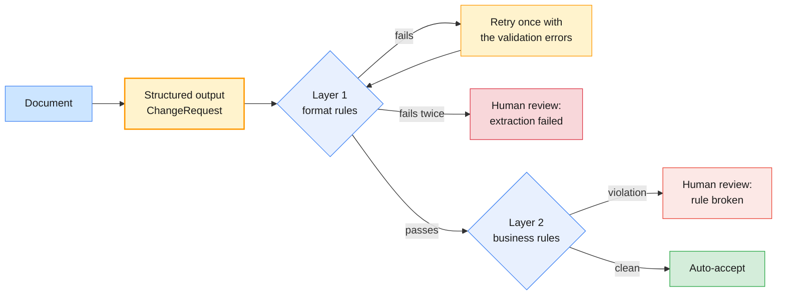

# Lab 01 — Prompt engineering and structured outputs

| | |
| --- | --- |
| **Level** | Beginner |
| **Duration** | ~75 minutes |
| **Covers** | H1 Prompt optimisation lab: zero-shot vs few-shot vs CoT on IT support-ticket triage, tested on OpenAI and Claude (45 min) · H2 Structured output generation: JSON schema enforcement on document extraction, OpenAI + Claude (30 min) |
| **Guide sections** | §2.2 Zero-shot, few-shot, chain-of-thought, role and instruction prompting · §2.3 Prompt templates · §2.4 Prompt debugging · §3.1 Designing the schema as a contract · §3.2 Enforcing the schema on both SDKs · §3.3 Validation beyond the schema · §6.1 Token budgeting · §6.2 Prompt caching |
| **Notebook** | [`notebooks/lab-01-prompt-engineering-structured-outputs.ipynb`](notebooks/lab-01-prompt-engineering-structured-outputs.ipynb) · solution in [`solutions/`](solutions/lab-01-prompt-engineering-structured-outputs.ipynb) |
| **You will need** | The course venv and `.env` from [`labs/setup/`](../setup/README.md); both API keys. About 300 small model calls in total (cents on a small or balanced model). |
| **Artefact** | [`data/triage_tickets.csv`](data/triage_tickets.csv): the labelled ticket set for triage scoring, reused in Labs 03 and 05 |

## Learning objectives

By the end of this lab you will be able to:

1. **Score** an LLM classifier against a labelled set and a non-LLM baseline, per field, and read a confusion matrix.
2. **Compare** zero-shot, few-shot and chain-of-thought prompting on two providers, on accuracy, output tokens and latency.
3. **Debug** a prompt from its errors: find the failing tickets, name the missing instruction, fix it in a new template version and check for regressions.
4. **Price** a prompt template with each provider's token counter and **observe** prompt caching on a stable prefix.
5. **Explain** why asking for JSON in the prompt is not enough, and **enforce** a schema with OpenAI `text_format` and Claude `output_format`.
6. **Separate** format errors (retry with feedback) from business-rule violations (route to a person) with Pydantic validators.

---

## Part 1 — The labelled ticket set and a baseline to beat (10 min)

You cannot improve a prompt you do not measure. This part sets up the measuring stick.

Run the **setup cell** first. It reads `.env`, creates both SDK clients and prints a line per provider:

**Expected** (your path and model IDs may differ):

```
Lab folder : /…/agentic-ai-python/labs/module-02
OpenAI     : ✅ gpt-5-mini
Claude     : ✅ claude-haiku-5-5
```

> **Common trap:** you edited `.env` but the cell still shows ❌. The file is read when the kernel
> starts. Restart the kernel and run the setup cell again.

[`data/triage_tickets.csv`](data/triage_tickets.csv) holds 30 synthetic tickets labelled under
[`data/triage_policy.md`](data/triage_policy.md) (POL-OPS-004): 6 worked examples for few-shot
prompts and 24 test tickets. Each row has a gold `category`, `priority` and `assignment_group`,
plus a `rationale` that explains the label.

**Expected:**

```
6 examples · 24 test tickets · languages {'en': 22, 'fr': 1, 'es': 1}
priorities: {'P1': 4, 'P2': 5, 'P3': 6, 'P4': 9}
```

The policy is a two-step rule an engineer would recognise from any ITSM tool:

| Impact \ Urgency | High | Medium | Low |
| ---------------- | ---- | ---- | --- |
| **High** (site, service, 20+ users) | P1 | P2 | P3 |
| **Medium** (team, 2–19 users) | P2 | P3 | P4 |
| **Low** (one user) | P3 | P4 | P4 |

It has two overrides: a *confirmed* security incident is at least P2, and seniority or tone never
changes the priority. The test set has tickets aimed at each rule, for example a lost laptop
(security, not endpoint), a director demanding P1 for a low mouse battery, and a phishing email that
nobody clicked (reported, so not confirmed).

The label contract is a Pydantic model with `Literal` fields, so an invalid label cannot even be constructed:

```python
# (notebook)
class TriageLabel(BaseModel):
    category: Category              # Literal["access", "network", "endpoint", …]
    priority: Priority              # Literal["P1", "P2", "P3", "P4"]
    assignment_group: Group         # Literal["Service Desk", "Network Ops", …]
```

`score()` returns the accuracy per field and for all three fields at once. Then you score a ten-line
keyword baseline: no model, just `if "vpn" in text`.

**Expected:**

```
keyword baseline: {'category': 0.958, 'priority': 0.333, 'assignment_group': 0.875, 'all three': 0.25}
```

What to notice:

- Keywords get the **category** almost right: the vocabulary of IT tickets is distinctive.
- Keywords get **priority** wrong two times in three. Priority needs judgement about impact and
  urgency, so that is where an LLM has to earn its cost.

**Expected:** `✅ Part 1 — labelled set and scorer`

---

## Part 2 — Zero-shot vs few-shot vs chain-of-thought, on both providers (20 min)

You run three prompting techniques on the same 24 tickets, on both providers, and measure what each one buys.

All three templates share a **role** ("You are an L1 service-desk analyst…") and a **short label
guide**: the category names with a few words each, `P1 critical · P2 high · P3 medium · P4 low`, and
the five assignment groups. They differ only in technique:

| Template | Adds | Schema |
| -------- | ---- | ------ |
| `zero-shot v1` | Nothing | `TriageLabel` |
| `few-shot v1` | The 6 worked examples, XML-tagged, in the system prompt | `TriageLabel` |
| `chain-of-thought v1` | Three reasoning steps (who is affected, is work stopped, any security aspect) | `TriageWithReasoning`: a `reasoning` field **before** the labels |

The templates are data, not f-strings scattered through code:

```python
# (notebook)
@dataclass(frozen=True)
class PromptTemplate:
    name: str
    version: str
    system: str
    user: str = "<ticket>\n$ticket\n</ticket>"
    schema: type[BaseModel] = TriageLabel

    def render(self, ticket: str) -> tuple[str, str]:
        return self.system, Template(self.user).substitute(ticket=ticket)
```

> **Bridge from what you know:** a prompt template is configuration. Give it a name and a version,
> review changes to it, and keep a test set that runs whenever it changes, as you would for a
> feature flag or a SQL migration.

`classify()` makes one call with the template's schema enforced, using structured output (Part 4
explains it). Without structured output, parsing failures would blur the comparison. The two calls
side by side:

```python
# (notebook)
openai_client.responses.parse(model=OPENAI_MODEL, instructions=system, input=user,
                              text_format=template.schema, reasoning={"effort": "low"}, max_output_tokens=4_000)
claude_client.messages.parse(model=ANTHROPIC_MODEL, max_tokens=4_000, system=system, output_config={"effort": "low"},
                             output_format=template.schema, messages=[{"role": "user", "content": user}])
```

The run is 3 techniques × 24 tickets × 2 providers = 144 calls, 8 at a time on a thread pool.

**Representative output** (recorded with `gpt-5-mini` and `claude-haiku-5-5`; your numbers will differ):

```
144 calls in 37s
    provider         technique version  category  priority  assignment_group  all three  errors  avg output tokens  avg s
0          —  keyword baseline       —     0.958     0.333             0.875      0.250     NaN                NaN    NaN
1     openai         zero-shot      v1     1.000     0.375             0.958      0.375     0.0              110.0    2.0
2     openai          few-shot      v1     0.958     0.625             0.958      0.583     0.0              107.0    1.8
3     openai  chain-of-thought      v1     1.000     0.458             0.958      0.458     0.0              218.0    3.1
4  anthropic         zero-shot      v1     1.000     0.583             0.958      0.542     0.0               32.0    1.6
5  anthropic          few-shot      v1     1.000     0.667             1.000      0.667     0.0               34.0    1.4
6  anthropic  chain-of-thought      v1     1.000     0.625             1.000      0.625     0.0              184.0    2.3
```

What to notice:

- **Few-shot gave the biggest gain, and almost all of it on priority.** The examples carry the
  policy implicitly: one user with a workaround is P4, a whole floor is P2.
- **Chain-of-thought roughly doubled the output tokens and the latency** and helped less than
  few-shot. These are reasoning models: they already think before they answer (`effort: low`), so
  a written-out chain adds cost more than accuracy. On a non-reasoning model the result can differ.
  Measure it; don't assume.
- Every technique beats the keyword baseline on priority, but none gets past two-thirds. The
  ceiling is not the technique. Part 3 finds out what it is.

> **Common trap:** comparing techniques on three hand-picked tickets. With 24 tickets one ticket is
> 4 percentage points, so differences under about 8 points between two runs can be noise. Run
> twice before you believe a small difference, and keep the test set fixed.

📝 Fill in the **Record (Part 2)** table in the notebook.

**Expected:** `✅ Part 2 — technique comparison`

---

## Part 3 — Debug the prompt, then price it (15 min)

You find out *why* the best prompt still misses, fix it, check that the fix breaks nothing, and put a cost on each version.

### 3.1 Error analysis

The first cell counts, for every ticket, how many of the 6 runs (3 techniques × 2 providers) got each field wrong, and prints a confusion matrix for priority.

**Representative output** (abridged):

```
Wrong-label counts out of 6 runs per ticket:
            category_wrong  priority_wrong  assignment_group_wrong  total   priority  rationale
INC-104429               0               6                       3      9        P4  Folder permissions are access. One user, a future need: P4.
INC-104411               0               6                       0      6        P3  One user, work stopped with a deadline now (high urgency): P3.
INC-104416               0               6                       0      6        P4  One user, degraded (medium urgency): P4.
…
predicted  P1  P2  P3  P4
gold
P1         24   0   0   0
P2          9  21   0   0
P3          2  18  15   1
P4          0   3  31  20
```

Read the matrix before you read any ticket: almost every error sits **above** the diagonal. The
models are not random. They **over-prioritise**, consistently: a one-user P4 becomes P3, a P3
becomes P2. The rationale column says why the gold label is lower: "one user", "a workaround
exists". Those rules are in the policy, and the v1 prompt never gave the model the policy.

A prompt-debugging checklist, in the order that usually pays off:

| Step | Question | What you saw here |
| ---- | -------- | ----------------- |
| 1 | Is the error systematic (one direction) or scattered? | Systematic: over-prioritisation |
| 2 | Does the prompt contain the rule the gold label follows? | No: "P3 medium" is not "one user + work stopped = P3" |
| 3 | Is the label definition ambiguous to a human? | "high" vs "medium" is ambiguous without impact × urgency |
| 4 | Only then: technique (examples, reasoning steps) | Few-shot helped because the examples encode some rules |

### 3.2 v2: give the model the policy

The fix the analysis points to is an instruction, not a technique:

```python
# (notebook)
ZERO_SHOT_V2 = PromptTemplate("zero-shot", "v2", f"{ROLE}\n\nApply this policy exactly:\n<policy>\n{POLICY}\n</policy>")
FEW_SHOT_V2 = PromptTemplate("few-shot", "v2", f"{ZERO_SHOT_V2.system}\n\nLabelled examples, with the reason for each label:\n"
                             f"{examples_block(EXAMPLES, with_reason=True)}")
```

**Representative output** (v2 rows only):

```
    provider  technique version  category  priority  assignment_group  all three  avg output tokens
7     openai  zero-shot      v2     1.000     0.917             1.000      0.917              162.0
8     openai   few-shot      v2     1.000     0.958             1.000      0.958              146.0
9  anthropic  zero-shot      v2     1.000     0.875             1.000      0.875               54.0
10 anthropic   few-shot      v2     1.000     0.792             1.000      0.792               45.0
```

"All three correct" goes from 0.38–0.67 to 0.79–0.96. Adding the policy did more than any choice of technique.

### 3.3 The regression check

```python
# (notebook)
def regressions(before, after):
    """Tickets that were fully right before and are wrong after, per provider and technique."""
```

**Representative output:**

```
4 regression(s) from v1 to v2
     provider  technique   ticket_id  ok_v1  ok_v2
61     openai   few-shot  INC-104426   True  False
62  anthropic  zero-shot  INC-104426   True  False
63  anthropic   few-shot  INC-104426   True  False
83  anthropic   few-shot  INC-104431   True  False
```

`INC-104426` is the file server at 91% with "no impact yet": the policy says high impact, low
urgency, so P3. With the policy in hand, the models now read "a whole service is at risk" as more
urgent than the policy allows. A fix that helps 10 tickets and breaks 1 can still be the right
fix, but you only know that because you checked. The optional `MY_TEMPLATE` cell is where you try
a v3.

> **Production habit:** keep every template version and its scores together. Treat a prompt change
> like a code change: a diff, a test run on the fixed set, and a regression list in the review.

### 3.4 What a template costs, and prompt caching

The token cell counts one rendered prompt with each provider's own counter
(`responses.input_tokens.count`, `messages.count_tokens`).

**Representative output:**

```
                     openai  anthropic
template
zero-shot v1            186        294
few-shot v1             586        944
chain-of-thought v1     248        376
zero-shot v2            902       1373
few-shot v2            1484       2284
```

The same text costs more tokens on Claude: each provider has its own tokeniser, so always count with
the provider you will call. Few-shot v2 is eight times the prompt of zero-shot v1, and it is identical
for every ticket. That makes it a cacheable prefix:

| | OpenAI | Claude |
| --- | --- | --- |
| How | Automatic for prompts of 1,024+ tokens; `prompt_cache_key` routes requests to the same cache | A `cache_control` breakpoint on the system block (or top-level automatic caching with `messages.create`) |
| Where you see it | `usage.input_tokens_details.cached_tokens` (included in `input_tokens`) | `usage.cache_creation_input_tokens` and `cache_read_input_tokens` (not included in `input_tokens`) |
| Price | Cache reads at 10% or less of the input price (see `data/model_prices.json`) | Cache writes at 1.25× input; reads at 10% of input on Claude Haiku 5.5, 5% on Claude Opus 5.5 |

**Representative output** (four calls per provider, two seconds apart):

```
   call   provider  input total  read from cache  written to cache
0     1     openai         1593                0               0
1     2     openai         1585             1536               0
…
4     1  anthropic         2714                0            2661
5     2  anthropic         2711             2661               0
6     3  anthropic         2734             2661               0
```

> **Common trap:** a timestamp, a request ID or an unsorted `json.dumps` in the system prompt. Any
> byte that changes before the end of the prefix makes every request a cache miss. Put volatile
> content after the stable part. OpenAI's cache is also best-effort: in some runs every call reports
> `0` even with an identical prefix. Run the cell again before you conclude that caching is broken.

**Expected:** `✅ Part 3 — debugging and cost`

---

## Part 4 — Enforce a JSON schema on document extraction (15 min)

You extract change requests (RFCs) from emails into one schema, first by asking nicely, then by enforcing it.

[`data/change_requests/`](data/change_requests/) holds five synthetic documents: a formal RFC email,
a terse standard change, a free-text request with a back-out plan, a **German** firewall change, and
a forwarded thread that **reschedules** the change and states "high risk … we don't need CAB".
`ground_truth.json` holds the gold extraction for each.

```python
# (notebook)
class ChangeRequest(BaseModel):
    change_id: str = Field(description="Change ID exactly as written, e.g. CHG-20931")
    change_type: Literal["standard", "normal", "emergency"]
    risk: Literal["low", "medium", "high"] = Field(description="Risk level as stated in the document")
    requested_by_team: Group
    region: Literal["EU", "US", "APAC"]
    affected_services: list[str]
    window_start: datetime = Field(description="Start of the CURRENT implementation window, ISO 8601 with UTC offset")
    window_end: datetime
    cab_required: bool
    rollback_plan: str | None = Field(description="… or null if the document has none")
```

### Approach A: JSON in the prompt

The system prompt contains the JSON Schema and "Return ONLY a JSON object…". Your code does
`json.loads`, then `ChangeRequest.model_validate`.

**Representative output:**

```
    provider               approach        doc                         outcome                 starts with
0     openai  A: JSON in the prompt  CHG-20931                           valid  {\n  "change_id": "CHG-209
…
8  anthropic  A: JSON in the prompt  CHG-20934  invalid JSON (Expecting value)  ```json\n{"change_id": "CH
9  anthropic  A: JSON in the prompt  CHG-20935  invalid JSON (Expecting value)  ```json\n{"change_id": "CH
```

The content was right; the envelope was not. Two of five Claude replies came wrapped in a Markdown
code fence. You could strip fences with a regex, and then you would meet trailing commentary, a
missing field or a string where you wanted a number. Each is a new parser hack.

**Deliberate failures.** The next cell parses a reply recorded from an earlier run, then tries the
old trick of pre-filling the assistant turn with `{`:

**Expected** for the recorded reply; the 400 comes from the API (`claude-haiku-5-5`, October 2026):

```
recorded reply → invalid JSON (Expecting value)
❌ claude-haiku-5-5 → 400 BadRequestError: This model does not support assistant message prefill. The conversation must end with a user message.
```

> **Outline vs current API.** Older Claude guides used assistant prefill to force JSON. Current
> Claude models reject a conversation that ends with an assistant turn. Structured output replaces
> the trick.

### Approach B: the API enforces the schema

```python
# (notebook)
openai_client.responses.parse(..., instructions=INSTRUCTIONS, input=messages, text_format=ChangeRequest)   # → .output_parsed
claude_client.messages.parse(..., system=INSTRUCTIONS, output_format=ChangeRequest, messages=messages)     # → .parsed_output
```

Both providers compile the schema into a grammar and constrain generation to it (constrained
decoding), then the SDK validates the JSON into your Pydantic model.

**Representative output:**

```
approach   A: JSON in the prompt  B: schema enforced
provider
anthropic                      3                   5
openai                         5                   5
```

| | OpenAI Responses API | Claude Messages API |
| --- | --- | --- |
| Pydantic helper | `responses.parse(text_format=Model)` → `response.output_parsed` | `messages.parse(output_format=Model)` → `message.parsed_output` |
| Raw form | `text={"format": {"type": "json_schema", "strict": True, …}}` | `output_config={"format": {"type": "json_schema", "schema": …}}` |
| Schema rules | `additionalProperties: false` on every object; every property `required` (optional means nullable) | `additionalProperties: false` on every object; keep every property required too, so one schema serves both |
| Old alternative | JSON mode (valid JSON, any shape) | Assistant prefill: rejected by current models |

**Expected:** `✅ Part 4 — schema enforcement`

---

## Part 5 — Validate the output, retry with feedback, route what is left (15 min)

A schema guarantees the shape of the answer, not that it is true. You add two layers of checks and a routing rule.



**Layer 1** is a subclass with Pydantic validators: the ID format, timestamps with a UTC offset, and
a window that ends after it starts and lasts at most 12 hours. **Layer 2** is a plain function of
business rules: a high-risk change needs CAB, a standard change must be low risk, and a normal
change needs a rollback plan.

**Expected:**

```
layer 1 → Value error, window_end must be after window_start
layer 2 → ['high-risk change without CAB approval']
```

The distinction matters for what you do next:

| Failure | Example | Whose problem | Action |
| ------- | ------- | ------------- | ------ |
| Format (layer 1) | Window end before start; no UTC offset | The extraction | Retry once, with the error messages in the next turn |
| Business rule (layer 2) | High risk without CAB | The **document** | Route to a person; retrying cannot fix it |

`extract_with_retry()` implements the loop: on a layer-1 failure it appends the model's answer and
a user turn listing the errors, then asks again.

**Representative output:**

```
    provider        doc  attempts                                                route fields correct wrong
0     openai  CHG-20931         1                                          auto-accept            8/8
…
4     openai  CHG-20935         1  human review: high-risk change without CAB approval            8/8
…
9  anthropic  CHG-20935         1  human review: high-risk change without CAB approval            8/8
```

Both providers extracted all eight scored fields correctly, including the German document's times
and the rescheduled window in the forwarded thread. Both correctly reported `cab_required: false`
for CHG-20935, because that is what the document says. The business rule caught it. If a model
had "helpfully" set `cab_required: true`, the record would look compliant and nobody would check
it: the check cell prints a ⚠️ in that case.

> **Production habit:** keep the gold set (`ground_truth.json`) and re-run field accuracy whenever
> the prompt, the schema or the model changes. Compare windows as instants, not strings:
> `22:00+01:00` and `21:00Z` are the same time.

**Expected:** `✅ Part 5 — validation and routing`

📝 Write your 3–5 sentence **write-up** in the notebook.

---

## Checkpoint questions

<details>
<summary>1. Few-shot beat chain-of-thought in Part 2, yet both lost to a zero-shot prompt that contained the policy. What does that tell you about where to spend prompt-engineering effort?</summary>

Technique tunes how the model uses the information it has; it cannot supply information it lacks.
The v1 prompts never stated the impact × urgency matrix or the overrides, so every technique
guessed, and guessed high. Start with error analysis and the missing instructions. Then choose a
technique, and keep the one that measurably helps on your labelled set.
</details>

<details>
<summary>2. Chain-of-thought added about 100–150 output tokens per ticket and was slower. When would you still use it?</summary>

When accuracy gains on your measured set justify the cost: on a non-reasoning model, on genuinely
multi-step decisions, or when you need the reasoning for audit or debugging. With reasoning models
you get most of the benefit from the model's internal thinking, controlled by the effort setting,
without paying for written-out reasoning in every response.
</details>

<details>
<summary>3. The v2 prompt broke INC-104426, which v1 got right. Do you ship v2?</summary>

Probably yes: v2 fixed far more tickets than it broke. But you ship it knowingly: record the
regression, add a targeted example or rule (a v3) and re-run the whole set. A regression list is
what turns "it seems better" into a reviewable decision.
</details>

<details>
<summary>4. Why did two of Claude's prompt-only replies fail `json.loads` while the schema-enforced calls never did?</summary>

Asking for JSON is an instruction the model may follow loosely: here it wrapped valid JSON in a
Markdown fence. Structured output constrains decoding to the schema's grammar, so the reply cannot
be anything but a matching JSON object, and the SDK validates it into your Pydantic model. The
instruction became a contract.
</details>

<details>
<summary>5. In production, what happens to CHG-20935, and why should the extraction step not "fix" `cab_required`?</summary>

It goes to a change manager for review, with the rule it broke. The extraction's job is to report
what the document says; whether the change is allowed is a business decision. A model that silently
corrects the field hides the very non-compliance you want caught, and you could not tell a fixed
document from a compliant one.
</details>

---

## Clean up

Nothing to delete: this lab writes no files. Keep the kernel running if you go straight on. Lab 02
uses the same setup cell, and Lab 03 turns this lab's triage and extraction prompts into reusable Skills.

**Next:** [Lab 02 — One assistant, two SDKs: OpenAI function calling vs Claude tool use](lab-02-one-assistant-two-sdks.md)
