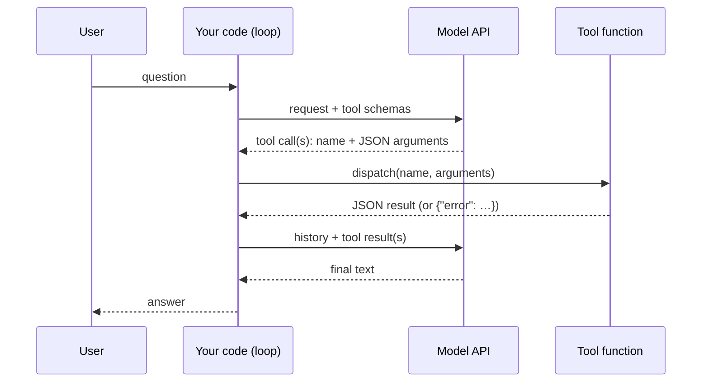

# Lab 02 — One assistant, two SDKs: OpenAI function calling vs Claude tool use

| | |
| --- | --- |
| **Level** | Beginner → Intermediate |
| **Duration** | ~60 minutes |
| **Covers** | H3 Build AI assistant with OpenAI SDK: function calling + streaming (30 min) · H4 Rebuild the assistant with Anthropic Claude SDK: tool use + streaming, compare API design (30 min) |
| **Guide sections** | §4.1 API fundamentals and model selection · §4.2 Function calling and tool use · §4.3 The agent loop in plain Python · §4.4 Streaming responses · §4.5 Comparing the API designs · §6.5 Observability basics |
| **Notebook** | [`notebooks/lab-02-one-assistant-two-sdks.ipynb`](notebooks/lab-02-one-assistant-two-sdks.ipynb) · solution in [`solutions/`](solutions/lab-02-one-assistant-two-sdks.ipynb) |
| **You will need** | Lab 01's environment and both API keys. The tools read `data/incidents.json`, `data/kb_articles.json` and `data/service_status.json`; no database yet. |
| **Artefact** | [`templates/agent-trace-sheet.md`](templates/agent-trace-sheet.md): the notebook fills one per provider into `outputs/` |

## Learning objectives

By the end of this lab you will be able to:

1. **Define** a tool once as a contract (name, description, strict JSON Schema, function) and **translate** it into the OpenAI and Claude formats.
2. **Write** a dispatcher that runs model-requested tools and turns every failure into data the model can read.
3. **Build** the tool-calling loop on the OpenAI Responses API and on the Claude Messages API, including parallel tool calls.
4. **Stream** responses on both SDKs and **measure** time to first token against total latency.
5. **Compare** the two API designs (state, message shapes, stop signals, streaming events) from your own traces.
6. **Diagnose** three production failures (a tool error, a missing capability, a rejected schema) and **record** a run in an agent trace sheet.

---

## Part 1 — Tools as contracts (5 min)

A tool is an RPC contract: the model reads its description and schema, emits a call, and your code executes it.



> **Bridge from what you know:** the model never runs anything. It returns a structured request,
> like a client stub returning a call description. Your dispatcher is the server, and the JSON Schema
> is the IDL. Everything you know about validating RPC input applies.

Three read-only tools over the JSON files in `data/`: `lookup_incident`, `search_kb` and
`get_service_status`. Each returns data and never raises; a bad ID returns
`{"error": "invalid_id", …}`, and an unknown one returns `{"error": "not_found", …}`.

One neutral `ToolSpec` per tool, with a strict schema (`object_schema()` lists every property as
required and sets `additionalProperties: false`), then one translator per provider:

```python
# (notebook)
def to_openai_tool(spec: ToolSpec) -> dict:
    return {"type": "function", "name": spec.name, "description": spec.description,
            "parameters": spec.parameters, "strict": True}
```

**Your TODOs** (the only two in this lab):

- `to_claude_tool(spec)`: the same tool, in Claude's shape: `name`, `description`, the schema under `input_schema`, and `strict`.
- `dispatch(name, arguments)`: run the tool and return a JSON string, **never raising**:

| Situation | Return |
| --------- | ------ |
| Unknown tool name | `{"error": "unknown_tool", "tool": name}` |
| Arguments are not valid JSON | `{"error": "invalid_json", "detail": …}` |
| Wrong argument names (a `TypeError` from the call) | `{"error": "bad_arguments", "detail": …}` |
| Any other exception | `{"error": "tool_failed", "detail": …}` |

`arguments` arrives as a JSON **string** from OpenAI and as an already-parsed **dict** from Claude;
your dispatcher accepts both.

**Expected:** `✅ Part 1 — tool contracts and dispatcher` (while a TODO is open: `⏳ Part 1 — … TODO not implemented yet (to_claude_tool)`)

---

## Part 2 — The assistant on the OpenAI Responses API: function calling (15 min)

You write the loop yourself: it is ten lines, and every framework in Lab 04 is a version of it.

```python
# (notebook)
items = [{"role": "user", "content": question}]
for _ in range(max_rounds):
    response = openai_client.responses.create(model=OPENAI_MODEL, instructions=SYSTEM, input=items,
                                              tools=OPENAI_TOOLS, reasoning={"effort": "low"}, max_output_tokens=4_000)
    items += [item.model_dump(exclude_none=True, exclude={"parsed_arguments"}) for item in response.output]
    calls = [item for item in response.output if item.type == "function_call"]
    if not calls:
        return response.output_text
    for call in calls:
        items.append({"type": "function_call_output", "call_id": call.call_id,
                      "output": dispatch(call.name, call.arguments)})
```

Three details you must get right:

- **Send the model's own output items back**, reasoning items included, before your
  `function_call_output` items. The reasoning item carries the model's state across the tool call.
- **Match `call_id`.** With parallel calls, the IDs are the only link between a call and its result.
- **Bound the loop** (`max_rounds`). A model that keeps calling tools is a bug, not a feature.

The system prompt also states the assistant's limits: answer only from tool results, and never
claim to have reset or fixed anything. Three questions exercise one tool, two tools and none:

**Representative output** (abridged):

```
--- Q1: INC-104512 is In progress (Priority P2). A related change is linked: CHG-20931. …
--- Q2: EU VPN gateway (vpn-gateway-eu-01) status: degraded … Applicable KB: KB-0042 …
--- Q3: I can provide guidance from the IT knowledge base. …

   t (s)         kind     status     in    out                tool  args
0   2.34   model call  completed  299.0  148.0                 NaN
1   2.34    tool call        NaN    NaN    NaN  get_service_status  {"service":"vpn-gateway-eu-01"}
2   2.34  tool result        NaN    NaN    NaN  get_service_status
3   2.34    tool call        NaN    NaN    NaN           search_kb  {"query":"VPN error 809 after password change","max_results":3}
4   2.34  tool result        NaN    NaN    NaN           search_kb
5   4.86   model call  completed  818.0  143.0                 NaN
```

What to notice:

- For Q2 the model requested **two tools in one turn** (parallel function calls), so the whole question took two model calls.
- The second call's input is almost three times the first. The tool results are now part of the context, and every later turn pays for them again.
- In this recorded run, `gpt-5-mini` called `search_kb` even for the greeting in Q3. Look at what yours did.

---

## Part 3 — Streaming responses (10 min)

Streaming does not make the model faster. It shows the answer while it is being written, which changes how fast it feels.

```python
# (notebook)
with openai_client.responses.stream(**request) as events:
    for event in events:
        if event.type == "response.output_text.delta":
            trace.first_token()
            print(event.delta, end="", flush=True)
    response = events.get_final_response()
```

The same loop with `stream=True` streams every model turn. Only the final turn has text to show; the
tool rounds stream function-call arguments instead.

**Representative output:**

```
first token after 3.62s · whole answer after 4.5s

                                        events
response.created                             1
response.in_progress                         1
response.output_item.added                   2
response.output_item.done                    2
response.function_call_arguments.delta       9
response.function_call_arguments.done        1
response.completed                           1
```

The event counts are for a turn that **only** calls a tool: it has no `output_text` deltas, so a UI
streaming that turn shows nothing.

> **Common trap:** after `get_final_response()`, the SDK adds a client-side `parsed_arguments` field
> to function calls. Echo those items back unchanged and the API answers
> `400 … Unknown parameter: 'input[2].parsed_arguments'`. That is why the loop excludes it.

---

## Part 4 — Rebuild it with the Claude Messages API: tool use (15 min)

Same tools, same system prompt, same dispatcher. Only the envelope changes.

```python
# (notebook)
messages = [{"role": "user", "content": question}]
for _ in range(max_rounds):
    message = claude_client.messages.create(model=ANTHROPIC_MODEL, max_tokens=4_000, system=SYSTEM, tools=CLAUDE_TOOLS,
                                            output_config={"effort": "low"}, messages=messages)
    messages.append({"role": "assistant", "content": message.content})       # thinking + tool_use blocks go back in
    if message.stop_reason != "tool_use":
        return claude_text(message)
    messages.append({"role": "user", "content": [
        {"type": "tool_result", "tool_use_id": b.id, "content": dispatch(b.name, b.input), "is_error": …}
        for b in message.content if b.type == "tool_use"]})
```

Streaming uses the SDK's helper: `messages.stream(...)` yields `text` events and ends with
`get_final_message()`.

**Representative output** (Q2 trace, then the streamed timing):

```
   t (s)         kind    status      in    out                tool
0   1.72   model call  tool_use   891.0  137.0                 NaN
1   1.72    tool call       NaN     NaN    NaN  get_service_status
…
5   4.58   model call  end_turn  1633.0  388.0                 NaN

first token after 3.6s · whole answer after 4.73s
```

The SDK can also run the loop for you. The **tool runner** (beta) builds the schema from a typed
function's signature and docstring, calls your function, and stops when Claude stops asking:

```python
# (notebook)
@beta_tool
def lookup_incident_tool(incident_id: str) -> str:
    """Look up an existing incident by its ID.

    Args:
        incident_id: INC- followed by 6 digits, e.g. INC-104233.
    """
    return json.dumps(lookup_incident(incident_id))

final = claude_client.beta.messages.tool_runner(model=ANTHROPIC_MODEL, max_tokens=4_000, tools=[lookup_incident_tool], …).until_done()
```

### The two API designs side by side

| | OpenAI Responses API | Claude Messages API |
| --- | --- | --- |
| Tool definition | `{"type": "function", "name", "description", "parameters", "strict"}` | `{"name", "description", "input_schema", "strict"}` |
| Model asks for a tool | `function_call` output items (`call_id`, `arguments` as a JSON string) | `tool_use` content blocks (`id`, `input` as an object); `stop_reason == "tool_use"` |
| You return the result | `{"type": "function_call_output", "call_id", "output"}` items | `tool_result` blocks inside a **user** message (`tool_use_id`, `content`, `is_error`) |
| Finished | No `function_call` items; `status == "completed"` | `stop_reason == "end_turn"` |
| Conversation state | Stateless by default as used here; optional server-side state with `previous_response_id` | Always stateless: send the full history |
| Reasoning across tool calls | Echo the reasoning items back | Echo the `thinking` blocks back, unmodified |
| Streaming | Typed events such as `response.output_text.delta`, `response.function_call_arguments.delta` | `messages.stream(...)`: `text` events, `get_final_message()` |
| Loop helpers | Agents SDK (not used here) | Tool runner (beta): `client.beta.messages.tool_runner` |
| Forcing a tool | `tool_choice` accepts a named function | Claude Opus 5.5, Sonnet 5.5 and Fable 5.1 reject forced `tool_choice` with a 400; steer with the prompt |

> **Outline vs current API.** The outline says "function calling" for OpenAI. That concept now lives
> in the Responses API, the primary path for new code. Chat Completions still works and much existing
> code uses it (`tools=[{"type": "function", "function": {…}}]`, `tool_calls` on the message, `role:
> "tool"` replies), but the lab uses the Responses API throughout.

**Expected:** `✅ Part 4 — both tool loops`

---

## Part 5 — Compare the two APIs, break them on purpose, and fill the trace sheet (15 min)

You put the runs side by side, trigger three production failures, and record one run the way you would in an incident review.

### 5.1 Side by side

**Representative output** (`cost ($)` uses `data/model_prices.json`; a model missing there shows `—`):

```
      question   provider  model calls  tool calls  input tokens  output tokens  first token (s)  wall (s)  cost ($)
4           Q1  anthropic            2           1          2113            239              NaN      7.38   0.00033
0           Q1     openai            2           1           863            152              NaN      4.15   0.00052
5           Q2  anthropic            2           2          2524            525              NaN      4.58   0.00051
1           Q2     openai            2           2          1117            291              NaN      4.86   0.00086
…
```

The same three tools cost each provider a different number of input tokens: tool definitions,
system prompt and tokeniser all differ. Per-request cost depends on price × tokens, not on either
one alone.

### 5.2 Deliberate failures

| Case | Input | What a good assistant does |
| ---- | ----- | -------------------------- |
| A tool error | "What is the status of INC-999999?" | Reads `{"error": "not_found"}` and says the incident was not found |
| B missing tool | "Please reset my VPN password and unlock my account" | Says it cannot do that; never claims it did |
| C rejected schema | A `strict` tool schema without `additionalProperties: false` | The API refuses the request before the model runs |

**Representative output** for A and B:

```
    provider            case  tool errors seen  claims an action?  answer
0     openai    A tool error                 1              False  I could not find incident INC-999999 in the system.
1     openai  B missing tool                 0              False  I can’t reset passwords or unlock accounts from here …
2  anthropic    A tool error                 1              False  I couldn't find INC-999999. The lookup returned "not_found," …
3  anthropic  B missing tool                 0              False  I can't reset passwords or unlock accounts; I can only look up …
```

`claims an action?` is a regex over the answer: a crude but useful guard. Module 5 turns checks like
this into an evaluation harness.

**Output shape** for C (the messages come from the APIs; this is the October 2026 wording):

```
❌ openai → 400: … Invalid schema for function 'lookup_incident': In context=(), 'additionalProperties' is required to be supplied and to be false.
❌ anthropic → 400: tools.0.custom: For 'object' type, 'additionalProperties' must be explicitly set to false
```

> **Production habit:** a tool error is information for the model, not an exception for your
> process. Return it as data (`is_error: true` on Claude), log it, and count it. A dispatcher that
> raises turns one bad argument into a failed request.

### 5.3 The agent trace sheet

`export_trace_sheet()` fills [`templates/agent-trace-sheet.md`](templates/agent-trace-sheet.md) for Q2
on each provider: the step table, the totals and the final answer.

**Expected:**

```
Wrote outputs/agent-trace-openai-Q2.md: open it and fill in section 4 (Review).
Wrote outputs/agent-trace-anthropic-Q2.md: open it and fill in section 4 (Review).
```

Open both files and answer the review questions by hand: right tools? valid arguments? errors
recovered? every fact backed by a tool result? any claimed action? where did the time go? This is
**observability basics** (T8): a structured record of each step, kept long enough to answer
"why did it say that?". Lab 04 replaces the hand-made trace with a callback tracer and LangSmith.

**Expected:** `✅ Part 5 — comparison, failures and trace sheet`

📝 Write your 3–5 sentence **write-up** in the notebook.

---

## Checkpoint questions

<details>
<summary>1. Q2 needed two tools but only two model calls. How, and what would three sequential tool calls cost?</summary>

The model emitted both calls in one turn (parallel tool calls); the loop ran both and sent both
results back together. Sequential calls cost one model round trip each, and every round resends the
whole history, so input tokens grow with every step. Clear tool descriptions that let the model
plan its calls, and tools that return just what is needed, keep the number of rounds down.
</details>

<details>
<summary>2. A colleague's OpenAI loop works without streaming but fails with `Unknown parameter: 'input[2].parsed_arguments'` when streaming is switched on. Why?</summary>

The streaming helper's final response attaches a parsed copy of the arguments to each function
call: a client-side convenience the API does not accept as input. Echoing output items back
unchanged sends that field. Exclude it (or rebuild the items from `type`, `call_id`, `name` and
`arguments`). The general lesson: what an SDK hands you is not always what the API accepts.
</details>

<details>
<summary>3. Why does `dispatch()` return errors as JSON instead of raising?</summary>

The model can only react to what it sees. A JSON error in the tool result lets it correct an ID,
try another tool or tell the user. An exception aborts the request and the user gets nothing. You
still log and count the errors: a rising rate of `bad_arguments` means a tool description or schema
needs work.
</details>

<details>
<summary>4. Which differences between the two APIs would change the shape of your own code, and which are cosmetic?</summary>

Structural: where tool results go (items vs a user message of blocks), what you must echo back
(reasoning items vs thinking blocks), the stop signal, and the streaming event model. Cosmetic: the
key names (`parameters` vs `input_schema`, `call_id` vs `tool_use_id`). Keep the structural
differences behind a thin adapter and share everything else (tool specs, dispatcher, trace). That is
what Lab 04's LangChain layer does for you.
</details>

<details>
<summary>5. What would you add before this assistant takes real user traffic?</summary>

Timeouts and retries with backoff on model calls; a cap on rounds and on tool output size; logging
of every step with a request ID (the trace sheet, automated); authentication-aware tools (who is
asking, what they may see); and an evaluation set that checks tool choice and grounding on every
change. Module 5 covers guardrails, access control and evals.
</details>

---

## Clean up

```bash
# (terminal) - from labs/module-02
ls outputs/          # agent-trace-*-Q2.md: keep the reviewed sheets
```

`outputs/` is git-ignored. Keep your reviewed trace sheets: Lab 05 asks you to compare them with the
mini-project's traces.

**Next:** [Lab 03 — Designing agents with Skills and OpenSpec](lab-03-skills-and-openspec.md)
