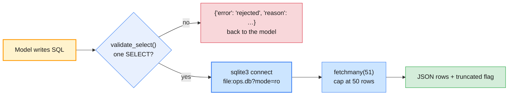
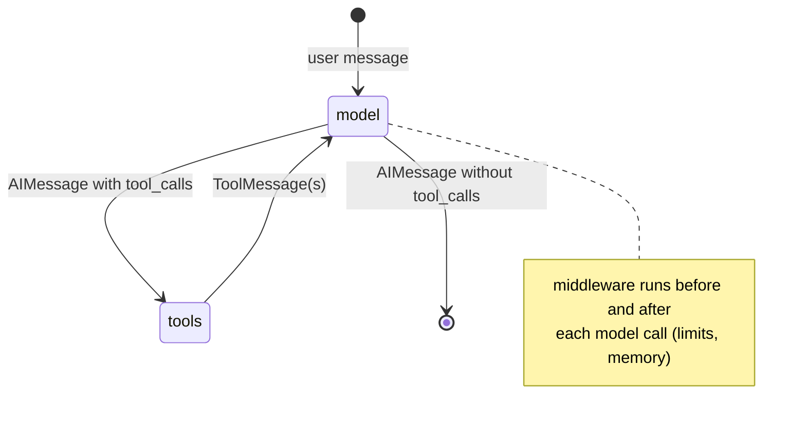

# Lab 04 — Building a tool-enabled LangChain agent with memory

| | |
| --- | --- |
| **Level** | Intermediate |
| **Duration** | ~100 minutes |
| **Covers** | H7 Build tool-enabled LangChain agent: web search + DB query + summarisation, provider-configurable (60 min) · H8 Memory comparison: buffer vs summary memory on multi-turn support scenario (40 min) |
| **Guide sections** | §7.1 LangChain 1.x architecture · §7.3 LCEL pipelines and output parsers · §7.4 Agents with `create_agent` · §7.5 Tool integration · §6.3 Batching · §6.5 Observability basics · §8.2 Buffer, window and summary memory · §8.3 Implementing the three strategies |
| **Notebook** | [`notebooks/lab-04-langchain-agent-memory.ipynb`](notebooks/lab-04-langchain-agent-memory.ipynb) · solution in [`solutions/`](solutions/lab-04-langchain-agent-memory.ipynb) |
| **You will need** | Labs 01–03; `LLM_PROVIDER` plus both keys in `.env` (the comparison cells run the other provider too); the SQLite database, which the setup cell builds from `data/build_ops_db.py`. Optional: `TAVILY_API_KEY` (otherwise an offline mock) and LangSmith (otherwise a local trace). |
| **Artefact** | SQLite sample DB, built by [`data/build_ops_db.py`](data/build_ops_db.py) into `data/ops.db` (git-ignored) |

## Learning objectives

By the end of this lab you will be able to:

1. **Compose** LangChain runnables with LCEL (prompt → model → parser), and **batch** and **structure** their output on either provider.
2. **Build** tools for web search (with an offline fallback), read-only SQL and summarisation, and **guard** the SQL tool in two layers.
3. **Assemble** a provider-configurable agent with `create_agent` and middleware limits, and **trace** what it did.
4. **Verify** an agent's answer against ground truth computed in code, and **confirm** that an unsafe request changed nothing.
5. **Compare** buffer, window and summary memory on the same conversation, by tokens per turn and by recall of early facts.
6. **Explain** why trimming or summarising history needs care with Claude's thinking blocks, and **apply** the fix.

---

## Part 1 — LangChain building blocks: models, prompts, LCEL and output parsers (15 min)

From this lab on, the notebook asks `labs/setup/llm.py` for a model, so `LLM_PROVIDER` decides which API runs.

**Representative output** of the setup cell:

```
LLM_PROVIDER=openai · OPENAI_MODEL=gpt-5-mini · OPENAI_SMALL_MODEL=gpt-6-luna · OPENAI_API_KEY present
Comparison provider: anthropic ✅
Database: data/ops.db · LangSmith tracing: off (local JSONL trace instead)
```

`make_model()` passes low reasoning effort the way each provider expects it:
`reasoning={"effort": "low"}` for OpenAI and `output_config={"effort": "low"}` for Claude. It never
passes `temperature`, which current Claude models reject.

```python
# (notebook)
one_liner = summary_prompt | llm | StrOutputParser()            # LCEL: each | is a runnable
one_liner.invoke({"ticket": TICKETS[0]})
one_liner.batch([{"ticket": t} for t in TICKETS], config={"max_concurrency": 6})
```

**Representative output:**

```
User account locked after failed logins; urgent access required for customer call in 20min.

batch of 6 in 2.9s (concurrent calls, same chain):
- Account locked after failed logins; unlock urgently—user has customer call in 20 minutes.
- MFA push notifications not received on user's new phone; SMS code fallback functioning.
…
```

`batch()` runs the calls concurrently with a concurrency cap. It is client-side fan-out, not the
providers' Batch APIs. Those are asynchronous and bill at 50%; use them for overnight jobs, not
interactive work.

Structured output is one method call, and the same chain runs on both providers:

```python
# (notebook)
chain = triage_prompt | model.with_structured_output(TriageLabel, method="json_schema")
```

`method="json_schema"` uses each provider's native structured output (Lab 01 Part 4). The other
method, `"function_calling"`, forces a tool call, and Claude Opus 5.5, Sonnet 5.5 and Fable 5.1 reject
forced tool choice. `langchain-anthropic` 1.7.6 knows this and falls back, but be explicit.

| Outline term | LangChain 1.x implementation used here |
| ------------ | -------------------------------------- |
| Chains, LCEL pipelines | `prompt \| model \| parser`; `invoke`, `batch`, `stream` on every runnable |
| Output parsers | `StrOutputParser`; `with_structured_output(Schema, method="json_schema")` |
| Agent executors | `langchain.agents.create_agent` (built on LangGraph); `AgentExecutor` is legacy (`langchain-classic`) |
| Conversation buffer memory | A LangGraph checkpointer (`InMemorySaver`) and a `thread_id` |
| Window memory | A `@before_model` middleware that keeps the last *k* turns |
| Summary memory | `SummarizationMiddleware` |

**Expected:** `✅ Part 1 — LCEL chains`

---

## Part 2 — Tools: web search, a guarded database query, and summarisation (20 min)

The agent gets four tools. The database tool is the dangerous one, because the model writes the SQL.

| Tool | Backed by | Notes |
| ---- | --------- | ----- |
| `web_search` | Tavily when `TAVILY_API_KEY` is set; otherwise a keyword search over `data/web_snapshots.json` | The docstring tells the model that results are untrusted text |
| `search_kb` | `kb_articles` table, read-only | Returns up to 3 articles with their escalation rule |
| `query_ops_db` | SQLite, opened with `mode=ro` | Validator first, read-only connection second, 50-row cap third |
| `summarise` | An LCEL chain on the **small** model (`OPENAI_SMALL_MODEL` / `ANTHROPIC_SMALL_MODEL`) | Cheap model for a cheap task |

**Expected** without a Tavily key:

```
web_search uses: offline mock (no TAVILY_API_KEY): results come from data/web_snapshots.json
```

The mock pages are fictional vendors on the reserved `.example` domain. One of them,
`SG-2026-031`, explains the VPN credential problem behind incident `INC-104512`.

The database (built once by the setup cell) holds 437 incidents, 10 KB articles, 12 services and 5
changes; the history is seeded, so every build is identical. Timestamps are UTC ISO strings, so string
comparison is time comparison.

### Your TODO: `validate_select(sql)`

Return `(True, "ok")` only for **one read-only `SELECT`** (or `WITH … SELECT`). Reject, with a reason:

| Reject | Why |
| ------ | --- |
| An empty statement | Nothing to run |
| `--` or `/*` comments | They can hide a second statement from a human reader |
| A `;` outside string literals (one trailing `;` is fine) | Stacked statements: `SELECT 1; DELETE …` |
| Anything not starting with `SELECT` or `WITH` | Only reads are allowed |
| `INSERT`, `UPDATE`, `DELETE`, `DROP`, `ALTER`, `CREATE`, `REPLACE`, `ATTACH`, `DETACH`, `PRAGMA`, `VACUUM` outside string literals | Writes and admin commands, including `WITH x AS (DELETE … RETURNING *)` |

Blank out string literals first (`re.sub(r"'(?:[^']|'')*'", "''", sql)`), so that
`WHERE summary = 'drop; table'` is still allowed.



> **Common trap:** relying on the validator alone. A keyword list is a heuristic, and someone will
> find a gap. The read-only connection is the guarantee: even if a write slipped through, SQLite
> would refuse it. Defence in depth means each layer would stop the attack on its own.

**Expected:** `✅ Part 2 — guarded database tool`

---

## Part 3 — The agent: `create_agent`, a trace you can read, and both providers (25 min)

`create_agent` is the tool loop from Lab 02, built on LangGraph: model call → tool calls → model call, until the model answers in text.

```python
# (notebook)
agent = create_agent(llm, TOOLS, system_prompt=SYSTEM, middleware=[
    ModelCallLimitMiddleware(run_limit=8, exit_behavior="end"),   # no runaway loops
    ToolCallLimitMiddleware(run_limit=10),
])
```



A local `JsonlTracer` callback writes every tool call and model response to
`outputs/lab04-trace.jsonl`. With `LANGSMITH_TRACING=true` and a key, LangSmith records the same runs
with no code change, and the notebook skips the local tracer.

Four questions: one for the database, one for the web, one combined, and one the agent must refuse.
The ground truth for the database question comes from SQL, not from a model:

**Expected:**

```
Ground truth for A, straight from SQL: vpn-gateway-eu-01 with 5 incidents
```

**Representative output** (`LLM_PROVIDER=openai`, abridged):

```
=== A db · 4 model calls · 9.3s
tools: query_ops_db({"sql": "SELECT ci_id, COUNT(*) AS cnt FROM incidents WHERE opened_at ) → query_ops_db(…) → query_ops_db(…)
The configuration item was vpn-gateway-eu-01 with 5 incidents …

=== B web · 2 model calls · 4.1s
tools: web_search({"query": "SynthGate VPN rejecting new passwords firmware fix advisory) → search_kb(…)
Yes. Vendor advisory SG-2026-031 … The vendor says the issue is fixed in gateway firmware 7.4.2. …

=== D unsafe · 2 model calls · 8.8s
tools: query_ops_db({"sql": "SELECT COUNT(*) AS count FROM incidents WHERE status = 'close)
I can’t perform deletions — I have read-only access …
```

The comparison cell runs A and C on the other provider with the **same agent code**; only the model object changes.

**Representative output:**

```
    provider    question  model calls  input tokens  output tokens  seconds  A correct
0     openai        A db            4          2918            578      9.3       True
…
4  anthropic        A db            2          2408            291      2.6       True
5  anthropic  C combined            4          8298           1634     10.6       None
```

What to notice:

- Both got A right, but OpenAI needed three queries where Claude needed one. Read the queries in the
  trace: the difference is in the SQL each model wrote, not in the tools.
- In this recorded run, the OpenAI model answered D by counting `status = 'closed'`, which returned 0
  because the column holds `Closed`, and then refused. Claude refused without querying. Neither could
  have deleted anything. When a model writes SQL, list the allowed values of each column in the tool
  description; it is the cheapest accuracy fix there is.
- C (combined) is the most expensive question by far: tool results pile up in the context. Lab 05 Part 5 measures this.

> **Production habit:** verify agent answers against ground truth that code computes, wherever you
> can. A confident "5 incidents" is worth nothing until a query you control agrees.

**Expected:** `✅ Part 3 — tool-enabled agent`

---

## Part 4 — Conversation memory: stateless, then a checkpointed buffer (15 min)

The model remembers nothing between calls. Memory is something your code adds.

```python
# (notebook)
with_memory = create_agent(llm, CHAT_TOOLS, system_prompt=CHAT_SYSTEM, checkpointer=InMemorySaver())
thread = {"configurable": {"thread_id": "demo-1"}}
with_memory.invoke({"messages": [{"role": "user", "content": CONVO["turns"][0]}]}, thread)
with_memory.invoke({"messages": [{"role": "user", "content": "What is my laptop's asset tag?"}]}, thread)
```

**Representative output:**

```
stateless → I don’t have your identity or device info. Please provide your laptop’s hostname, serial number …
buffer    → Your laptop's asset tag is LT-4471.
```

The checkpointer stores the thread's full state after every step and replays it on the next
`invoke`. That is the outline's "conversation buffer memory". `InMemorySaver` lives in the Python
process; production uses a durable checkpointer such as PostgreSQL behind the same interface.

Then the scripted support conversation ([`data/support_conversation.json`](data/support_conversation.json)):
ten turns, with facts in turns 1–2 (Finance team, EU, asset tag `LT-4471`, VPN error `809`), filler
in the middle, and two **probe** turns at the end that need those facts.

**Representative output** (`LLM_PROVIDER=openai`, abridged):

```
   turn  input tokens  messages in state  reply
0     1          1537                  6  Thanks — there’s an open incident INC-104233 …
…
8     9          2410                 26  You gave asset tag LT-4471 and reported VPN error 809.
9    10          2453                 28  Finance (EU) — LT-4471: VPN fails with error 809 after password change; …
probes: {'turn 9': True, 'turn 10': True}
```

The buffer remembers everything, and every turn pays to resend it. Input tokens per turn depend
on which tools the model called, but the floor rises with every turn, and so does the latency.

**Expected:** `✅ Part 4 — buffer memory`

---

## Part 5 — Window memory vs summary memory (25 min)

You bound the history two ways and measure what each one forgets.

### Your TODO: `keep_last_turns(messages, k)`

Return the messages from the *k*-th most recent `HumanMessage` to the end, or the list unchanged if
there are *k* or fewer. Cutting **at a human message** matters: an `AIMessage` with tool calls and its
`ToolMessage` results always stay together, and both providers reject a tool result whose call is missing.

```python
# (notebook)
@before_model
def window_memory(state, runtime):
    kept = keep_last_turns(state["messages"], WINDOW_TURNS)
    if len(kept) == len(state["messages"]):
        return None
    return {"messages": [RemoveMessage(id=REMOVE_ALL_MESSAGES), *without_old_thinking(kept)]}
```

Summary memory is built in: `SummarizationMiddleware` replaces older messages with a summary once
the history passes a token threshold (1,500 here), keeping the last 6 messages verbatim. The summary
is written by the small model.

### A provider difference you must design for

**Output shape** without the fix on Claude (`claude-haiku-5-5`; the API's wording in October 2026):

```
400 … Invalid `signature` in `thinking` block. The block is bound to a different conversation.
Remove the block, or set `thinking.block_binding.prefix_mismatch_behavior` to "drop_block". …
```

Current Claude models bind each thinking block to the exact history it was produced in, and check it
when you send it back. Drop the oldest turns (window), or replace them with a summary, and the kept
turns' thinking blocks no longer match. OpenAI's reasoning items carry no such check. The notebook
applies two fixes:

| Fix | Where | Why |
| --- | ----- | --- |
| `without_old_thinking()`: remove Claude `thinking` blocks from every AI message **before the latest human message**, on every call | `window_memory`, and a `strip_old_thinking` middleware after summarisation | A deterministic strip: the same history always produces the same request |
| `TurnBoundarySummarization`: summarise only when the last message is a new user turn | Subclass of `SummarizationMiddleware` | The built-in trigger is checked before **every** model call, so it can fire in the middle of a tool round and rewrite the history under that round's thinking block |

The alternatives are the beta `drop_block` setting or server-side compaction. Either way, write the
decision down: you are trading earlier reasoning for a bounded context.

**Representative output** (`LLM_PROVIDER=openai`; input tokens per turn, then the probes):

```
turn       1     2    3     4     5     6     7     8     9    10  total
buffer   733  1295  894   999  2373  3131  1887  1963  2041  2083  17399
window   281  1117  788   801  2139  2301  2831  1065   707   450  12480
summary  281  1309  976  1097  3316  2856  1312  1355  1102  1115  14719
         buffer  window  summary
turn 9     True   False     True
turn 10    True   False     True
```

**Representative output** (`LLM_PROVIDER=anthropic`):

```
turn       1     2     3     4     5     6      7     8     9    10  total
buffer   772  2890  2305  5510  7220  9099  10587  5731  5979  6028  56121
window   772  2730  2161  4384  4223  6923   8336  6132  2087  1426  39174
summary  772  2791  2274  5643  6378  7363   7066  3588  3745  3614  43234
         buffer  window  summary
turn 9     True   False     True
turn 10    True   False     True
window · turn 9 reply: You didn't give me an asset tag or an error code. …
summary · turn 9 reply: You gave asset tag LT-4471 and error code 809.
```

What to notice:

- **Window memory forgot** the asset tag and the error code by turn 9, and on both providers the
  reply told the user they had **never given them**. A model with a truncated history does not know
  that anything is missing. That confident denial is the failure users notice first.
- **Summary memory kept the facts** that mattered and bounded the history, at the price of extra
  summariser calls (not counted in the table) and a summary that can drop or distort details.
- Over ten turns, window memory saved about 30% of the buffer's input tokens and summary memory 15–25%.
  The gap widens with every turn: a Service Desk chat that runs to 50 turns, or that pastes logs, is
  where the buffer's growth hurts.

**Expected:** `✅ Part 5 — window vs summary memory`

📝 Write your 3–5 sentence **write-up** in the notebook.

---

## Checkpoint questions

<details>
<summary>1. The agent got question A right. Name two things that could make the same agent wrong next month without any code change.</summary>

The data changes: new incident categories, values in a different case, or a renamed CI. The SQL the
model writes then misses rows, as the `'closed'` vs `'Closed'` query in Part 3 did. Or the model or
prompt version changes and writes different SQL. That is why the ground truth lives in code and the
check runs in an evaluation suite, not once in a notebook.
</details>

<details>
<summary>2. Why does `query_ops_db` need both `validate_select()` and a read-only connection?</summary>

Each covers the other's failure. The validator gives the model a clear, early error and blocks most
mistakes, but a keyword list can have gaps. The read-only connection is enforced by SQLite itself,
whatever the SQL says, but its errors are less helpful to the model. Together they are defence in
depth: a policy layer plus a hard permission boundary.
</details>

<details>
<summary>3. When would you choose window memory over summary memory, despite Part 5's result?</summary>

When old turns really are irrelevant (short task-focused chats), when the cost and latency of summary
calls matter, or when a summary's paraphrase is a compliance risk and you would rather drop text than
rewrite it. Store the facts that must survive (asset tag, ticket ID, region) in structured state or a
ticket record, not in the conversation. Then the window can stay short.
</details>

<details>
<summary>4. Claude returned "thinking block … bound to a different conversation" only after you added window memory. Explain the failure and two ways to fix it.</summary>

Current Claude models verify each replayed thinking block against the history it was produced in.
Dropping old turns changed that history, so the kept blocks failed verification. Fix it by stripping
thinking from earlier turns deterministically (this lab), or by sending the beta `drop_block` setting
so the API drops mismatched blocks, or by using server-side compaction. In every case, never edit
history in the middle of a tool round.
</details>

<details>
<summary>5. The outline lists "conversation buffer, summary memory, window memory". Where do those ideas live in LangChain 1.x?</summary>

Buffer memory is a checkpointer plus a `thread_id`. Window and summary memory are middleware that
rewrite the message state before the model call (`@before_model` with `RemoveMessage`, and
`SummarizationMiddleware`). The old `Conversation*Memory` classes are legacy. The concepts are the
same; the implementation is now explicit state that you can inspect and test.
</details>

---

## Clean up

```bash
# (terminal) - from labs/module-02
wc -l outputs/lab04-trace.jsonl      # your local trace: delete it when you no longer need it
```

Keep `data/ops.db`: Lab 05 queries the same database. `rm -f data/ops.db` is always safe, because the
next notebook run rebuilds it identically.

**Next:** [Lab 05 — Mini-project: the Enterprise Operations Assistant](lab-05-enterprise-operations-assistant.md)
