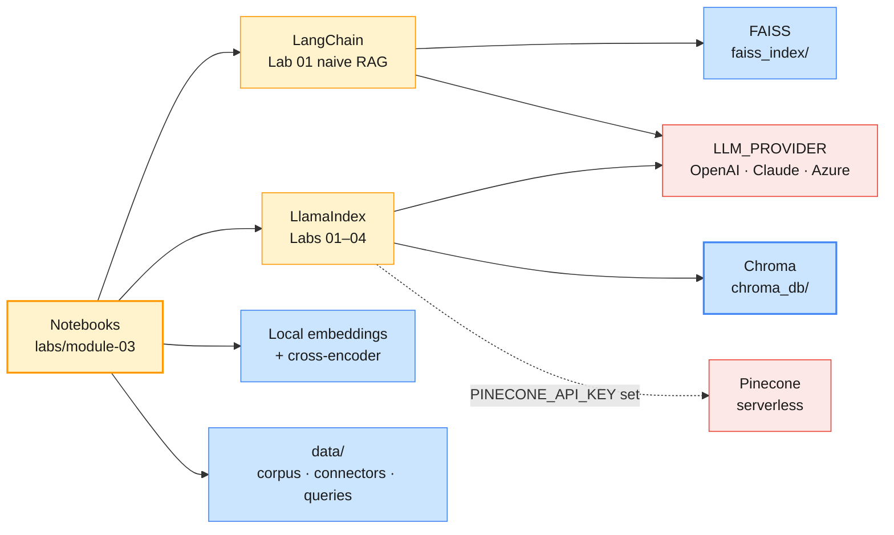

# Module 3 Labs — Enterprise RAG Pipelines & Fine-Tuning Strategy

> **Course:** Agentic AI Systems Engineering (Python track)
> **Companion guide:** [`guides/module-03-enterprise-rag-fine-tuning-strategy.md`](../../guides/module-03-enterprise-rag-fine-tuning-strategy.md)
> **Module objective:** Build production RAG pipelines with LangChain and LlamaIndex, including enterprise data-source connectors. Apply a fine-tuning decision framework to choose between fine-tuning, RAG, prompt engineering, and hybrid approaches.

You build retrieval-augmented generation for **Daimler Truck after-sales and engineering**:
workshop bulletins, fault-code guides, fleet-customer FAQs, warranty policies and engineering specs.
**Lab 01** builds a naive RAG pipeline with **LangChain** and rebuilds it with **LlamaIndex**.
**Labs 02–04** are advanced RAG in **LlamaIndex**: measured chunking and hybrid retrieval, then
enterprise connectors with access control, and finally an agent that decides when to search.
The labs climb from Beginner to Advanced, and each one reuses the last, so do them in order.

| # | Lab | Level | Time | Covers | What you will do |
| - | --- | ----- | ---- | ------ | ---------------- |
| 01 | [Building a RAG pipeline with LangChain and LlamaIndex](lab-01-rag-pipeline-langchain-llamaindex.md) | Beginner | 75 min | H1, H2 | Ingest, chunk, embed, FAISS, an LCEL chain with checked citations, the same pipeline in LlamaIndex on Chroma, a side-by-side comparison |
| 02 | [Tuning and evaluating retrieval](lab-02-tuning-evaluating-retrieval.md) | Intermediate | 60 min | H3, H4 | Retrieval metrics, fixed vs semantic vs structure-aware chunking, BM25, hybrid fusion and re-ranking, an LLM judge on both providers |
| 03 | [Enterprise connectors and use-case assistants](lab-03-enterprise-connectors-assistants.md) | Intermediate → Advanced | 90 min | H5, H6 | SharePoint and Confluence connectors, delta sync, Pinecone or Chroma with access trimming, policy-search and customer-support assistants, a calibrated score floor |
| 04 | [Agentic RAG and fine-tuning decisions](lab-04-agentic-rag-fine-tuning-decisions.md) | Advanced | 55 min | H7 + workshop | The retriever as a tool, a LlamaIndex agent vs 2-step RAG, the four-scenario fine-tuning decision workshop |

Estimated total: **4 hours 40 minutes**: the outline's 250 minutes of hands-on, plus the 30-minute
fine-tuning decision workshop from the delivery schedule (Lab 04 Part 3).

> **Synthetic data, real company.** These labs are tailored for Daimler Truck engineers, so the
> company is named. Every document, model series (LH-40, ED-26, CT-33), part number, fault code,
> specification, policy and procedure is **invented for training**. None of it is Daimler Truck
> information. Never use it on a vehicle.

---

## Prerequisites

| Requirement | Check with | Notes |
| ----------- | ---------- | ----- |
| Python 3.12 or 3.13 and the course venv | `python --version` | See [`labs/setup/README.md`](../setup/README.md) |
| Course packages | `python labs/setup/check_env.py --module 3` | Pinned in `labs/setup/requirements.txt`: `llama-index-core` 0.14.25, `langchain` 1.4.7, `faiss-cpu` 1.15.1, `chromadb` 1.5.9, `pinecone` 9.1.0 |
| A model provider in `.env` | `check_env.py` shows ✅ | `LLM_PROVIDER=openai`, `anthropic`, `azure-openai` or `azure-anthropic`; the comparison cells also run its partner |
| Local models cached | `python labs/setup/prefetch_models.py --module 3` | The multilingual embedding model (`ST_MODEL`) and the cross-encoder re-ranker (`RERANK_MODEL`) |
| Pinecone (optional) | `PINECONE_API_KEY` row | Lab 03 indexes on Pinecone when the key is set; otherwise the same cells run on Chroma |
| SharePoint / Confluence tenant (instructor only) | — | Lab 03 reads the exports in `data/connectors/`; live readers are an instructor demo |

Module 2 is not a code dependency: everything these labs read is in `data/`.

---

## Lab environment

Retrieval runs on your laptop: the embedding model, the re-ranker, FAISS and Chroma. Only answer
generation, the judges and the agent call a model API. The provider comes from `LLM_PROVIDER`
through [`labs/setup/llm.py`](../setup/llm.py), and Azure OpenAI and Claude on Microsoft Foundry
are first-class options.



| Setting | Where | Used by |
| ------- | ----- | ------- |
| `LLM_PROVIDER` (`openai`, `anthropic`, `azure-openai`, `azure-anthropic`) | `.env` | Every lab |
| `OPENAI_*`, `ANTHROPIC_*`, or the `AZURE_OPENAI_*` / `ANTHROPIC_FOUNDRY_*` deployments | `.env` | The chosen provider and its comparison partner |
| `EMBEDDING_PROVIDER` (`local`, `openai`, `azure-openai`), `ST_MODEL` | `.env` | Every index; `local` is the default and needs no key |
| `RERANK_MODEL` | `.env` | Labs 02–04 |
| `PINECONE_API_KEY`, `PINECONE_INDEX`, `PINECONE_CLOUD`, `PINECONE_REGION` | `.env` (optional) | Lab 03 Part 3 |

| Folder | Contents |
| ------ | -------- |
| `notebooks/` | Starter notebooks: they run top to bottom; a `TODO` falls back to the `rag_kit` reference with a ⏳ note until you write it |
| `solutions/` | Reference notebooks: every TODO filled in, every check passing |
| `data/` | `corpus/` (20 documents), `connectors/` (SharePoint and Confluence exports), `test_queries.json`; see [`data/README.md`](data/README.md) |
| `templates/` | `chunking-workbook.md`, `retrieval-eval-rubric.md`, `fine-tuning-decision-canvas.md`, `scenario-cards.md` |
| `rag_kit.py` | Shared helpers and the reference versions of every TODO, so a lab never depends on the last one's TODOs |
| `uv-projects/` | The four labs as standalone uv projects for terminal demos (`uv run lab01 all`); see its [README](uv-projects/README.md) |

### Everyday commands

```bash
# (terminal) - from the repo root
source .venv/bin/activate
python labs/setup/check_env.py --module 3
python labs/setup/prefetch_models.py --module 3   # once, on a good connection
jupyter lab labs/module-03/notebooks/              # or open the folder in VS Code
```

To run a lab on another provider, change `LLM_PROVIDER` in `.env` and restart the kernel.

> **Convention used in the labs**
>
> - `# (terminal)`: run in a shell with the course venv active, from the folder the block names.
> - `# (notebook)`: a cell in the lab's starter notebook.
> - **Expected** output is deterministic: fixed data, the local embedding model and the pinned
>   versions. **Representative output** comes from a model and varies; the guides' runs used
>   `gpt-5-mini` and `claude-haiku-5-5` with `EMBEDDING_PROVIDER=local`.
> - Check cells print ✅ (passed), ⏳ (your TODO is not done yet) or ⚠️ (skipped, with the reason).

---

## Troubleshooting

| Symptom | Likely cause | Fix |
| ------- | ------------ | --- |
| `SystemExit: ❌ LLM_PROVIDER=… is not configured` | The provider's key, model or Azure resource is missing | Fill in `.env`, then restart the kernel |
| `ValidationError … value.int … input_value=True` on a `MetadataFilter` | LlamaIndex filters take numbers and strings, not booleans | Store flags as `1` and filter on `value=1` (`rag_kit.flat_metadata`) |
| `Value for metadata allowed_groups must be one of (str, int, float, None)` | Chroma through LlamaIndex stores only flat metadata | Flatten lists into one key per group, as `flat_metadata` does |
| `Expected a name containing 3-512 characters …` from Chroma | A collection name under 3 characters or with spaces | Use names like `lab02-markdown-local-paraphrase-multilingual` |
| `Kernel died` in Lab 04 while the agent searches | A local PyTorch model called from a worker thread (seen on macOS) | Use `rk.agent_tool(...)` (runs the tool on the event loop); the re-ranker runs on the CPU |
| Pinecone `… has another dimension` | `PINECONE_INDEX` was created with a different embedding model | Set a new `PINECONE_INDEX`, or delete the old index in the console |
| `Unknown model: <deployment>` from LlamaIndex on Azure | A deployment name LlamaIndex does not recognise | Name deployments after their model (Azure's default); `llm.py` falls back to a generic context window |
| Models download during the lab | `prefetch_models.py` was not run | Run it now; it skips files already cached |

---

## Cleaning up after the module

```bash
# (terminal) - from labs/module-03
rm -rf chroma_db faiss_index outputs   # git-ignored; the notebooks rebuild them in seconds
```

If you used Pinecone, delete the index in the Pinecone console, or keep it for Module 4. **Module 4**
turns `search_knowledge` from Lab 04 into one specialist agent under a LangGraph supervisor, and the
group exercise in **Module 5** (scenario B) extends this pipeline with a connector and a groundedness eval.
