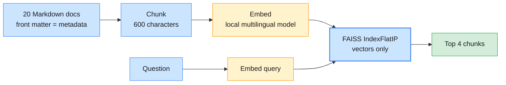

# Lab 01 — Building a RAG pipeline with LangChain and LlamaIndex

| | |
| --- | --- |
| **Level** | Beginner |
| **Duration** | ~75 minutes |
| **Covers** | H1 Build end-to-end RAG pipeline with LangChain: ingest → chunk → embed → retrieve → answer on support-doc corpus (45 min) · H2 Rebuild the same pipeline with LlamaIndex: compare developer experience and output quality (30 min) |
| **Guide sections** | §2.1 The pipeline · §2.3 The pipeline in code · §2.5 How RAG fails · §4.2 FAISS, Chroma and Pinecone · §8.1 The same pipeline in LlamaIndex · §8.2 Architecture comparison |
| **Notebook** | [`notebooks/lab-01-rag-pipeline-langchain-llamaindex.ipynb`](notebooks/lab-01-rag-pipeline-langchain-llamaindex.ipynb) · solution in [`solutions/`](solutions/lab-01-rag-pipeline-langchain-llamaindex.ipynb) |
| **You will need** | The course venv and `.env` from [`labs/setup/`](../setup/README.md); one configured `LLM_PROVIDER` (its partner is optional). About 10 model calls. |
| **Artefact** | The support-doc corpus in [`data/corpus/`](data/corpus/): 20 synthetic Daimler Truck documents |

## Learning objectives

By the end of this lab you will be able to:

1. **Explain** why an LLM cannot answer questions about internal documents, and what each RAG stage adds.
2. **Build** a naive RAG pipeline in LangChain: load, chunk, embed, index in FAISS, retrieve, generate.
3. **Verify** that every citation in an answer points to a document that was actually retrieved.
4. **Rebuild** the pipeline in LlamaIndex on Chroma, and **compare** the two frameworks' developer experience.

---

## Part 1 — The corpus, and a question without retrieval (10 min)

The use case: a dealer technician asks the after-sales assistant about a fault on a truck. The
answer lives in an internal bulletin that no public model has seen.

```python
# (notebook)
QUESTION = "An LH-40 built in March 2026 shows FC-ADB-0412. Which bulletin applies, and which part replaces the dosing valve?"
print(llm.invoke(QUESTION).text)
```

**Representative output** (`gpt-5-mini`, abridged):

```
I don't have enough context to give a definitive bulletin number or part number. … What manufacturer
is the LH-40 (e.g., Liebherr, Hyundai, Hitachi, Linde, etc.)?
```

The model does not know your bulletins, your part numbers or even your product names. That is a
**knowledge** gap: RAG closes it by putting the right text into the prompt at question time.

## Part 2 — Naive RAG with LangChain: chunk, embed and index in FAISS (15 min)



```python
# (notebook)
splitter = RecursiveCharacterTextSplitter(chunk_size=600, chunk_overlap=80, add_start_index=True)
chunks = splitter.split_documents(docs)
vectors = np.array(embeddings.embed_documents([c.page_content for c in chunks]), dtype="float32")
faiss_index = faiss.IndexFlatIP(vectors.shape[1])   # inner product = cosine on unit vectors
faiss_index.add(vectors)
```

**Expected** (local embeddings):

```
20 documents -> 55 chunks · median 472 characters · max 597
FAISS: 55 vectors of dimension 384 · saved to faiss_index/
0.61  TSB-2026-031  '# AdBlue dosing valve crystallisation on LH-40 tractors with DTE-13 en'
0.55  KB-0610       'LH-40 tractors with the DTE-13 engine built in weeks 01 to 13 of 2026 '
0.51  TSB-2026-031  '## Repair\n\n1. Read the fault memory with DiagLink and confirm FC-ADB-0'
0.49  TSB-2026-039  '# Druckluftkompressor mit erhöhter Einschaltdauer bei CT-33 Baustellen'
✅ Part 2 — chunked, embedded and indexed in FAISS
```

What to notice:

- **FAISS is a library, not a database.** It returns row numbers; your `retrieve()` maps them back
  to chunks and metadata that you keep yourself (`faiss_index/lab01-chunks.json`).
- `EMBEDDING_PROVIDER=local` runs a multilingual Sentence Transformers model on your laptop: no key,
  no cost, and no document text leaves the machine. Switch to `openai` or `azure-openai` in `.env`.

> **Common trap:** mixing embedding models in one index. Vectors from two models live in different
> spaces. That is why every index name in these labs ends in `embedding_slug()`.

## Part 3 — Retrieve, augment, generate, with citations (20 min)

```python
# (notebook)
def rag_chain(model):
    return {"sources": RunnableLambda(retrieve) | format_sources, "question": RunnablePassthrough()} | RAG_PROMPT | model | StrOutputParser()
```

The prompt says: answer only from the sources, cite `[doc_id]` after each claim, and say so if
the sources do not answer. Your code then checks the citations: `rk.cited_ids(answer) <= retrieved`.

**Representative output** (`gpt-5-mini`):

```
The applicable bulletin is TSB-2026-031 [TSB-2026-031].
The dosing valve is replaced with part number PN 47-0118-334 [TSB-2026-031].

cited: ['TSB-2026-031'] · retrieved: ['KB-0610', 'TSB-2026-031', 'TSB-2026-039']
```

The other provider (`claude-haiku-5-5`) added a caveat the question needed: "The sources don't map
calendar months to weeks … A March build could fall on either side of week 14." Same retrieval,
different writer.

**Representative output** of the three extra questions:

| kind | retrieved | answer (abridged) |
| ---- | --------- | ----------------- |
| paraphrase ("exhaust fluid light") | `KB-0705`, … | A flashing AdBlue lamp means drive to a safe place or a workshop … `[KB-0705]` |
| German (`FC-BRK-0705`) | `KB-0610`, `KB-0622`, … | "In den bereitgestellten Quellen wird der Fehlercode FC-BRK-0705 nicht beschrieben" |
| unanswerable (list price) | `TSB-2026-031`, … | "The provided sources do not state the list price …" |

What to notice:

- **The German fault-code question failed at retrieval, not generation.** `TSB-2026-039` (in German)
  never reached the prompt, so the model correctly said it could not find it. Vector search does
  not match exact codes reliably. Lab 02 fixes this with keyword search.
- The refusal is the right behaviour. Some models still cite sources in a refusal; check the
  *claims*, not just the brackets.

**Expected:** `✅ Part 3 — grounded answers with valid citations`

## Part 4 — The same pipeline in LlamaIndex, on Chroma (20 min)

```python
# (notebook)
li_docs = rk.to_llama_documents(records)        # id_ = doc_id; only the title is embedded with the text
nodes = SentenceSplitter(chunk_size=160, chunk_overlap=20).get_nodes_from_documents(li_docs)
index = VectorStoreIndex(nodes, storage_context=StorageContext.from_defaults(vector_store=store))
query_engine = index.as_query_engine(similarity_top_k=4, text_qa_template=QA_PROMPT)
```

**Expected:** `20 documents -> 55 nodes · Chroma collection holds 55 vectors`

**Representative output:**

```
The applicable bulletin is TSB-2026-031 (vehicles built CW 01/2026–CW 13/2026) [TSB-2026-031].
Replace the dosing valve with part number PN 47-0118-334 (revised nozzle geometry) [TSB-2026-031].

sources: [('TSB-2026-031', 0.68), ('TSB-2026-031', 0.67), ('KB-0610', 0.67), ('TSB-2026-031', 0.67)]
```

> **Common trap:** the default LlamaIndex prompt does not ask for citations. `source_nodes` tells
> *you* what was used, but the user sees uncited prose. Always pass your own `text_qa_template`.

## Part 5 — Compare the two pipelines (10 min)

| Concern | LangChain + FAISS | LlamaIndex + Chroma |
| ------- | ----------------- | ------------------- |
| Chunk size unit | characters (`600`) | tokens (`160`) |
| Retriever | you wrote it: embed, search, map rows to chunks | `index.as_retriever()` |
| Metadata | your own list beside the index | stored with each vector in Chroma; filterable (Lab 03) |
| Prompt + LLM | an LCEL chain you compose | a query engine with a template |
| Best when | RAG is one step inside an app or agent | the hard part is the data: sources, chunking, retrieval |

| Store | What it is | Persistence | Metadata filters | In these labs |
| ----- | ---------- | ----------- | ---------------- | ------------- |
| FAISS | a similarity-search library | you save and load files | none | Lab 01 |
| Chroma | an open-source database, embedded or server | built in | `where` on flat metadata | Labs 01–04 |
| Pinecone | a managed serverless service | managed | yes; namespaces | Lab 03, when `PINECONE_API_KEY` is set |

📝 Fill in the observation table in the notebook.

---

## Checkpoint questions

<details>
<summary>1. The German question about FC-BRK-0705 got "not found". Which stage failed, and how do you know?</summary>

Retrieval. The retrieved list did not contain `TSB-2026-039`, the only document that explains the
code, so the generator never saw it. When an answer is wrong, look at the retrieved IDs first: if
the right document is missing, no prompt change can fix it.
</details>

<details>
<summary>2. Why does the chain check citations in code instead of trusting the prompt?</summary>

The prompt asks for citations, but nothing forces the model to cite only what it was given. A set
comparison (`cited <= retrieved`) turns a hope into a test. In production a failed check routes the
answer to review instead of showing it.
</details>

<details>
<summary>3. `chunk_size=600` in LangChain and `chunk_size=160` in LlamaIndex gave the same number of chunks. Why?</summary>

`RecursiveCharacterTextSplitter` counts characters and `SentenceSplitter` counts tokens (about
four characters each in English). The numbers look different but describe chunks of similar size.
Always check the unit before you compare settings across libraries.
</details>

<details>
<summary>4. When would you choose FAISS over Chroma in production?</summary>

When you need raw search speed inside one process over a mostly static set, and you manage
metadata, persistence and filtering yourself, for example an embedded search inside a service.
When you need filters, updates, deletes and persistence, which enterprise RAG always needs, use a
database: Chroma, Pinecone or your platform's vector store.
</details>

---

## Clean up

Keep `chroma_db/`: Lab 02 creates its own collections next to it. `rm -rf faiss_index` is safe;
the notebook rebuilds it in seconds.

**Next:** [Lab 02 — Tuning and evaluating retrieval](lab-02-tuning-evaluating-retrieval.md)
