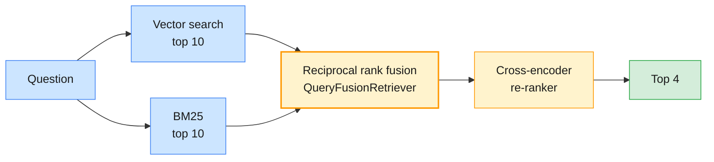

# Lab 02 — Tuning and evaluating retrieval

| | |
| --- | --- |
| **Level** | Intermediate |
| **Duration** | ~60 minutes |
| **Covers** | H3 Chunking strategy comparison: fixed vs semantic on same document set (30 min) · H4 Retrieval quality evaluation: measure precision and answer relevance on test queries (30 min) |
| **Guide sections** | §5.1 Why chunk size matters · §5.2 The strategies in code · §5.3 What the comparison shows · §6.2 Hybrid retrieval · §6.3 Re-ranking · §7.1–§7.5 Retrieval quality evaluation |
| **Notebook** | [`notebooks/lab-02-tuning-evaluating-retrieval.ipynb`](notebooks/lab-02-tuning-evaluating-retrieval.ipynb) · solution in [`solutions/`](solutions/lab-02-tuning-evaluating-retrieval.ipynb) |
| **You will need** | Lab 01; `RERANK_MODEL` cached (`prefetch_models.py --module 3`). About 15 model calls, 10 of them on the small tier. |
| **Artefacts** | [`data/test_queries.json`](data/test_queries.json) (labelled queries), [`templates/chunking-workbook.md`](templates/chunking-workbook.md), [`templates/retrieval-eval-rubric.md`](templates/retrieval-eval-rubric.md) |

## Learning objectives

By the end of this lab you will be able to:

1. **Implement** precision@k, recall@k, hit rate and MRR, and run them over a labelled query set.
2. **Compare** fixed, semantic and structure-aware chunking with numbers, and read the chunks behind the numbers.
3. **Combine** BM25 and vector search with reciprocal rank fusion, and **measure** what a re-ranker adds or breaks.
4. **Judge** answer relevance with an LLM on both providers, scoring unanswerable questions separately.

---

## Part 1 — Labelled queries and retrieval metrics (10 min)

Retrieval is the part of RAG you can test like ordinary code. The labelled set pairs 24 real
after-sales questions with the documents that answer them:

| kind | count | example |
| ---- | ----- | ------- |
| identifier | 5 | `PN 47-0118-341`, `Was bedeutet der Fehlercode FC-BRK-0705?` |
| paraphrase | 16 | "The exhaust fluid light is flashing, can I keep driving?" (the document says "AdBlue") |
| cross-lingual | 3 | "Wie lange dauert das Schnellladen von 20 auf 80 Prozent?" (the answer is in English) |
| unanswerable | 3 | "What is the list price of a new LH-40 tractor?" |

### Your TODO: `retrieval_metrics(ids, relevant, k)`

| Metric | Per query |
| ------ | --------- |
| precision@k | relevant entries in the top k ÷ k (one entry per chunk, so a document can count twice) |
| recall@k | distinct relevant documents found ÷ relevant documents |
| hit rate@k | 1 if anything relevant is in the top k |
| MRR | 1 ÷ rank of the first relevant entry, or 0 |

Until your function works, the harness uses `rk.retrieval_metrics` and prints a ⏳ note.

**Expected:** `✅ Part 1 — retrieval metrics`

## Part 2 — Fixed vs semantic chunking (20 min)

Same documents, same embeddings, dense top-4 retrieval; only the node parser changes.

```python
# (notebook)
SPLITTERS = {
    "fixed-128": SentenceSplitter(chunk_size=128, chunk_overlap=16),
    "fixed-512": SentenceSplitter(chunk_size=512, chunk_overlap=50),
    "semantic": SemanticSplitterNodeParser.from_defaults(embed_model=Settings.embed_model, breakpoint_percentile_threshold=90),
    "markdown": MarkdownNodeParser(),   # one node per heading section
}
```

**Expected** (local embeddings):

| strategy | nodes | median chars | precision | recall | hit rate | MRR |
| -------- | ----- | ------------ | --------- | ------ | -------- | --- |
| fixed-128 | 72 | 331 | 0.66 | 0.92 | 0.96 | 0.84 |
| fixed-512 | 20 | 1073 | 0.27 | 0.96 | 0.96 | 0.86 |
| semantic | 57 | 321 | 0.57 | 0.90 | 0.92 | 0.82 |
| markdown | 89 | 212 | 0.80 | 0.92 | 0.96 | 0.84 |

What to notice:

- **Precision rewards small chunks.** Four small chunks of the right document fill the top 4.
  `fixed-512` turns each document into one chunk, so three of every four slots are other documents.
- **Recall barely moves.** On 24 queries one query is 0.04: differences that small are noise.
- **Read the chunks.** For "DC fast charge 20 to 80 percent", `markdown` returns the whole "AC or DC?"
  section with its table, while `fixed-128` returns the preconditioning paragraph *next to* the
  table. Structure-aware chunking keeps a table with its heading, and well-formatted manuals and
  policies reward it.

> **Common trap:** `SemanticSplitterNodeParser.from_defaults()` without `embed_model` uses
> `OpenAIEmbedding()`, not `Settings.embed_model`. With an OpenAI key it quietly sends every document
> to OpenAI and finds breakpoints in another model's space; without one it fails with
> `OpenAIError: Missing credentials`. Pass the embedding model explicitly.

📝 Fill in [`templates/chunking-workbook.md`](templates/chunking-workbook.md).

## Part 3 — Keyword, hybrid and re-ranked retrieval (15 min)



```python
# (notebook)
hybrid = rk.hybrid_retriever(index, nodes, k=4, pool=10)   # QueryFusionRetriever, mode="reciprocal_rerank", num_queries=1
```

`num_queries=1` turns off LlamaIndex's LLM query rewriting, so the fusion costs no model call.

**Expected:**

| retriever | precision | recall | hit rate | MRR |
| --------- | --------- | ------ | -------- | --- |
| dense | 0.80 | 0.92 | 0.96 | 0.84 |
| bm25 | 0.79 | 0.96 | 1.00 | 0.96 |
| hybrid | 0.83 | 0.98 | 1.00 | 0.95 |
| hybrid + rerank | 0.77 | 0.90 | 0.96 | 0.96 |

**Expected** misses:

| qid | dense | bm25 | hybrid | hybrid + rerank | query |
| --- | ----- | ---- | ------ | --------------- | ----- |
| q10 | 0 | 1 | 1 | 1 | Was bedeutet der Fehlercode FC-BRK-0705? |
| q11 | 1 | 1 | 1 | 0 | Wie lange dauert das Schnellladen von 20 auf 80 Prozent? |

What to notice:

- **q10 is Lab 01's failure, fixed.** Vector search misses the exact code; BM25 matches the token
  `FC-BRK-0705`; fusion keeps both strengths. Codes, part numbers and labour codes need keyword search.
- **q11 is a new failure caused by the fix.** `ms-marco-MiniLM` is an English-only cross-encoder. It
  scores a German question against an English answer as irrelevant and pushes it out of the top 4.
  In a bilingual estate, check the re-ranker's languages, or use a multilingual one.

> **Common trap:** trusting averages. Hybrid + rerank has the best MRR and the worst recall here. The
> per-query table tells you *which* users a change helps and which it breaks.

**Expected:** `✅ Part 3 — hybrid retrieval`

## Part 4 — Answer relevance with an LLM judge, on both providers (15 min)

```python
# (notebook)
verdict = judge.structured_predict(Relevance, JUDGE, question=q["query"], answer=answers[q["qid"]])
passed = verdict.refused if not q["relevant"] else verdict.score >= 4
```

`structured_predict` returns a validated Pydantic object on both providers; on current Claude
models LlamaIndex uses Claude's native structured outputs.

**Representative output:**

| qid | answerable | anthropic score | openai score | pass (both) |
| --- | ---------- | --------------- | ------------ | ----------- |
| q05 | yes | 5 | 5 | ✅ |
| q08 | yes | 5 | 5 | ✅ |
| q10 | yes | 5 | 5 | ✅ |
| u01 | no | 3 | 5 | ✅ (refused) |
| u02 | no | 2 | 5 | ✅ (refused) |

What to notice: the judges agree on answerable questions but **disagree on refusals**. Claude
scores an honest "not in the sources" low for relevance; OpenAI scores it high. That is why the
rubric scores unanswerable questions with their own rule (a refusal passes), not with the relevance score.

📝 Fill in [`templates/retrieval-eval-rubric.md`](templates/retrieval-eval-rubric.md) and the write-up.

---

## Checkpoint questions

<details>
<summary>1. `fixed-512` has the best recall and the worst precision. Would you ship it?</summary>

No, not on these numbers. Each chunk is a whole document, so the prompt carries three irrelevant
documents for every relevant one: more tokens, more distraction and higher cost. Recall is high
only because there is little to miss in 20 documents. Pick the smallest chunk that still answers
the question, which you check by reading the chunks.
</details>

<details>
<summary>2. Why did adding a re-ranker lower recall?</summary>

The cross-encoder is English-only. It moved the right English document out of the top 4 for a
German question. Re-rankers re-order by their own idea of relevance, so they inherit their
training languages and domains. Measure per query type before you add one.
</details>

<details>
<summary>3. Why does `QueryFusionRetriever` need `num_queries=1` here?</summary>

With more than one query it asks the LLM to write query variations first: extra latency and cost
on every question. Fusion of two retrievers needs no LLM. Turn query generation on only if
measurements show paraphrased variations help.
</details>

<details>
<summary>4. How would you grow this 24-query set into a release gate?</summary>

Collect real technician and customer questions from logs, label the documents that answer them, and
cover every query type and language in proportion to traffic, with unanswerable ones included. Run
the harness in CI on every change to chunking, embeddings or retrieval, and block a release that
drops more than the noise of one query (§7.5).
</details>

---

## Clean up

Keep `chroma_db/`. The `lab02-*` collections are rebuilt on every run, so deleting them is always safe.

**Next:** [Lab 03 — Enterprise connectors and use-case assistants](lab-03-enterprise-connectors-assistants.md)
