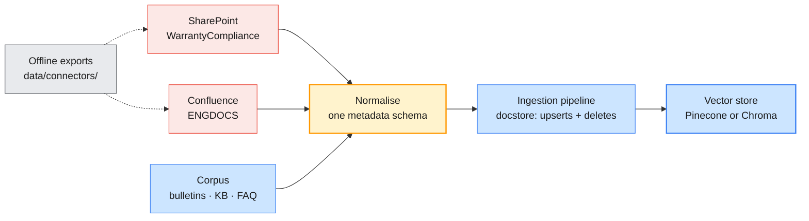
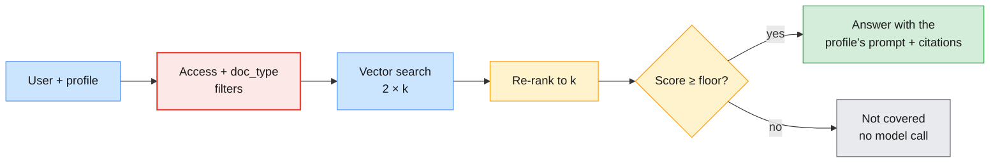

# Lab 03 — Enterprise connectors and use-case assistants

| | |
| --- | --- |
| **Level** | Intermediate → Advanced |
| **Duration** | ~90 minutes |
| **Covers** | H5 Enterprise connector lab: connect the RAG pipeline to a sample SharePoint/Confluence space via LlamaIndex Hub (45 min) · H6 Enterprise use-case walkthrough: build a policy-search assistant and a customer-support RAG assistant from a shared pattern (45 min) |
| **Guide sections** | §4.2 FAISS, Chroma and Pinecone · §6.1 Metadata design · §9.1 Connector architecture · §9.2 LlamaIndex Hub readers · §9.3 Enterprise RAG use cases · §9.4 Two assistants from one pattern |
| **Notebook** | [`notebooks/lab-03-enterprise-connectors-assistants.ipynb`](notebooks/lab-03-enterprise-connectors-assistants.ipynb) · solution in [`solutions/`](solutions/lab-03-enterprise-connectors-assistants.ipynb) |
| **You will need** | Labs 01–02. Optional: `PINECONE_API_KEY` (otherwise Chroma, the offline fallback). No SharePoint or Confluence tenant: the exports in `data/connectors/` stand in for them. About 12 model calls per provider. |
| **Artefact** | The offline connector exports: [`data/connectors/sharepoint/`](data/connectors/sharepoint/) and [`data/connectors/confluence/pages.json`](data/connectors/confluence/pages.json) |

## Learning objectives

By the end of this lab you will be able to:

1. **Normalise** documents from SharePoint and Confluence into one metadata schema, access lists included.
2. **Keep** an index in sync: exclude retired versions, re-embed only changed documents, propagate deletes.
3. **Enforce** per-user access trimming with metadata filters that work on both Pinecone and Chroma.
4. **Build** two assistants from one pattern, and **calibrate** a score floor that refuses before any model call.
5. **Justify** the floor and the profile settings from your own measurements on both providers.

---

## Part 1 — Connect SharePoint and Confluence (20 min)



The exports have the shape the LlamaIndex Hub readers return: `SharePointReader` adds the file's
permissions as metadata, and `ConfluenceReader` returns pages whose body is storage-format XHTML.
With a tenant, only the loader changes: chunking, index, filters and prompts stay the same.

```python
# (instructor) - shape only; credentials come from the client IT team, never from code
from llama_index.readers.microsoft_sharepoint import SharePointReader
from llama_index.readers.confluence import ConfluenceReader
policies = SharePointReader(client_id=..., client_secret=..., tenant_id=...).load_data(
    sharepoint_site_name="WarrantyCompliance", sharepoint_folder_path="Published")
pages = ConfluenceReader(base_url=os.environ["CONFLUENCE_URL"]).load_data(space_key="ENGDOCS")
```

**Expected:**

```
SharePoint: offline export in data/connectors/ (no tenant configured)
Confluence: offline export in data/connectors/ (no tenant configured)
```

| doc_id | version | status | region | audience | allowed_groups |
| ------ | ------- | ------ | ------ | -------- | -------------- |
| POL-WAR-001 | 2026 | published | EU | dealer | dealers_eu, warranty_eu, aftersales_eu, all_employees |
| POL-WAR-001 | 2025 | **retired** | EU | dealer | … |
| POL-WAR-002 | 2026 | published | US | dealer | dealers_us, warranty_us, aftersales_us, all_employees |
| POL-GDW-003 | 2026 | published | ALL | internal | warranty_eu, warranty_us, aftersales_eu, aftersales_us |
| … 4 more | | | | | |

### Your TODO: `load_confluence_export()`

Map each page onto the same schema as the corpus and SharePoint: `doc_id` and `title` from the page
title, `allowed_groups` from `restrictions.read.group`, and the text through `rk.storage_to_text()`,
which turns `<h2>` into headings and `<table>` rows into Markdown table rows, so they chunk well.

**Expected:** `✅ Part 1 — Confluence connector`

## Part 2 — Keep the index in sync: retired versions, edits and deletes (10 min)

```python
# (notebook)
pipeline = IngestionPipeline(transformations=[MarkdownNodeParser(), Settings.embed_model],
                             vector_store=sync_store, docstore=SimpleDocumentStore(),
                             docstore_strategy=DocstoreStrategy.UPSERTS_AND_DELETE)
```

**Expected:**

```
30 published documents · excluded as retired: ['POL-WAR-001@2025']
{'first run': 145, 'unchanged rerun': 0, 'one document edited': 6, 'one document deleted': 0, 'vectors in the store now': 139}
```

What to notice:

- The retired 2025 policy says the driveline warranty is 24 months / 300,000 km; the 2026 edition
  says 36 months / 450,000 km. Indexing both makes the assistant blend them. **Filter by status at ingest.**
- The docstore keys on `doc_id` and a content hash, so an unchanged rerun embeds nothing, an edit
  re-embeds one document's 6 chunks, and a deleted document's chunks leave the vector store.

## Part 3 — Index with access metadata, and prove the trimming (15 min)

```python
# (notebook)
index = rk.build_index(nodes, f"m03-{embedding_slug()}", backend=BACKEND, namespace="knowledge")
```

`BACKEND` is `pinecone` when `PINECONE_API_KEY` is set and `chroma` otherwise. The LlamaIndex
code is identical; only the vector store behind `VectorStoreIndex` changes.

| | Chroma (local) | Pinecone (managed) |
| --- | --- | --- |
| Runs | on your laptop, `chroma_db/` | serverless, in `PINECONE_CLOUD` / `PINECONE_REGION` |
| Consistency | read-your-writes | eventually consistent: `rk.wait_for_pinecone()` polls until every vector is counted |
| Data residency | wherever you run it | the index region; the Starter plan allows only `aws` / `us-east-1` |

> **Enterprise reality:** POL-DAT-004 §3 says a vector index built from EU documents must be hosted
> in an EU region. A free Pinecone index in `us-east-1` holding EU policies breaks that policy;
> the notebook prints a warning. Production uses an EU region (a paid plan) or a store you host.

### Your TODO: `access_filters(user, doc_types)`

```text
AND( region IN [user.region, "ALL"],
     audience IN user.audiences,
     OR( acl_<group> == 1  for each of the user's groups, plus "public" ),
     doc_type IN doc_types   (when given) )
```

Access lists become one `acl_<group>=1` key per group (`rk.flat_metadata`), because Chroma
through LlamaIndex stores only flat metadata. The same keys filter on Pinecone, so one function
serves both stores.

**Expected:**

```
eu_dealer_advisor      ['POL-WAR-001']
us_warranty_analyst    ['POL-GDW-003', 'POL-WAR-002']
fleet_customer         ['KB-0701', 'KB-0712', 'KB-0720']
✅ Part 3 — access trimming
```

The same question gets the EU warranty for the EU dealer and the US warranty for the US analyst.
The internal goodwill policy reaches the warranty analyst and never the dealer, and the fleet
customer sees only public FAQs.

> **Production baseline:** filters come from the authenticated user, never from the model or the
> question. Filter **before** ranking: a post-filter on the top 4 can leave nothing.

## Part 4 — One pattern, two assistants (25 min)



| Profile | Searches | User | Answer style |
| ------- | -------- | ---- | ------------ |
| `policy-search` | `policy`, `contract` | `eu_aftersales_engineer` | clause citations `[POL-WAR-001 §3]`; show both if documents disagree |
| `customer-support` | `faq` | `fleet_customer` | plain language; no internal teams, bulletins or systems |

### Your TODO: `make_assistant(profile, user, index, llm)`

One `index.as_query_engine(...)` with the user's `filters`, `node_postprocessors=[rk.reranker(k),
SimilarityPostprocessor(similarity_cutoff=floor)]` and the profile's `text_qa_template`. When no
node passes the floor, LlamaIndex returns "Empty Response" **without calling the model**.

**Representative output** (`gpt-5-mini`):

| assistant | question | answerable | answered | cited | s |
| --------- | -------- | ---------- | -------- | ----- | - |
| policy-search | How long is the HV battery warranty on an ED-26 … | ✅ | ✅ | POL-WAR-007 | 3.7 |
| policy-search | A customer asks for €4,000 goodwill on a gearbox … | ✅ | ✅ | POL-GDW-003 | 5.7 |
| policy-search | What uptime does contract CTR-2026-118 guarantee … | ✅ | ✅ | CTR-2026-118 | 3.3 |
| policy-search | What is the warranty on aftermarket trailers? | ❌ | ❌ | — | 0.2 |
| customer-support | How long does a DC charge from 20 to 80 percent take? | ✅ | ✅ | KB-0701 | 2.5 |
| customer-support | Can I get a discount on my next truck? | ❌ | ❌ | — | 0.2 |

```
The HV battery is covered for 8 years or 800,000 km, whichever comes first [POL-WAR-007 §2]. The warranty
guarantees the usable capacity stays at or above 70% of nominal capacity … [POL-WAR-007 §3].
```

The customer asking about a stuck software update gets the FAQ (`KB-0725`): "leave the truck
parked outdoors with the ignition off and try again later … contact your dealer". The internal
bulletin `TSB-2026-052` was never retrievable for this user, so it cannot leak.

**Expected:** `✅ Part 4 — two assistants from one pattern`

## Part 5 — Calibrate the floor and compare providers (20 min)

**Expected** (best re-ranked score per question):

| question | answerable | best score | best doc |
| -------- | ---------- | ---------- | -------- |
| Can I get a discount on my next truck? | ❌ | −8.85 | KB-0712 |
| What is the warranty on aftermarket trailers? | ❌ | −5.87 | POL-WAR-001 |
| A customer asks for €4,000 goodwill … | ✅ | 1.56 | POL-GDW-003 |
| How long does a DC charge … | ✅ | 4.03 | KB-0701 |
| … | ✅ | up to 7.54 | |

```
lowest answerable: 1.56 · highest unanswerable: -5.87 · floor in use: -1.0
```

The floor of −1 sits in a gap of about 7 points. Eight questions are a start, not a calibration:
production sets the floor on hundreds of labelled questions per profile, and re-checks it whenever
the embedding model or the re-ranker changes.

The comparison cell reruns both assistants on the partner provider. Retrieval and the floor are
identical, so `answered` matches exactly; only the wording and the response times differ.

📝 Write up the floor you would ship, its margin, and the question type that would break it.

---

## Checkpoint questions

<details>
<summary>1. Why are access lists stored as `acl_dealers_eu=1` keys instead of a list?</summary>

Chroma through LlamaIndex accepts only flat scalar metadata, and LlamaIndex's filter values cannot
be booleans. One numeric key per group works on Chroma and Pinecone with plain equality filters
combined with OR. Pinecone could filter a list field directly, but then the filter would differ per
store. A portable representation keeps one access function for both.
</details>

<details>
<summary>2. The unchanged rerun embedded 0 nodes. What makes that possible, and what breaks it?</summary>

The docstore remembers each document's ID and content hash. A rerun compares hashes and skips
unchanged documents. It breaks if document IDs are not stable, for example random UUIDs or file
paths that change. Then every run looks new, duplicates pile up, and deletes never propagate.
That is why `id_ = doc_id`.
</details>

<details>
<summary>3. The score floor stopped "discount on my next truck" without a model call. Why is that better than letting the model refuse?</summary>

It is cheaper and faster (0.2 s vs several seconds), and it cannot fail: a filtered index always
returns its nearest neighbours, however far away, and a model handed weak neighbours may stretch
them into an answer. The floor turns "is this covered?" into a measured decision you can calibrate and test.
</details>

<details>
<summary>4. What must change before this connects to the live SharePoint tenant?</summary>

A least-privilege service identity (an app registration with `Sites.Selected`), delta sync from a
stored checkpoint instead of full exports, refreshing access lists when permissions change,
delete reconciliation, and an index in the right residency region. None of it changes the chunking,
filters, prompts or evaluation, and that is the point of normalising at the connector.
</details>

---

## Clean up

Keep `chroma_db/`: Lab 04 builds its own knowledge base there. If you used Pinecone, keep the
index for Lab 04 or delete it in the console.

**Next:** [Lab 04 — Agentic RAG and fine-tuning decisions](lab-04-agentic-rag-fine-tuning-decisions.md)
