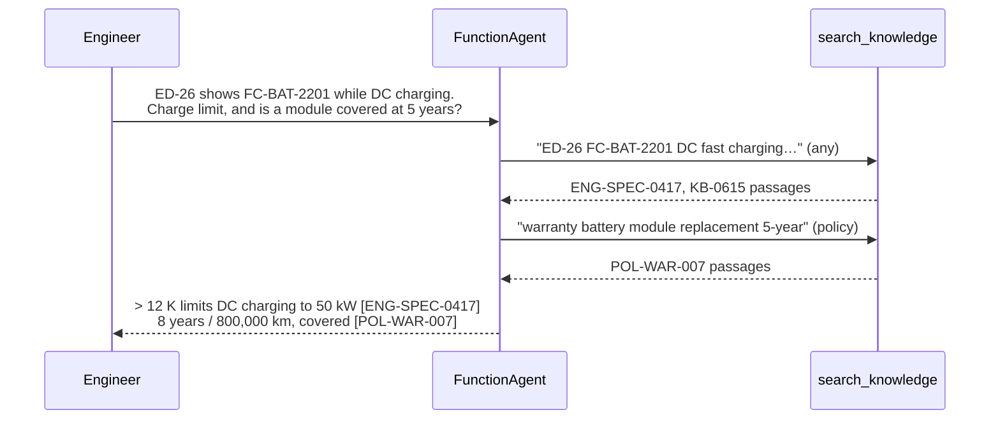
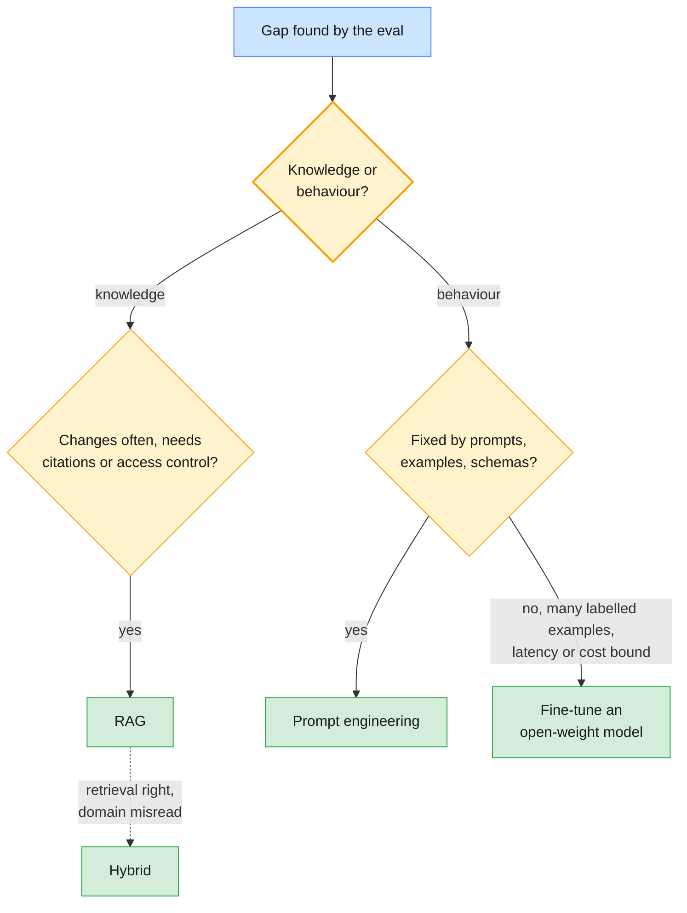

# Lab 04 — Agentic RAG and fine-tuning decisions

| | |
| --- | --- |
| **Level** | Advanced |
| **Duration** | ~55 minutes |
| **Covers** | H7 Agentic RAG exercise: wrap the retriever as a tool for an agent to call selectively (25 min) · Fine-tuning decision workshop: the decision framework applied to 4 scenarios (30 min, from the delivery schedule) |
| **Guide sections** | §10.1 Retrieval as a tool · §10.2 The retriever as a tool for an agent · §10.3 Agentic retrieval patterns · §3.1–§3.5 Fine-tuning overview, provider reality, decision framework and canvas |
| **Notebook** | [`notebooks/lab-04-agentic-rag-fine-tuning-decisions.ipynb`](notebooks/lab-04-agentic-rag-fine-tuning-decisions.ipynb) · solution in [`solutions/`](solutions/lab-04-agentic-rag-fine-tuning-decisions.ipynb) |
| **You will need** | Labs 01–03 (the setup cell rebuilds the knowledge base, so no state is carried over). Teams of 3–4 for Part 3. About 20 model calls per provider. |
| **Artefacts** | [`templates/scenario-cards.md`](templates/scenario-cards.md) (4 scenario cards), [`templates/fine-tuning-decision-canvas.md`](templates/fine-tuning-decision-canvas.md) |

## Learning objectives

By the end of this lab you will be able to:

1. **Design** a retrieval tool contract: a narrow input, JSON with stable IDs, and actionable misses.
2. **Build** a LlamaIndex `FunctionAgent` that decides whether, where and how often to search, and **trace** it.
3. **Measure** agentic RAG against 2-step RAG on the same tasks and both providers, and **choose** one.
4. **Decide** between prompt engineering, RAG, fine-tuning and hybrid for four scenarios, and **name** the evaluation that would overturn each decision.

---

## Part 1 — The retriever as a tool (10 min)

The user is an EU after-sales engineer (`rk.EU_AFTERSALES`), who sees 131 of the 145 chunks. The
search inside the tool is everything Labs 02–03 built: hybrid retrieval, the access filters, the
re-ranker and the floor.

### Your TODO: `search_knowledge(query, doc_type="any") -> str`

| Contract rule | Why |
| ------------- | --- |
| The docstring lists every `doc_type` and says when **not** to search | It is the tool description the model reads |
| An unknown `doc_type` returns `NO_RESULTS: unknown doc_type …` naming the valid ones | The model can correct itself on the next call |
| No hit above the floor returns `NO_RESULTS: … rephrase …` | An empty list gives the model nothing to act on |
| Results are JSON: `doc_id`, `title`, `text` | Stable IDs let your code check citations |

**Expected:** `✅ Part 1 — search_knowledge tool`

## Part 2 — An agent that decides when and where to search (15 min)



```python
# (notebook)
agent = FunctionAgent(tools=[rk.agent_tool(tool_fn, "search_knowledge")], llm=rk.llama_llm(provider), system_prompt=SYSTEM)
handler = agent.run(user_msg=task)
async for event in handler.stream_events():
    if isinstance(event, ToolCallResult):
        searches.append(event.tool_kwargs)
```

**Representative output:**

| provider | task | searches | cited | cited ⊆ returned | expected cited | s |
| -------- | ---- | -------- | ----- | ---------------- | -------------- | - |
| openai | thanks | 0 | — | ✅ | ✅ | 2.2 |
| openai | two-part | 2 (`any`, then `policy`) | ENG-SPEC-0417, KB-0615, POL-WAR-007 | ✅ | ✅ | 10.5 |
| openai | German | 1 | TSB-2026-052 | ✅ | ✅ | 5.3 |
| anthropic | thanks | 0 | — | ✅ | ✅ | 1.5 |
| anthropic | two-part | 2 | ENG-SPEC-0417, KB-0615, KB-0622, POL-WAR-007, TSB-2026-047 | ✅ | ✅ | 5.1 |
| anthropic | German | 3 (German, then English, then `TCU-5 OTA`) | TSB-2026-052 | ✅ | ✅ | 6.3 |

**Representative output** of the 2-step pipeline on the same tasks:

| task | searches | answered | cited | expected cited |
| ---- | -------- | -------- | ----- | -------------- |
| thanks | 1 | ❌ (floor) | — | ✅ |
| two-part | 1 | ✅ | ENG-SPEC-0417, KB-0615 | ❌ missed POL-WAR-007 |
| German | 1 | ❌ (floor) | — | ❌ |

What to notice:

- **One search cannot serve a two-part question.** The 2-step pipeline retrieved for the whole
  question, the battery documents won, and the warranty half was never answered. The agent split
  the question and chose `doc_type="policy"` for the second search.
- **The agent rewrote the German query.** Claude searched in German, then in English, and found the
  bulletin. The 2-step pipeline hit Lab 02's English-only re-ranker and stopped at the floor.
- **The agent costs more** in model calls and seconds, and its search count varies by provider.
  Assert on what matters (the tool was used, cited IDs came from it, the facts were found), not on
  the number of searches.

> **Common trap:** `Kernel died` the first time an agent calls a tool that runs a local PyTorch
> model. LlamaIndex runs a sync tool in a worker thread; on some platforms PyTorch crashes there.
> `rk.agent_tool()` gives the tool an async path that runs on the event loop, and the re-ranker runs
> on the CPU.

**Expected:** `✅ Part 2 — agentic RAG`

📝 Decide: agent or 2-step pipeline for the workshop assistant?

## Part 3 — Fine-tuning decision workshop: four scenarios (20 min, from the delivery schedule)

In teams, read the [scenario cards](templates/scenario-cards.md) and fill in one
[canvas](templates/fine-tuning-decision-canvas.md) per scenario, then enter your decisions in the notebook.

| Card | Scenario | Facts that matter |
| ---- | -------- | ----------------- |
| A | Workshop repair assistant | 3,000 bulletins, weekly changes, technicians need the source |
| B | Warranty claim coding | 380 fixed codes, 200,000 labelled claims, 300 ms budget |
| C | Goodwill decision letters | 9 languages, tone and a forbidden word, 40 letters a day |
| D | Engineering specification assistant | part codes and jargon, weekly changes, 400 Q&A pairs |



> **Outline vs current API (§3.3):** the OpenAI fine-tuning API is being wound down and Claude
> cannot be fine-tuned, so "fine-tuning" here means an open-weight model you host and evaluate.

**Expected:** `✅ Part 3 — decision canvases` once all four canvases are complete.

## Part 4 — Challenge your decisions with a second opinion (10 min)

A small-tier critic on each provider returns a structured `Critique`: `agrees`, the strongest
counter-argument, and the cheapest evaluation that would settle it.

**Representative output** (abridged):

| critic | scenario | decision | agrees | strongest counter-argument |
| ------ | -------- | -------- | ------ | -------------------------- |
| openai | B · Warranty claim coding | fine-tuning | ✅ | A prompt-based small model may already meet the accuracy and latency targets … |
| anthropic | B · Warranty claim coding | fine-tuning | ✅ | The 380 codes may drift … so a fine-tuned classifier would need recurring retraining |
| anthropic | D · Engineering specification | hybrid | ✅ | Hybrid retrieval plus a conditional fine-tune adds two moving parts to maintain … |

A critic that agrees is not proof. Its value is the counter-argument: here both pointed at
scenario B's real risk, that a few-shot baseline or label drift could make the fine-tune unnecessary
or expensive. That is exactly the evaluation on your canvas.

📝 Present one decision and the evaluation that would overturn it.

---

## Checkpoint questions

<details>
<summary>1. The agent made 0 searches for "Thanks, that fixed it!" and the 2-step pipeline made 1. Why does that matter at scale?</summary>

A support chat is full of small talk and follow-ups. 2-step RAG pays for retrieval, and often a
model call, on every turn. Selective retrieval skips it. The cost is less predictability: the
agent may also skip a search it needed, so you evaluate both on the same labelled tasks before choosing.
</details>

<details>
<summary>2. Why does `search_knowledge` return "NO_RESULTS: … rephrase" instead of an empty list?</summary>

The tool result is the model's only feedback. An empty list says nothing; a message naming the
next action (rephrase, or widen `doc_type`) lets the model recover on its own. It is the same
contract design as Module 2's `search_kb`: narrow input, compact output, actionable errors.
</details>

<details>
<summary>3. A stakeholder says "fine-tune the model on our 3,000 bulletins". What do you answer?</summary>

That is a knowledge request: the gap is facts that change weekly and must be cited and withdrawn.
Fine-tuning puts facts into weights that cannot cite, cannot forget a withdrawn bulletin and need
retraining for each change. RAG updates in minutes. Fine-tune only for behaviour that prompts and
examples cannot fix, and only after an evaluation shows it.
</details>

<details>
<summary>4. When would you ship the agent instead of the 2-step pipeline for the workshop assistant?</summary>

When the labelled task set shows the agent answering multi-part and cross-lingual questions the
pipeline misses, as in Part 2, at an acceptable cost and latency, with a search budget and logging
of every query. If the pipeline matches it on your set, ship the pipeline: it is cheaper and more
predictable. Module 4 turns these loops into explicit LangGraph patterns.
</details>

---

## Clean up

```bash
# (terminal) - from labs/module-03
rm -rf chroma_db faiss_index outputs   # everything is rebuilt on the next run
```

**Next module:** *Module 4 — Multi-Agent Orchestration with LangGraph, Agentic Patterns & MCP*,
where `search_knowledge` becomes one specialist agent under a supervisor, and the connectors move
behind MCP servers.
